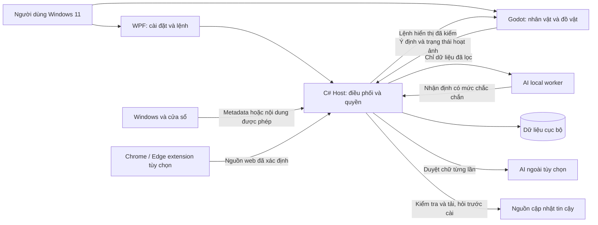

# Kiến trúc tổng thể — đề xuất để kiểm chứng

Hướng **Godot Engine** + C#/WPF + AI local đã thống nhất *(chuyển từ Unity 2026-11-15)*. Phân chia bảy module đã duyệt; topology và các kỹ thuật dưới đây là **PROPOSED / NOT VERIFIED**, chưa production ADR accepted. Không suy ra E02a làm được IPC/capture thật.

## 1. System context và container



- Host là nơi sở hữu policy, lifecycle, input arbitration, queue và persistence. UI/renderer không sở hữu quyền thực thi.
- Godot Engine là renderer/animation/interaction surface; không đọc màn hình hoặc phát input thật trực tiếp. Va chạm đồ vật/di chuyển trên cửa sổ dùng dữ liệu hình học tối thiểu từ host.
- Worker AI có thể tách tiến trình để quản lý tải/lỗi; đây là đề xuất, chưa chốt model/backend/transport. Không cấp worker quyền tự capture hoặc network.
- Extension chỉ thêm khi bật web; không bắt để sinh hoạt. Browser-native messaging cần host registration được cài theo luồng rõ ràng, không lấy quyền website rộng mặc định.
- DB logical đề xuất ở DATA; chưa chốt SQLite hoặc storage engine. Dữ liệu application tách dữ liệu người dùng ở các app khác.

## 2. Module và ownership

| Module | Owns | Consumes | Invariant |
|---|---|---|---|
| policy | Grants, generations, stops, source eligibility | Trusted input-state/source descriptors | Deny không bị planner/mood override |
| life-state | Needs, mood, relation, memory importance, activity intent | Safe semantic events, interactions | Không tự gọi input adapter |
| desktop-body | Avatar transform, animation, props, hit zones | Geometry, approved render intent | Animation acknowledgement không phải permission |
| perception | Visible-source filtering, OCR/context pipeline | Policy/source adapters | Forbidden raw data không vào OCR/model |
| task-execution | Lesson/run/step/queue, target verification | Policy/perception/body | Final recheck trước từng tác động |
| companion | Scheduling/attention/UI intent orchestration | Các module trên | Chỉ một quyết định điều khiển có hiệu lực tại một thời điểm |
| distribution | Storage lifecycle, profiles, backup, install/update | Policy/life-state contracts | Không nhập grants/keys, không auto backup |

Dependency DAG giữ như CAPABILITY_MAP. Sơ đồ container là data flow, có phản hồi hai chiều không có nghĩa module dependency cần cycle. Public contracts thuộc provider; event/call contracts không tạo generic event-bus toàn năng.

Đề xuất dependency inversion cho persistence: life-state định nghĩa port dữ liệu mang ý nghĩa memory/state, distribution thực thi adapter. Life-state không tham chiếu implementation storage để tránh tạo vòng với distribution. Physical source folders không tự quyết định ownership contract.

## 3. Critical path và failure boundaries

Quan sát: source evidence → grant check → visible-region extraction/filter → safe snapshot generation → OCR/AI → context event. Thu hồi giữa pipeline vô hiệu kết quả pending theo generation; không giữ raw screenshot để worker tự lọc.

Điều khiển: intent → policy + input gate → identify target → body approach → target/window/source revalidation → final policy recheck → one input action → observe postcondition. Nếu UI đổi, renderer đứng tại tọa độ cũ không làm click được phép.

Đề xuất fail-safe: renderer/worker/extension mất kết nối khiến pending control bị chặn, không tự replay sau reconnect. Cần D-02 xác nhận UX reconnect và task trạng thái; chưa tự quyết rằng pending queue luôn hủy hay luôn tiếp tục. Host vẫn phải giữ nút dừng/cài đặt truy cập được khi renderer lỗi.

Host crash: input không được tiếp tục từ bên khác; pending queue không được phục hồi như success. Crash recovery trạng thái/job cần chốt D-10; không tạo backup tự động. Controlled exit/profile switch giữ đúng BH07.

## 4. OS integration constraints

Phải tách tọa độ màn hình vật lý, WPF logical unit, Godot viewport và target rectangle. Transform có monitorId/DPI/layout generation; không dùng một hệ số phóng cho mọi màn hình. Chuyển monitor/DPI vô hiệu điểm click pending.

Chế độ windowed/borderless/exclusive fullscreen và protected desktop khác nhau. Không hứa overlay trên mọi game. Không tự chạy admin để giải quyết hạn chế. SendInput bị ràng buộc integrity/UIPI; nếu target không hỗ trợ thì chặn/báo, không bypass.

Input arbitration theo dấu input do app sở hữu và input thật; không log nội dung phím người dùng. Lock/sleep/desktop-switch cần mô hình event thử riêng. Unlock input ngoại lệ chỉ cho timer đã chốt, không đọc credentials.

## 5. Version/tool decisions

Host .NET10/WPF có mẫu đã chạy; production SDK có thể giữ cùng nhánh nhưng cần pin tại thời điểm tạo project. Godot Engine version (`4.7.2 – .NET` đề xuất)/render backend, AI runtime và extension manifest versions phải chọn/kiểm chứng sau `B00-02`/E-INT/E04, không ghi con số suy đoán.

Production source tree **đề xuất**, không phải folder đã có:

```text
src/Host/{Policy,LifeState,Perception,Tasks,Companion,Storage}/
src/Desktop.Wpf/
src/BrowserBridge/
src/LocalAI.Worker/
godot/CompanionRenderer/
contracts/
tests/{Unit,Integration,NativeUI,Fixtures}/
```

Trước mỗi task chốt file whitelist cụ thể, tránh “sửa cả src”. Không reuse E02a code nguyên trạng mà không rà trách nhiệm/trust boundary.

## 6. Sources và bằng chứng

[WPF](https://learn.microsoft.com/en-us/dotnet/desktop/wpf/overview/), [Godot 4 DisplayServer](https://docs.godotengine.org/en/stable/classes/class_displayserver.html), [SendInput restrictions](https://learn.microsoft.com/en-us/windows/win32/api/winuser/nf-winuser/nf-winuser-sendinput), [Edge native messaging](https://learn.microsoft.com/en-us/microsoft-edge/extensions/developer-guide/native-messaging). Các nguồn xác nhận khả năng API/framework; không xác nhận kiến trúc này đã chạy. Chưa chọn plugin bên thứ ba.
