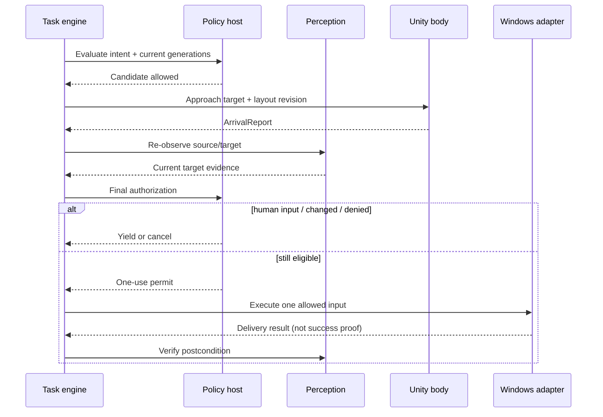

# Hợp đồng giữa các phần — draft v1 (PROPOSED FOR D-02/D-03 PROBE — NOT IMPLEMENTED/VERIFIED)

Tài liệu này phản ánh đề xuất kỹ thuật `UW-DOC-2026-11-15-r4` tại [SPEC Unity–Windows](../../unity-windows/SPEC.md) và [TEST_PLAN](../../unity-windows/TEST_PLAN.md). Tất cả giao thức dưới đây là **PROPOSED FOR D-02/D-03 PROBE — NOT IMPLEMENTED/VERIFIED**; `UW01–UW30` hiện ở trạng thái `NOT RUN`. [NamedPipeServerStream](https://learn.microsoft.com/en-us/dotnet/api/system.io.pipes.namedpipeserverstream?view=net-10.0) dùng làm ứng viên transport cục bộ giữa WPF Host (`.NET 10 LTS`, giữ authority) và Unity Renderer (`.NET Standard 2.1`, process tách biệt), dùng `PipeOptions.CurrentUserOnly` (Windows 10/11 same-user ACL); native messaging vẫn là hướng khảo sát cho browser bridge. Tên message dưới đây là contract đề xuất để viết test, chưa phải API đã implement.

## 1. Envelope chung

| Field | Kiểu ý nghĩa | Validation |
|---|---|---|
| protocolVersion | version string | Chỉ accepted compatibility set; unknown fail closed |
| messageId | opaque unique id | Required; duplicate không phát lại side effect |
| sessionId, connectionEpoch | opaque id + monotonic revision | Reconnect đổi epoch; frame cũ vô hiệu |
| profileId | opaque id | Phải khớp active profile; không dùng làm grant |
| kind | allowlisted enum | Không tên phương thức tùy ý hoặc executable command |
| correlationId | optional parent id | Liên kết request/result, không thay messageId |
| stateGeneration | permission/source/layout/input generations khi liên quan | So sánh tại thời điểm dùng |
| body | typed union per kind | Unknown field policy và max size phải chốt D-03 trước coding |

Không mang API key, raw clipboard, URL có query/token hoặc mật khẩu trong envelope/log. Identifier không phải authority token; peer biết ID vẫn phải qua host policy.

## 2. Provider-owned operations

| Provider | Operation | Input | Output/failure | Điều kiện |
|---|---|---|---|---|
| policy | EvaluateRead | SourceIdentity, VisibleRegions, PermissionGeneration | SafeRegionPlan hoặc Deny(reason) | Không nhận payload để quyết định quyền |
| policy | EvaluateAction | ActionIntent, target evidence, current input/mode | ActionPermit hoặc Deny/Yield | Permit ràng source/target/revisions, không grant tổng quát |
| perception | ProduceSafeSnapshot | Allowed plan + current source revision | SafeSnapshot hoặc Stale/Unsafe | Lọc trước mọi OCR/model; final revision check |
| life-state | ObserveEvent | Sanitized semantic event + profile + logical time | Updated private state, optional render intent | Không nhận raw nguồn mặc định |
| desktop-body | ApproachTarget | Target rect/coordinate-space/layout revision, animation intent | ArrivalReport hoặc Interrupted/Unreachable | Report không phát click |
| desktop-body | PresentState | Render state, size, allowed monitor surfaces | RenderAck | Không authority đọc/control |
| task-execution | RequestLesson | LessonId, search parameters, explicit user intent | JobId/Delay/Denied | Chỉ user yêu cầu bài học |
| task-execution | ResumeQueue | Current user command | Queue state | Không sống lại cancelled jobs |
| distribution | ExportProfile | ProfileId + destination chosen + credentials in secure channel | Encrypted archive + recovery secret separately | Không grants/API keys |
| distribution | ImportProfile | User-selected archive + password/recovery credential | New frozen/selected profile workflow hoặc failure | Không merge hoặc apply permissions |

## 3. DTOs quan trọng

**SourceIdentity:** app identity, browser instance/tab/frame identity nếu web, normalized origin, window handle token nội bộ, sourceGeneration, visibility/private classification. Không dùng window title làm ID tin cậy. Frame parent+origin binding để ngoại lệ embedded không lan rộng.

**SafeSnapshot:** snapshotId, source identity reference, policyGeneration, captureGeneration, safe cropped regions/text, provenance/retention tags. Không chứa vùng forbidden hoặc full desktop raw image. Ephemeral, không tự persist; đã thu hồi thì in-flight result stale không đi vào memory/decision.

**SemanticObservation:** eventId, profileId, snapshotId, labels, confidence/uncertain, evidence type, scene timing, provenance class. Model không trả tool call. Unknown emotion → uncertain, không coerced sang vui/buồn.

**ActionIntent:** intentId, reason (user-job/autonomous-media), operation allowlist (navigate/search/click permitted target), source/target descriptor, expectedPostcondition, parameters, generation set. Không freeform shell/URL launch hoặc arbitrary script.

**ActionPermit:** short-lived logical authorization bound to intentId, source, target fingerprint, policy/input/layout/source generations, one-use status. Expiration số giây chưa chốt; generation mismatch luôn hủy, không chờ timeout.

**ArrivalReport:** movementId, intentId, body pose, target/layout revision. Host xác minh nguồn/đích lại; callback Unity không được coi là chứng minh target không đổi.

**LessonDefinition:** lessonId, profileId, app/site scope, ordered steps, semantic target descriptors, parameter slots limited search/navigation, selectionMeaning enum, enabled, version. Sửa/reteach tăng version; running job dùng bản nào và invalidate ra sao cần chốt trong step design trước code.

**Job:** jobId, requestId, lessonVersion, parameters, queueOrder, status, stepIndex, delayUsed, expectedState evidence, errorReason. Đừng lưu raw typed sensitive text; tham số chỉ loại đã cho phép.

## 4. Sequence bấm sau khi đi tới nút

Input injection delivery success không bằng task success. Khi kết quả không biết, không tự lặp hành động; quan sát lại hoặc hỏi theo nghiệp vụ BH05. Không claim exactly-once across crash; permit consumption/job state/postcondition phải được thiết kế và test.

## 5. Errors và reconnect

Failure union: Denied, UnsafeSource, StaleGeneration, YieldedToUser, TargetChanged, UnsupportedSurface, Disconnected, IncompatibleVersion, InvalidMessage, TimedOutUnknown, InternalFailure. Mỗi loại có mã ổn định và thông báo user tương ứng, không lộ source text/stack trace.

Không replay side-effect command sau reconnect chỉ vì chưa thấy ack; mỗi peer duy trì `messageId` dedup và monotonic `epoch`. Đề xuất kỹ thuật `UW-DOC-2026-11-15-r4` (`PROPOSED FOR D-02/D-03 PROBE — NOT IMPLEMENTED/VERIFIED`, xem chi tiết tại [SPEC r4](../../unity-windows/SPEC.md) và [TEST_PLAN r4](../../unity-windows/TEST_PLAN.md)):
- **Transport & ACL:** Separate-process Windows Named Pipe (`\\.\pipe\nyua-probe-<runId>`), `PipeOptions.CurrentUserOnly`, 1 kết nối active cho mỗi phiên đã bind (`handshake` kiểm tra `protocolVersion`, `peerRole`, `sessionId`, `sessionNonce`, `connectionEpoch`; default peer không được tự xin role `host`).
- **Framing & Limits:** `4-byte` little-endian unsigned length prefix + UTF-8 JSON; trần cứng `frame <= 64 KiB`, `MaxDepth = 16`, outbound `queue <= 32`, `handshake timeout <= 10 s`, `incomplete frame read timeout <= 2 s`, `heartbeat` mỗi `1 s` và đánh dấu mất kết nối sau `3` lần nhỡ (`3 s`). Phía `.NET 10` Host dùng `System.Text.Json` allowlist; phía Unity `.NET Standard 2.1` (`Assets/Runtime/HostChannel.cs`) không dùng DLL ngoài hay `JsonUtility` lỏng lẻo mà dùng strict recursive-descent UTF-8 parser tự viết khớp đúng ngưỡng `MaxDepth = 16`, reject unknown/NaN/Infinity.
- **Fault & Restart Lifecycle:** Giao thức giữ nguyên UX `PausedAfterFault` (`[Kết nối lại]` để mở phiên mới với `connectionEpoch + 1` → hỏi `[Cho tiếp tục sau lỗi]` / `[Giữ tạm dừng]`; không crash-loop, không tự replay side-effect hoặc mất dữ liệu người dùng; mọi nút tùy chọn hủy hàng đợi mới được hoãn).
- **Diagnostics:** Ghi tối thiểu theo `BH13` (`errorCode`, `epoch`, `messageId`, latency/disconnect reason), tuyệt đối không log toàn bộ payload hay stack trace ra UI.

## 6. Khi nào được viết code?

Rà DTO và state chart liên quan, hoàn tất cổng `D-01`/`D-02`/`D-03` bằng chứng thực nghiệm trên Unity `6000.3.28f1` + `.NET 10` Host (`UW01–UW30`, `ProbeBuild.cs` Player inclusion, schema/abuse tests) theo [TEST_PLAN r4](../../unity-windows/TEST_PLAN.md), rồi mới được cho phép thực thi module thực (hiện tại `execution NOT_AUTHORIZED`). Không lấy tài liệu đề xuất làm permission cài đặt công cụ, tạo Unity project, hoặc kết nối cloud.
