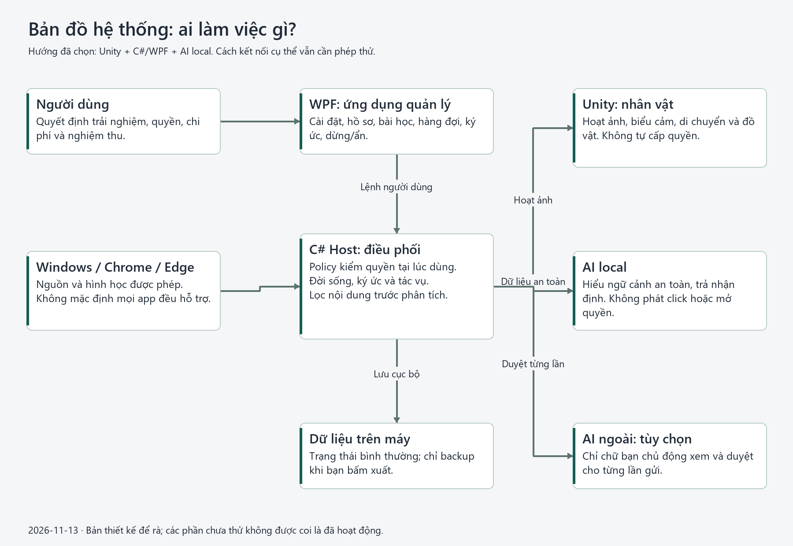

# Bản đồ và cách các phần phối hợp



Các khối là trách nhiệm. Chúng chưa khẳng định đã tồn tại tiến trình hoặc kết nối đang chạy.

## 1. Bốn công cụ, bảy trách nhiệm

Unity làm nhân vật và đồ vật; WPF làm cửa sổ quản lý; C# điều phối trạng thái và tương tác Windows; AI local hiểu nội dung được phép. Các công cụ không thay thế bảy trách nhiệm đã duyệt:

| Trách nhiệm | Câu hỏi nó trả lời |
|---|---|
| Quyền hạn | Có được đọc/bấm việc này lúc này không? |
| Đời sống | Cô ấy đang mệt, vui, nhớ gì và muốn làm gì? |
| Cơ thể/hoạt ảnh | Cô ấy đang ở đâu và biểu hiện ra sao? |
| Quan sát | Có thể lấy phần nội dung an toàn nào và hiểu được gì? |
| Thực hiện việc | Bài học đang ở bước nào, đã đạt chưa, có cần dừng? |
| Điều phối | Kết hợp các phần để có một hành vi nhất quán |
| Dữ liệu/phát hành | Lưu hồ sơ, xuất/nhập, cài/cập nhật/gỡ thế nào? |

“AI thấy buồn” chỉ là một nhận định. C# còn phải xét cô ấy có chú ý không, cảm xúc đang chuyển thế nào và có quyền với nguồn đó không; Unity thể hiện phản ứng đã chọn.

## 2. Ví dụ bấm tập tiếp theo

```text
Nhìn được trang đã cấp quyền
         ↓
Xác định tập đã hết và đúng nút
         ↓
Kiểm tra bạn không đang dùng chuột/phím
         ↓
Unity cho cô ấy đi/leo tới nút
         ↓
C# kiểm tra lại: quyền, cửa sổ, nút có còn đúng?
         ↓
Bấm thật một lần → kiểm tra đã chuyển tập
```

Nếu bạn di chuyển chuột khi cô ấy đang leo, cô ấy không được bấm theo kế hoạch cũ. Nếu nút biến mất, dừng và nhờ bạn chỉ; không thử bấm vùng gần đó.

## 3. Vì sao phải có phần kết nối riêng?

Unity và app quản lý phải thống nhất vị trí, kích thước, hoạt động và trạng thái dừng. Cách nối chúng còn là đề xuất cần thử. Trường hợp renderer mất kết nối mà lệnh click vẫn chạy là rủi ro cần thiết kế chặn; không được coi hình ảnh đang leo là bằng chứng chắc có thể bấm.

Đề xuất kỹ thuật là thử các phần chạy riêng và trao đổi trên máy, tránh nhúng quá sớm. Chưa chốt cách truyền, phiên bản Unity, kiểu đóng gói hay cách vượt nhau của cửa sổ. Cần mẫu đo trước khi chọn cho toàn app.

## 4. Dữ liệu đi đâu?

```text
Nguồn đang nhìn thấy
   → kiểm tra quyền + loại nội dung cấm
   → AI local / nhận biết đơn giản
   → quyết định phản ứng
   → hoạt ảnh

Tương tác chăm sóc → ký ức/quan hệ trên máy
Lịch sử thao tác → mục riêng, tối đa 30 ngày
Sao lưu → chỉ khi bạn bấm xuất, có mật khẩu/mã khôi phục
AI ngoài → chỉ chữ đã xem trước và duyệt cho lần gửi đó
```

Che nội dung sau khi AI đã xem ảnh thô là sai quy trình. Cửa sổ xem trước đẹp không đủ: team phải kiểm dữ liệu thực sự vào mô hình và log.

## 5. Cách đọc các sơ đồ còn lại

[Danh mục sơ đồ](../diagrams/README.md) có sơ đồ quyền, hàng đợi, trạng thái đời sống, dữ liệu, xem phim, backup và quy trình xây. Bản vẽ dữ liệu mô tả quan hệ ý nghĩa, chưa chốt phần mềm lưu trữ. Mũi tên “phụ thuộc” ở bản đồ module khác mũi tên “gửi thông tin” ở sơ đồ chạy; không trộn hai loại.
