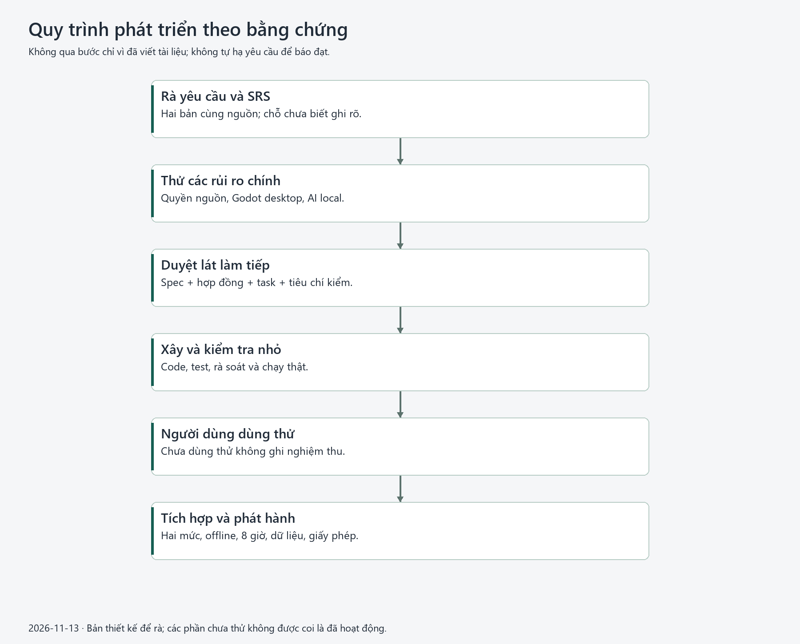

# Team cần làm gì và khi nào được làm tiếp?

## 1. Lộ trình theo bằng chứng

| Chặng | Đầu ra cụ thể | Bạn kiểm gì? | Điều kiện chưa cho qua |
|---|---|---|---|
| Rà hồ sơ | SRS, nghiệp vụ, UX, rủi ro, truy vết | Có đúng hình dung và không mất yêu cầu? | Còn mâu thuẫn ảnh hưởng chặng kế |
| Khép mẫu quyền | Mẫu E02a và các kiểm tra UI còn mở | Bật/tắt/thử lại có dễ hiểu? | Còn lỗi quyền hoặc chưa đủ bằng chứng bắt buộc |
| Thử Godot + Windows | Nhân vật đại diện trong suốt, đúng vùng chuột, mất kết nối được xử lý | Đúng cảm giác sống trên desktop? | Chưa chứng minh được hiển thị/nhường chuột/độ ổn định |
| Thử hiểu cảnh local | Bộ cảnh tiếng Việt, độ đúng, độ trễ, tài nguyên, giấy phép | Phản ứng có hợp và đủ nhanh? | Chưa đo hoặc chất lượng không đạt mức chấp nhận |
| Xây một luồng kết hợp | Mở app → hiện cô ấy → cấp quyền một nguồn → phản ứng → dừng | Dùng được xuyên suốt? | Chỉ các phần riêng lẻ chạy được |
| Mở rộng sinh hoạt/quan hệ | Chăm sóc, đồ vật, ký ức, hai mức | Cá tính có nguyên nhân, không quá phiền? | Sai bộ đếm, mất ký ức, trạng thái không nhất quán |
| Điều khiển và bài học | Dạy–duyệt–chạy–nhường–hủy, kiểm kết quả | Có kiểm soát được cô ấy làm gì? | Click sai, không dừng, làm vượt phạm vi |
| Dữ liệu và bộ cài | Hồ sơ, mật khẩu/mã khôi phục, cập nhật/gỡ | Chuyển máy/reset giữ-xóa đúng? | Không khôi phục được hoặc làm mất dữ liệu |
| Tích hợp và phát hành | Hai mức, offline, nhiều cấu hình, phiên 8 giờ | Đủ ổn định để cho người khác dùng? | Còn lỗi chặn, giấy phép/tên/chi phí chưa giải quyết |

Các chặng có thể khảo sát song song về tài liệu, nhưng không kết luận khả thi bằng cách bỏ kiểm chứng. Không có ngày phát hành cam kết hoặc số giờ làm việc được tự đặt thay bạn.

## 2. Những tài liệu team dùng

PRD giải thích vì sao sản phẩm đáng làm. SRS nói hành vi và ràng buộc phải đúng. Tài liệu nghiệp vụ xử lý ngoại lệ. UX giải thích người dùng thấy/bấm gì. Kiến trúc và hợp đồng giải thích các phần kết nối. Dữ liệu giải thích lưu/xóa/khôi phục. Test chỉ cách chứng minh. Backlog chỉ việc thực hiện, phụ thuộc và đầu ra. Sổ quyết định giữ lý do và điểm chưa biết.

Một task có tên nhưng không có kết quả mong đợi chưa đủ để bắt đầu. Một file đặc tả dài nhưng giấu chỗ chưa biết cũng chưa đủ để bắt đầu.

## 3. Vai trò khi chỉ có bạn và AI

Bạn là chủ sản phẩm và người dùng thử. AI có thể lần lượt làm phân tích, thiết kế, lập trình, kiểm thử và ghi chép. Điều này chưa tạo ra kiểm tra độc lập. Khi chuẩn bị công khai, cần bố trí rà thực sự cho quyền điều khiển, dữ liệu, cập nhật và giấy phép; chưa có người thì ghi còn thiếu.

Không cần bạn chọn từng lớp code. Bạn cần chốt các đánh đổi có tác động: phạm vi, trải nghiệm, chất lượng nhận diện chấp nhận, chi phí và kết quả dùng thử. Khoản tốn tiền phải hỏi trước.

## 4. Thế nào là xong một việc?

Đúng tiêu chí → test phù hợp đạt → chạy thật phần liên quan → rà lỗi/quyền/dữ liệu → bạn dùng thử khi cần → lưu mốc → cập nhật tài liệu. Phần chưa kiểm chứng phải giữ mở, không ghi “xong” chỉ vì code đã viết.

Lỗi thao tác ngoài quyền, không dừng hoặc lộ nội dung bị cấm chặn luồng liên quan. Không tự hạ tiêu chuẩn để chạy nhanh hơn. Nếu không đạt, đưa bạn bằng chứng và phương án thay đổi để quyết định.

## 5. Cách thay đổi ý tưởng sau này

Bạn mô tả thay đổi → AI chỉ ra yêu cầu/màn hình/dữ liệu/test bị ảnh hưởng → làm rõ điểm cần chọn → cập nhật hai bộ tài liệu → đưa thay đổi vào backlog. Không xóa lịch sử quyết định hoặc viết lại các việc đang dang dở của mẫu E02a.

## 6. Những gì đã có hôm nay

Chỉ mẫu E02a đã có 53 test tự động và các luồng UI đại diện, chưa nghiệm thu toàn bộ. Những task toàn sản phẩm trong bộ hồ sơ là kế hoạch để rà. Danh sách chi tiết ở [backlog cho AI](../AI/BACKLOG.md); trình tự tổng thể phải được điều chỉnh theo kết quả thử, không theo số thứ tự cứng nhắc.
