# Atlas sơ đồ — bản vẽ chi tiết

Mọi topology/state design chưa được duyệt được hiểu là đề xuất. Sơ đồ không phải Graphify code extraction. Bản PNG/SVG tổng quan dễ đọc đi kèm.

## 01-context — Phạm vi sản phẩm

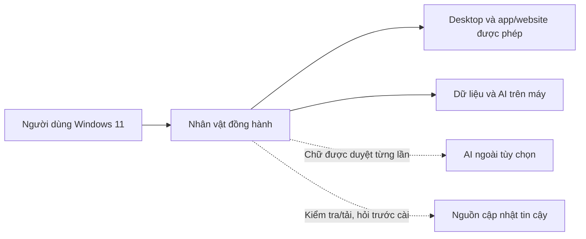

## 02-containers — Các phần chạy đề xuất

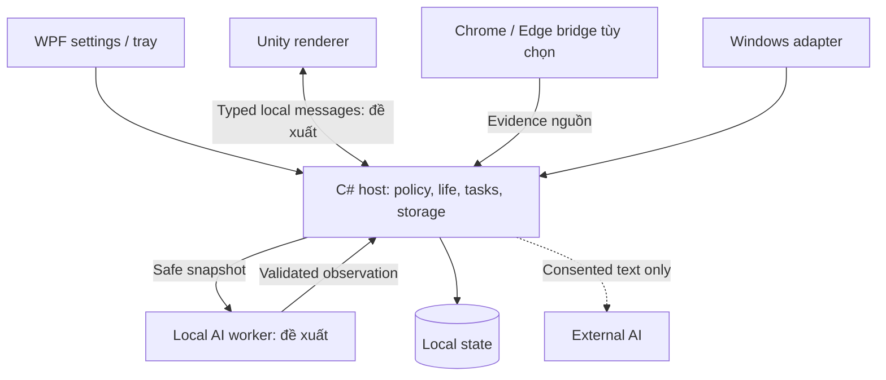

## 03-module-dependencies — Phụ thuộc module, không phải luồng dữ liệu

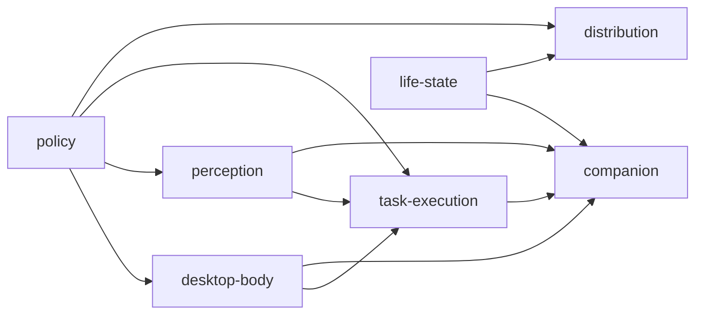

## 04-read-boundary — Cổng quan sát an toàn

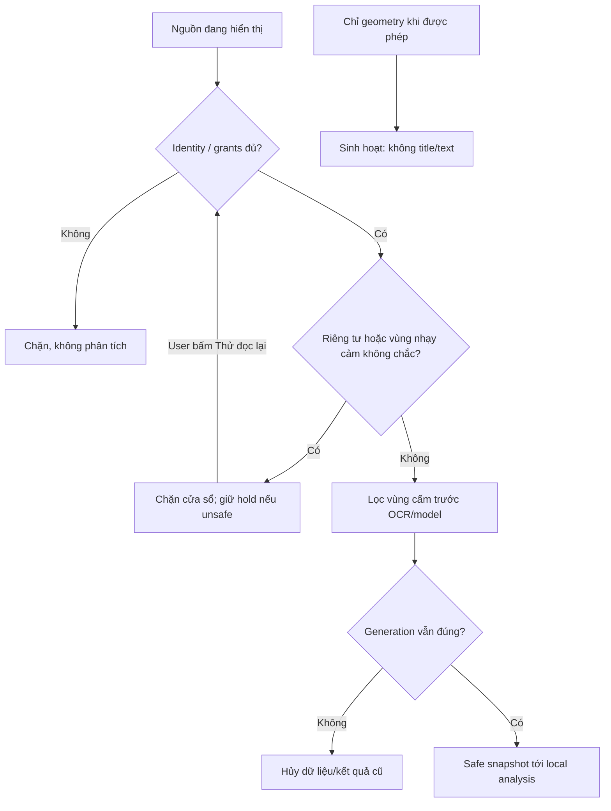

## 05-embodied-action — Trình tự tới nút rồi bấm

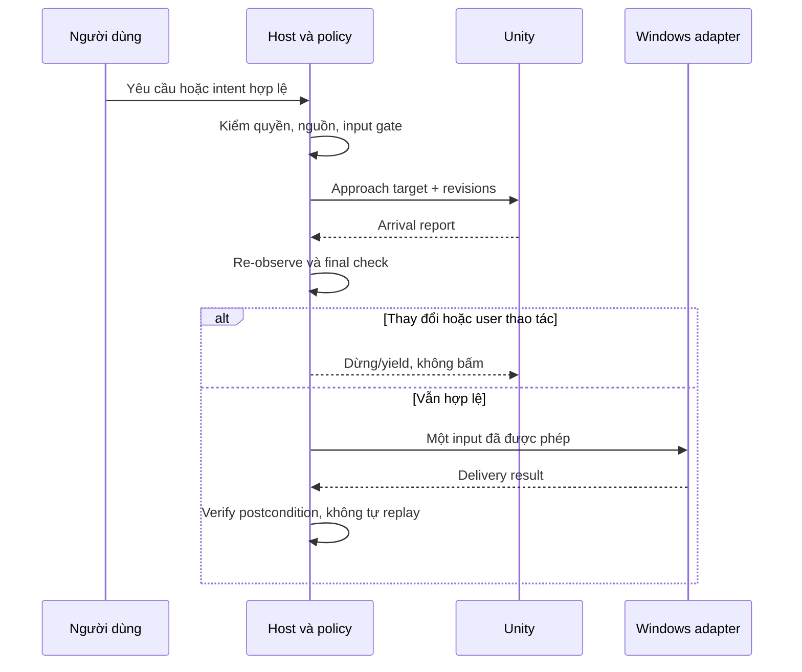

## 06-queue-state — Trạng thái công việc và dừng

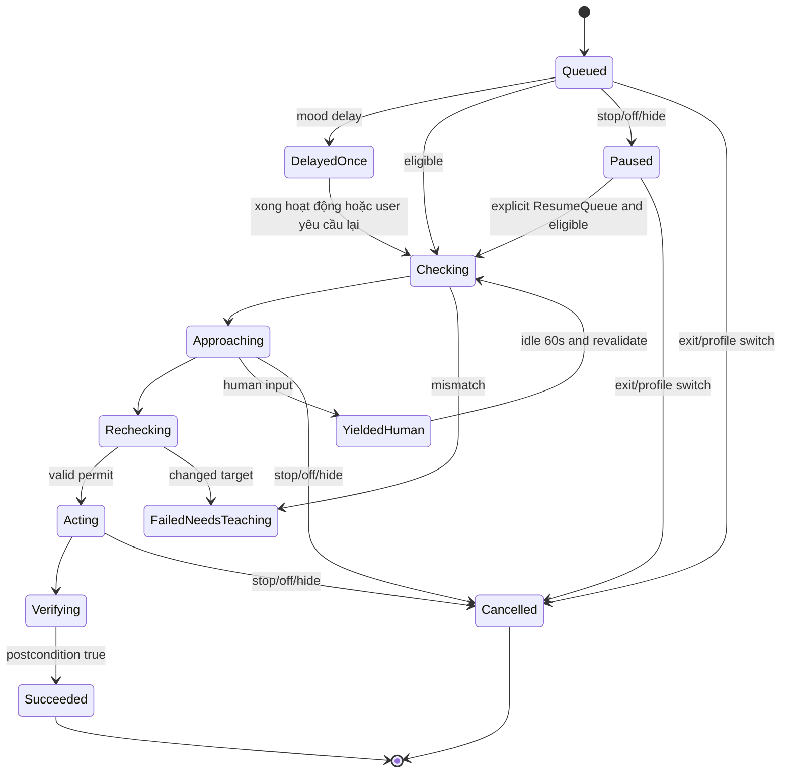

## 07-life-relationship — Quan hệ sâu: trạng thái đề xuất

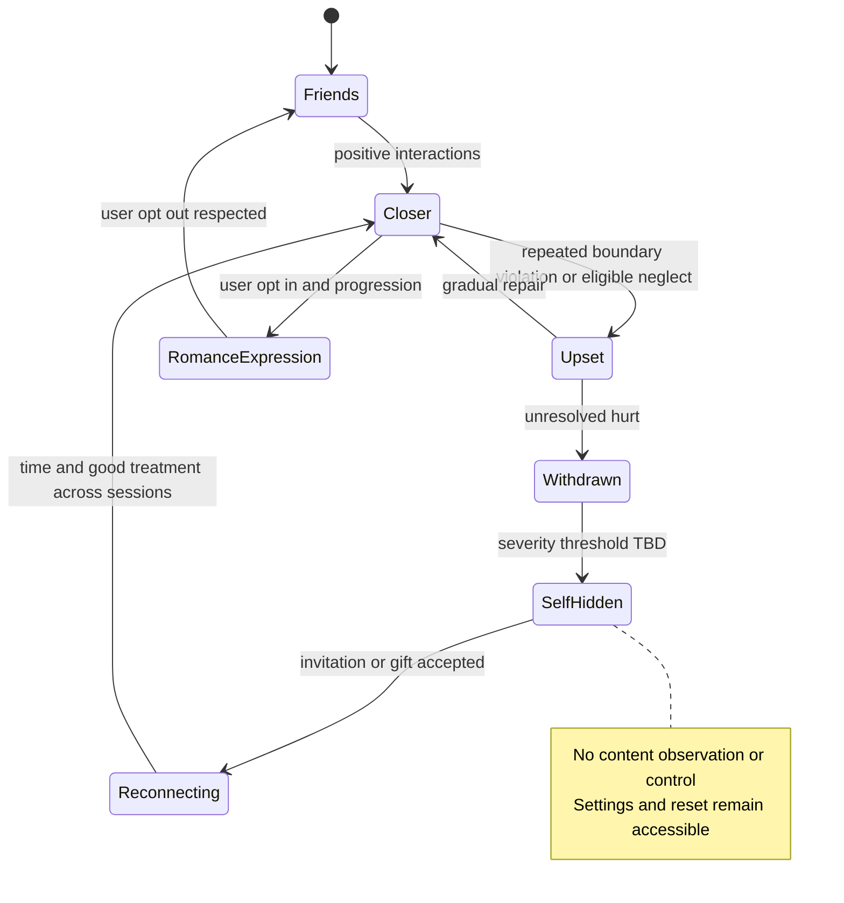

## 08-data-logical — Mô hình dữ liệu logic, chưa physical schema

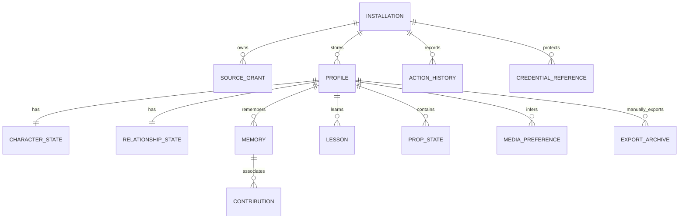

## 09-backup — Xuất/nhập và ranh giới dữ liệu

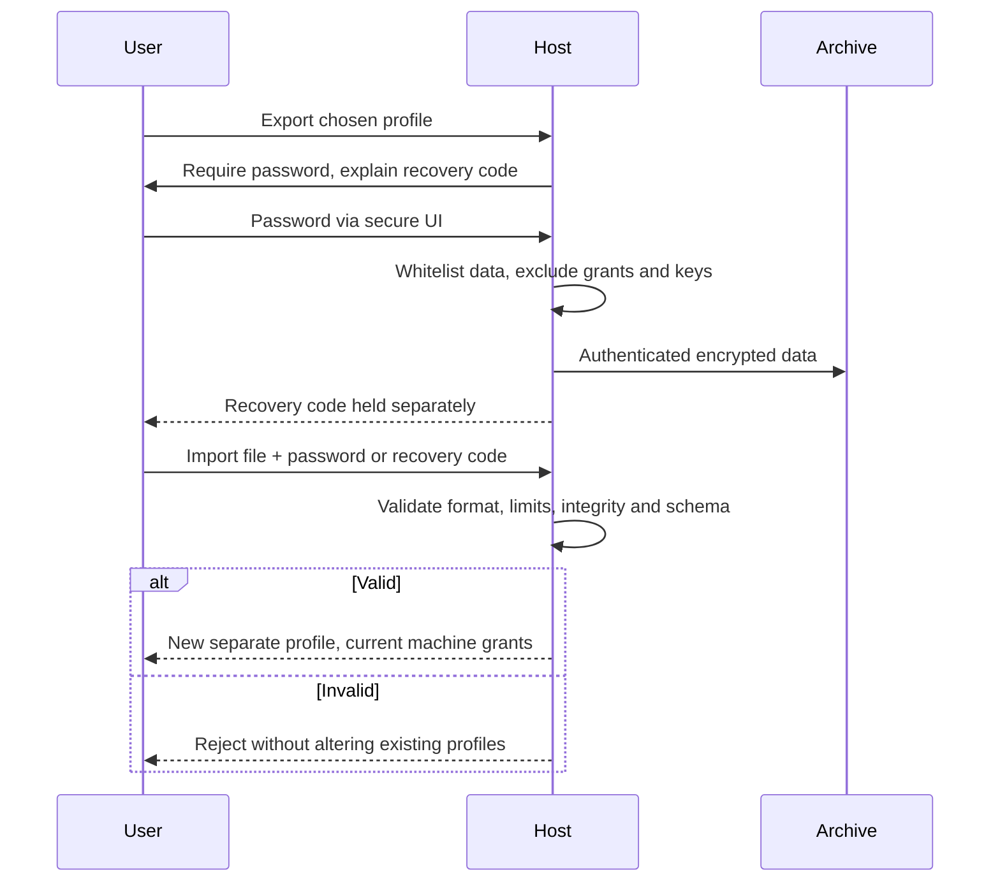

## 10-delivery — Quy trình theo bằng chứng

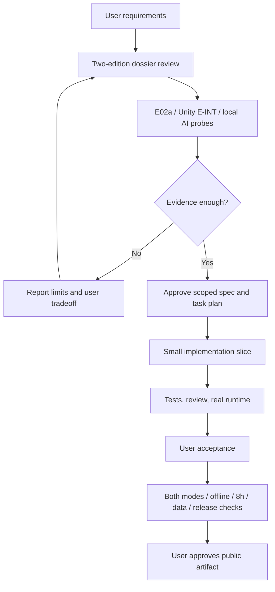

## 11-media — Tự mở nội dung ở nâng cao

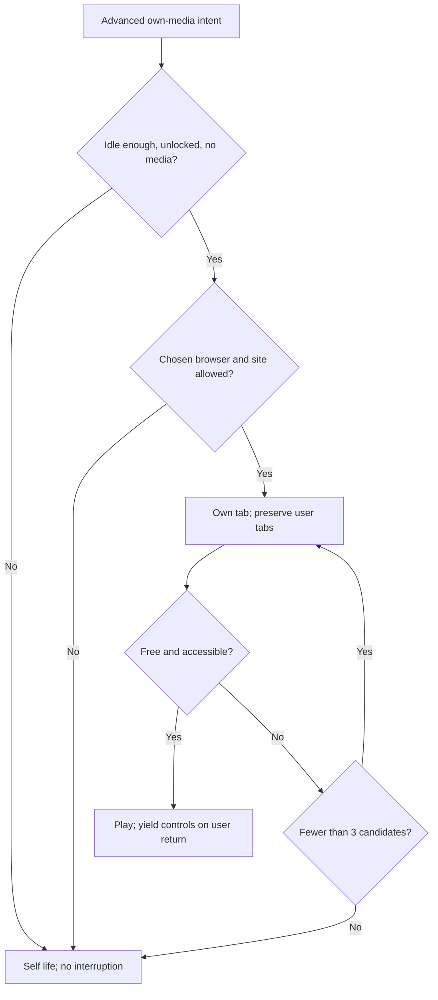

## 12-ui-map — Bản đồ màn hình đề xuất

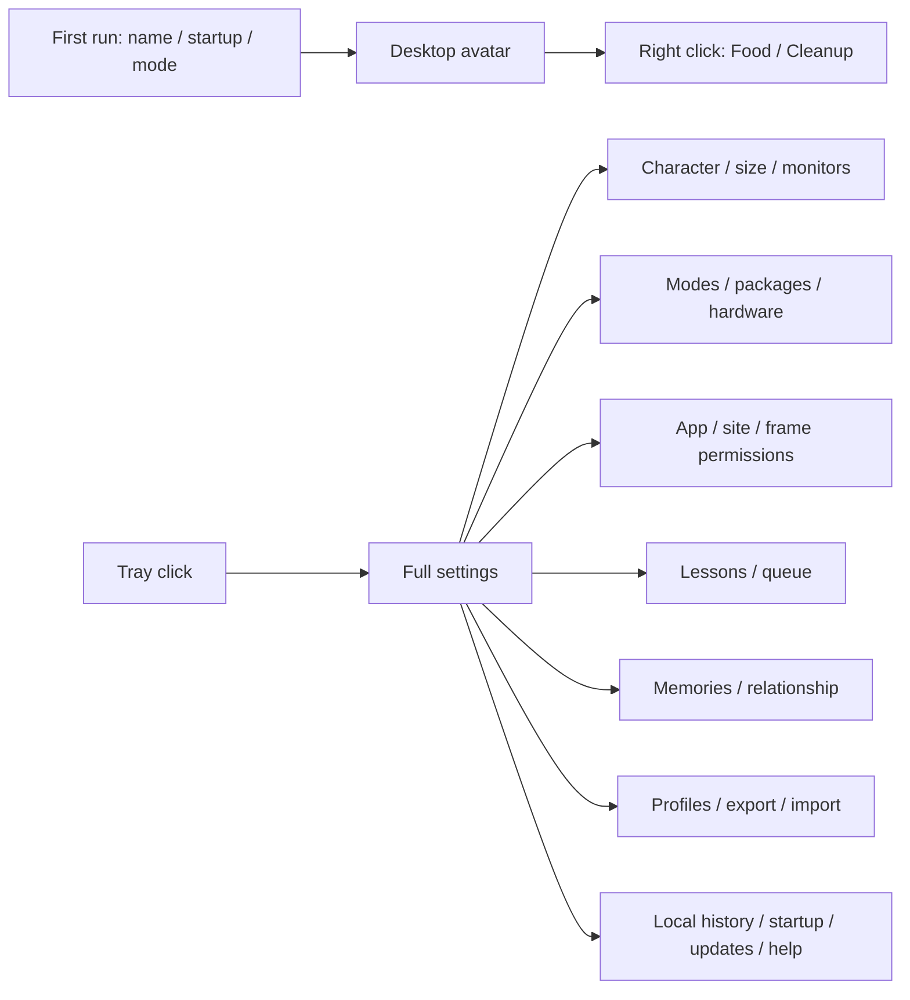

## 13-profile-clock — Đóng app khác chuyển hồ sơ

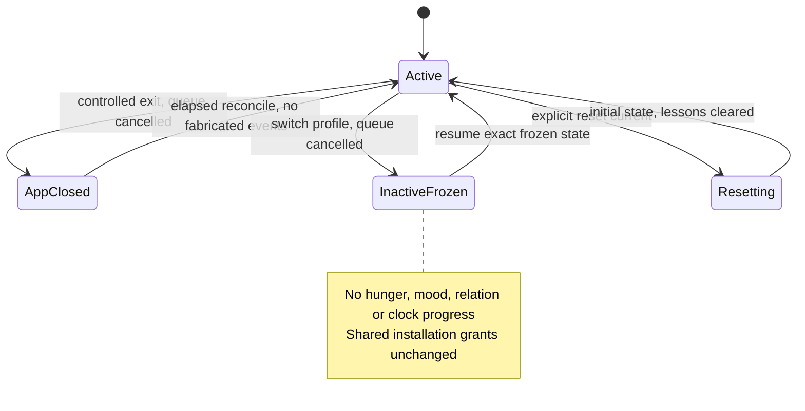

## 14-ai-timing — Đo phản ứng toàn luồng

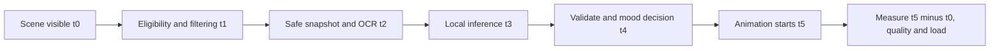

## 15-task-dependencies — Toàn bộ phụ thuộc task từ backlog, chưa ủy quyền thực thi

```mermaid
flowchart TD
 subgraph P00["P00"]
  P00_01["P00-01: Rà baseline và giải quyết mâu thuẫn phạm vi"]
  P00_02["P00-02: Rà ranh giới và hợp đồng hybrid"]
  P00_03["P00-03: Chốt tiêu chuẩn chất lượng sau đo"]
  P00_04["P00-04: Lập danh mục giấy phép và chi phí"]
 end
 subgraph P01["P01"]
  P01_01["P01-01: Khép kiểm tra UI còn mở của E02a"]
 end
 subgraph P02["P02"]
  P02_01["P02-01: Chọn và dựng renderer thử tối thiểu"]
  P02_02["P02-02: Thử transparent overlay và hit regions"]
  P02_03["P02-03: Thử tọa độ qua monitor và DPI"]
  P02_04["P02-04: Thử kết nối typed host-renderer"]
  P02_05["P02-05: Thử mất kết nối và khôi phục an toàn"]
 end
 subgraph P03["P03"]
  P03_01["P03-01: Sàng lọc model/runtime local có quyền phân phối"]
  P03_02["P03-02: Dựng benchmark dữ liệu cảnh an toàn"]
  P03_03["P03-03: Đo phản ứng toàn luồng dưới tải kết hợp"]
  P03_04["P03-04: Đề xuất hai mức và luồng gói nâng cao"]
 end
 subgraph P10["P10"]
  P10_01["P10-01: Triển khai grants mặc định tắt và read/control"]
  P10_02["P10-02: Nhận dạng nguồn và vùng đang hiển thị"]
  P10_03["P10-03: Lọc sensitive/private và retry hold trên nguồn thật"]
  P10_04["P10-04: Kiểm chứng clipboard history đúng Win+V scope"]
  P10_05["P10-05: Luồng AI ngoài có preview và consent mỗi lần"]
  P10_06["P10-06: Bridge trình duyệt và ngoại lệ khung video"]
  P10_07["P10-07: Input arbitration và các nút dừng"]
 end
 subgraph P20["P20"]
  P20_01["P20-01: Duyệt model sheet nhân vật gốc"]
  P20_02["P20-02: Di chuyển và bề mặt cửa sổ"]
  P20_03["P20-03: Pet/lift/throw và chuyển vị trí an toàn"]
  P20_04["P20-04: Foodtray, đồ vật và animatedcleanup"]
  P20_05["P20-05: Placement nhiều màn hình và fullscreen"]
 end
 subgraph P30["P30"]
  P30_01["P30-01: Needs/sleep/rest và elapsed reconciliation"]
  P30_02["P30-02: Lựa chọn hoạt động, mood và attention limits"]
  P30_03["P30-03: Quan hệ sâu, neglect và làm lành"]
  P30_04["P30-04: Memory provenance, pin/fade/edit/delete"]
  P30_05["P30-05: Học gu từ user media evidence"]
  P30_06["P30-06: Mode preservation, personality và romance opt-in"]
 end
 subgraph P40["P40"]
  P40_01["P40-01: Onboarding/tray/settings shell"]
  P40_02["P40-02: UI grants và chosenbrowser"]
  P40_03["P40-03: Dạy/review/manage lesson và searchparameters"]
  P40_04["P40-04: Embodied execution và postconditionverify"]
  P40_05["P40-05: Hàng đợi, priority và stop lifecycle"]
  P40_06["P40-06: Xem cùng và phản ứng cảm xúc"]
  P40_07["P40-07: Tự tìm/mở nội dung trong quyền"]
 end
 subgraph P50["P50"]
  P50_01["P50-01: Chốt storage và transaction/persistence"]
  P50_02["P50-02: Profile import/switch/reset semantics"]
  P50_03["P50-03: Manualexport password/recovery format"]
  P50_04["P50-04: Validate/import archive thành hồ sơ riêng"]
  P50_05["P50-05: Local actionhistory và expiry30days"]
  P50_06["P50-06: Bộ cài và startup opt-in"]
  P50_07["P50-07: Own update check/download/install confirmation"]
  P50_08["P50-08: Uninstall giữ/xóa và manualexport reminder"]
 end
 subgraph P60["P60"]
  P60_01["P60-01: Lát tích hợp đầu: hiện→đọc an toàn→phản ứng→dừng"]
  P60_02["P60-02: Hồi quy hai mức và toàn bộ nghiệp vụ"]
  P60_03["P60-03: Phiên8h/offline và ma trận cấu hình"]
  P60_04["P60-04: Rà độc lập, thương hiệu và release gate"]
  P60_05["P60-05: Chuẩn bị công bố và hỗ trợ có kiểm soát"]
 end
 P00_01 --> P00_02
 P00_01 --> P00_03
 P00_01 --> P00_04
 P00_01 --> P01_01
 P00_02 --> P02_01
 P00_04 --> P02_01
 P02_01 --> P02_02
 P02_02 --> P02_03
 P02_01 --> P02_04
 P00_02 --> P02_04
 P02_04 --> P02_05
 P02_03 --> P02_05
 P00_04 --> P03_01
 P03_01 --> P03_02
 P01_01 --> P03_02
 P03_02 --> P03_03
 P02_04 --> P03_03
 P03_03 --> P03_04
 P00_03 --> P03_04
 P00_02 --> P10_01
 P01_01 --> P10_01
 P10_01 --> P10_02
 P02_03 --> P10_02
 P10_02 --> P10_03
 P10_03 --> P10_04
 P10_03 --> P10_05
 P50_01 --> P10_05
 P10_03 --> P10_06
 P00_04 --> P10_06
 P10_01 --> P10_07
 P02_05 --> P10_07
 P00_04 --> P20_01
 P20_01 --> P20_02
 P02_03 --> P20_02
 P02_05 --> P20_02
 P20_02 --> P20_03
 P30_02 --> P20_03
 P20_02 --> P20_04
 P30_01 --> P20_04
 P20_02 --> P20_05
 P02_02 --> P20_05
 P00_02 --> P30_01
 P50_01 --> P30_01
 P30_01 --> P30_02
 P30_02 --> P30_03
 P30_04 --> P30_03
 P50_01 --> P30_04
 P10_01 --> P30_04
 P30_04 --> P30_05
 P10_02 --> P30_05
 P30_03 --> P30_06
 P03_04 --> P30_06
 P02_04 --> P40_01
 P50_01 --> P40_01
 P40_01 --> P40_02
 P10_01 --> P40_02
 P10_03 --> P40_03
 P40_01 --> P40_03
 P50_01 --> P40_03
 P40_03 --> P40_04
 P10_07 --> P40_04
 P20_02 --> P40_04
 P40_04 --> P40_05
 P30_03 --> P40_05
 P03_03 --> P40_06
 P10_03 --> P40_06
 P30_02 --> P40_06
 P20_04 --> P40_06
 P40_05 --> P40_07
 P40_06 --> P40_07
 P10_06 --> P40_07
 P00_02 --> P50_01
 P00_04 --> P50_01
 P50_01 --> P50_02
 P10_01 --> P50_02
 P50_01 --> P50_03
 P00_04 --> P50_03
 P50_03 --> P50_04
 P50_02 --> P50_04
 P50_01 --> P50_05
 P00_04 --> P50_06
 P40_01 --> P50_06
 P20_05 --> P50_06
 P50_06 --> P50_07
 P50_04 --> P50_07
 P50_06 --> P50_08
 P50_03 --> P50_08
 P40_01 --> P60_01
 P20_02 --> P60_01
 P30_02 --> P60_01
 P10_03 --> P60_01
 P60_01 --> P60_02
 P30_06 --> P60_02
 P40_07 --> P60_02
 P50_04 --> P60_02
 P50_05 --> P60_02
 P60_02 --> P60_03
 P03_04 --> P60_03
 P60_03 --> P60_04
 P50_07 --> P60_04
 P50_08 --> P60_04
 P00_04 --> P60_04
 P60_04 --> P60_05
```
