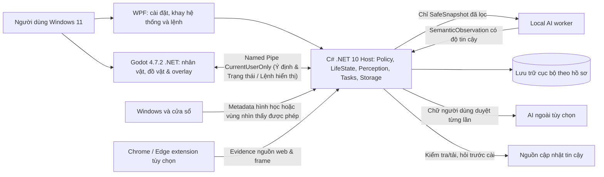

# Tài liệu Đặc tả Yêu cầu Phần mềm (SRS) Chi tiết — Dự án NYUA

> **Trạng thái tài liệu:** Tổng hợp toàn bộ đặc tả hiện hành của dự án **NYUA** *(ứng viên tên, chưa hoàn tất tra cứu nhãn hiệu)* tính đến **2026-11-16**.
> - **Nguồn hợp nhất:** `docs/YEU_CAU_HIEN_HANH.md`, `docs/product/AI/SRS.md`, `requirements.json` (**109** điều khoản), `CAPABILITY_MAP.md`, `CONSTRAINTS.md`, `ARCHITECTURE.md`, `BUSINESS_RULES.md`, `INTERFACES.md`, `DATA.md`, `SECURITY.md`, `AI_LOCAL.md`, `UX.md`, `ART.md`, `QA.md`, `RELEASE.md`, `USE_CASES.md`, `DECISIONS.md`, `docs/godot-windows/SPEC.md` (`GW-DOC-2026-11-15-r1`).
> - **Ranh giới trung thực (Quan trọng):** Đây là bản đặc tả rà soát trước xây dựng toàn sản phẩm. **Không** có ứng dụng nhân vật hoàn chỉnh đang chạy. Mẫu quyền `E02a` (`labs/policy-native/`) đã chạy `53/53 MSTest`, `35/35 UI case` giả và được người dùng đóng **nghiệm thu trải nghiệm C3** (`2026-11-15`), nhưng `T05` mở rộng & `P01-01` kỹ thuật còn mở. Hai bước bootstrap `B00-01` (`.NET 10 LTS`) và `B00-02` (`Godot 4.7.2 – .NET` headless GDScript) đã chạy `PASS` trong `TEMP` cô lập (`2026-11-15`), **chưa** chứng minh export `.exe`, DWM transparency, click-through hay IPC. Toàn bộ `UW01–UW30` là `NOT RUN` và toàn bộ 219 task sản phẩm giữ trạng thái `DRAFT_NOT_AUTHORIZED`.

---

## 1. Mục đích, Phạm vi & Bối cảnh Sản phẩm

### 1.1. Tầm nhìn & Giá trị cốt lõi
- **Sản phẩm:** Nhân vật đồng hành anime chibi pixel 128×128 sống tự do trên desktop Windows 11, có nhu cầu, tâm trạng, sở thích, ký ức và ý muốn riêng; có thể đi/leo/ngồi trên cạnh cửa sổ, xem phim/nghe nhạc cùng người dùng, phản ứng theo ngữ cảnh màn hình và thực hiện bài học thao tác được dạy có kiểm soát (`SP01–SP02`). Không cam kết hay mô phỏng ý thức thật.
- **Đối tượng & Phát hành (`SP03–SP06`):**
  - Thị trường ưu tiên: **Việt Nam**, giao diện **tiếng Việt** trước; quốc tế để sau.
  - Hệ điều hành mục tiêu: **Windows 11** (`x64`).
  - Mô hình phát hành: **Miễn phí bản đầu**, **không tài khoản riêng**, **dữ liệu lưu cục bộ trên máy**, **đóng mã nguồn** (chỉ phát hành ứng dụng). AI bên ngoài hoàn toàn tùy chọn, người dùng tự kết nối và tự chịu chi phí.
  - Chính sách công cụ/chi phí: Giai đoạn thử nghiệm chỉ dùng **100% công cụ miễn phí (`$0`)**; mọi khoản chi phát triển phải hỏi ý kiến người dùng trước.
  - Điều kiện phát hành công khai: Không ấn định hạn cố định; **cả hai mức Cơ bản và Nâng cao phải ổn định** trước khi công khai.
- **Thương hiệu ứng viên (`docs/TEN_UNG_VIEN.md`):** **NYUA** (*nyu-a*) được người dùng chọn làm ứng viên ưu tiên theo gu mềm mại, gọn hiện đại; hiện mới tra cứu sơ bộ WIPO (`Embedded`: 0 kết quả; `Fuzzy + VN + Nhóm 9`: 32 gợi ý chưa rà hết) và IPPlatform lỗi máy chủ — **chưa chốt nhãn hiệu chính thức**.

### 1.2. Định hướng Kiến trúc & Chuyển đổi Engine (`SP09`, `ADR-001`)
- Theo chỉ đạo ngày **2026-11-15**, dự án chính thức chuyển tầng hiển thị từ Unity sang **Godot Engine** (`docs/unity-windows/*` đã chuyển thành `SUPERSEDED`).
- **Phân công 3 trụ cột:**
  1. **Godot Engine (`4.7.2 – .NET` đề xuất, giấy phép MIT `$0`):** Dựng hình, hoạt ảnh nhân vật, đồ vật ảo, nhận diện cử chỉ trên avatar, cửa sổ trong suốt/overlay.
  2. **C# / `.NET 10 LTS` + WPF (`net10.0-windows`):** Host giữ toàn quyền (authority) về chính sách quyền, vòng đời, trọng tài input, hàng đợi công việc, trạng thái đời sống, lưu trữ và giao diện cài đặt/khay hệ thống native.
  3. **AI cục bộ (Local AI) + Browser Bridge tùy chọn:** Nhận diện ngữ cảnh/phụ đề tiếng Việt/cảm xúc từ dữ liệu **đã lọc sạch**; tiện ích Chrome/Edge chỉ cài khi người dùng bật tương tác website.

### 1.3. Phạm vi Bản đầu (`release1`) vs Ngoài Phạm vi (`deferred` / Non-Goals)
| Thuộc Bản đầu (`release1` — 108 điều khoản nguồn + 10 NFR) | Ngoài Phạm vi / Hoãn sau Bản đầu (`deferred` / Non-Goals) |
|---|---|
| Nhân vật chibi nữ trưởng thành tai cáo/đuôi bạc (`128×128`, scale `64–384`), 1 mẫu ngoại hình | Nhiều mẫu ngoại hình, trang phục hoặc tùy biến ngoại hình mở rộng (`NV01`) |
| Hai mức Cơ bản & Nâng cao (`MC01–MC04`, `MODE01–MODE09`) | Chế độ tập trung (Focus mode) riêng (`SH06`), bảng điểm số đói/mệt/tình cảm (`SH05`) |
| Sinh hoạt trên cạnh cửa sổ nhiều màn hình cho phép (`NV08` đầy đủ; multi-monitor/exclusive fullscreen ghi `NOT RUN` nếu thiếu phần cứng) | Hỗ trợ macOS/Linux, ngôn ngữ khác ngoài tiếng Việt trong bản đầu (`SP03`) |
| 6 món ăn miễn phí (cơm nắm, mì, táo, bắp ngô, sữa, nước cam) + thú bông thỏ + tối đa 5 đồ ảo để lại | Hệ thống tiền tệ, cửa hàng, chế tạo vật phẩm, mua quà (`SH04`, `SH08`) |
| Quan sát màn hình hiển thị thật (có lọc vùng nhạy cảm, cửa sổ ẩn danh, `SafetyHold` + `Thử đọc lại`) | **`QD07` (Hoãn):** Đọc tập tin/thư mục người dùng chọn riêng trên ổ đĩa |
| Đọc lịch sử Clipboard chỉ lúc bảng `Windows + V` đang mở (tạm thời, không nhớ lâu) | Lưu trữ lâu dài clipboard hoặc tự bật lịch sử clipboard hệ thống (`QD08`) |
| Nhận biết trạng thái đang phát/không phát tối thiểu ở nền (`D-16`) để tránh mở chồng phim/nhạc | Nghe/phân tích âm thanh hệ thống, micro, camera, nhảy theo nhịp (`AI01`) |
| Điều khiển có giám sát qua bài học được dạy (chỉ gõ vào ô tìm kiếm/điều hướng) | Sửa/xóa/di chuyển file cá nhân, gửi tin nhắn/email, đăng bài, điền biểu mẫu gửi dữ liệu, thanh toán, tự đánh dấu đã đọc (`DK02`, `QD06`) |
| AI cục bộ + AI ngoài gửi chữ từng lần khi user chủ động duyệt (`AI02`) | Trò chuyện văn bản tự do (chat), gửi ảnh/âm thanh/tệp/ký ức ra cloud (`AI02`, `UX`) |
| Tạo thêm hồ sơ **chỉ** qua nhập sao lưu thủ công có mật khẩu + mã khôi phục (`HS01`, `SL01–02`) | Tạo hồ sơ mới bằng nút bấm, tài khoản đám mây, đồng bộ cloud, sao lưu tự động, công khai mã nguồn (`SP03–04`, `SL01`) |

---

## 2. Phân rã 7 Module Chức năng & Đồ thị Phụ thuộc (`CAPABILITY_MAP.md`)

Toàn bộ hệ thống được chia thành **7 module** có ranh giới trách nhiệm chặt chẽ và đồ thị phụ thuộc **không chu trình (DAG)**:

```text
policy ─────┬── desktop-body ─┐
            └── perception ──┴── task-execution ──┐
life-state ───────────────────────────────────────┴── companion
policy + life-state ── distribution
```

| Mã Module | Trách nhiệm chính | Cấm tự thực hiện (Invariants) | Phụ thuộc |
|---|---|---|---|
| `policy` | Quyền đọc/điều khiển theo app & site, `generation` chống dữ liệu cũ, `SafetyHold`, điều kiện dừng, hiệu lực tại thời điểm dùng | Tự cấp quyền; coi text màn hình/output AI là lệnh cấp quyền; nâng Control trước Read | — |
| `life-state` | Nhu cầu, giấc ngủ, tâm trạng, ký ức có nguồn gốc, quan hệ sâu/làm lành, sở thích, phát triển tính cách và ý định sinh hoạt | Tự phát click/gõ OS hoặc vượt quyền vì tâm trạng/ý muốn | — |
| `desktop-body` | Biểu diễn nhân vật & đồ vật ảo (Godot), leo/ngồi/rơi trên cạnh cửa sổ, nhận diện cử chỉ kéo/vuốt/quăng/`Shift+drag`, thang/bàn phím ảo | Đọc tiêu đề/nội dung cửa sổ chỉ vì biết hình học; tự phát `SendInput` | `policy` |
| `perception` | Nhận nguồn hiển thị, xác định danh tính app/web/frame, lọc vùng nhạy cảm **trước** OCR/AI, đọc chữ/ngữ cảnh/cảm xúc, quản lý `Win+V` | Đưa dữ liệu thô bị cấm vào OCR/AI rồi mới che ở UI xem trước | `policy` |
| `task-execution` | Chế độ làm mẫu dạy bài học, tham số tìm kiếm, hàng đợi công việc, tự khám phá (Nâng cao), tự mở phim/nhạc, xác minh hậu điều kiện | Tự gọi bài học; bấm theo tọa độ cũ sau khi UI đổi; thực hiện tác vụ bị cấm | `policy`, `perception`, `desktop-body` |
| `companion` | Điều phối tổng thể trải nghiệm, chọn điểm chú ý, dung hòa hành động, giao diện cài đặt WPF/khay hệ thống & menu ngữ cảnh avatar | Tạo đường quan sát/điều khiển vòng qua `policy`; che giấu nút Dừng/Cài đặt | `life-state`, `perception`, `desktop-body`, `task-execution` |
| `distribution` | Quản lý hồ sơ (đóng băng/chuyển/reset), lưu trữ bền vững, xuất/nhập mã hóa thủ công, lịch sử thao tác 30 ngày, bộ cài/cập nhật/gỡ | Nhập quyền từ file backup; sao lưu khóa AI/gói AI nâng cao; tự động sao lưu ngầm | `policy`, `life-state` |

---

## 3. Danh mục Đầy đủ 109 Yêu cầu Chức năng & Phạm vi (`SRS-SP01` .. `SRS-MODE09`)

Gồm **100 mã nguồn gốc** (`SP01–09`, `NV01–11`, `MC01–04`, `SH01–08`, `QD01–15`, `DK01–04`, `BH01–13`, `XP01–16`, `AI01–03`, `KN01–02`, `QH01–07`, `HS01–03`, `SL01–02`, `CD01–03`) và **9 hàng ma trận hai mức** (`MODE01–MODE09`). Mọi quyết định người dùng ngày `2026-11-14` & `2026-11-15` đã được hợp nhất trực tiếp vào điều khoản tương ứng.

### 1. Nhóm Sản phẩm & Định hướng (`SP01–SP09`) (9 điều khoản)

| Mã SRS | Nguồn | Phạm vi | Module | UC | Task chủ | Bằng chứng hiện tại |
|---|---|---|---|---|---|---|
| `SRS-SP01` | `SP01` | `release1` | `companion` | `UC-01` | `P30-02` | `not_verified_production` |
| `SRS-SP02` | `SP02` | `release1` | `companion` | `UC-01` | `P60-01` | `not_verified_production` |
| `SRS-SP03` | `SP03` | `release1` | `companion` | `UC-18` | `P50-06` | `not_verified_production` |
| `SRS-SP04` | `SP04` | `release1` | `companion` | `UC-01` | `P40-01` | `not_verified_production` |
| `SRS-SP05` | `SP05` | `release1` | `companion` | `UC-18` | `P60-03` | `not_verified_production` |
| `SRS-SP06` | `SP06` | `release1` | `companion` | `UC-18` | `P00-04` | `not_verified_production` |
| `SRS-SP07` | `SP07` | `release1` | `companion` | `UC-05` | `P30-06` | `not_verified_production` |
| `SRS-SP08` | `SP08` | `release1` | `companion` | `UC-05` | `P30-02` | `not_verified_production` |
| `SRS-SP09` | `SP09` | `release1` | `companion` | `UC-01` | `P00-02` | `not_verified_production` |

#### `SRS-SP01` (`SP01`)
- **Yêu cầu gốc:** Tạo cảm giác một người bạn có cá tính sống trên máy: hoạt bát, tò mò, tinh nghịch, tự chọn hoạt động theo nhu cầu, tâm trạng, sở thích và ký ức; có thể đổi ý có lý do. Không phải cam kết có ý thức thật.
- **Module sở hữu:** `companion` | **Use Case:** `UC-01` | **Task dự kiến:** `P30-02` | **Bằng chứng hiện tại:** `not_verified_production`
- **Tiêu chí nghiệm thu kỹ thuật đề xuất (`AT-SP01` — `draft_for_review`):** Qua kịch bản chăm sóc, nghỉ và thay đổi chú ý, quyết định hoạt động có nguyên nhân từ trạng thái; không chỉ lặp một playlist hoạt ảnh.
- **Tiêu chí kiểm tra dễ hiểu cho người dùng:** Bạn quan sát vài lần ăn, nghỉ, chơi và phản ứng: hành vi phải có lý do từ việc vừa xảy ra, không chỉ lặp hình ảnh.

#### `SRS-SP02` (`SP02`)
- **Yêu cầu gốc:** Bản dùng thử có ý nghĩa phải kết hợp sinh hoạt/ghi nhớ, hiểu màn hình và chuyển động/tương tác tự nhiên. Chỉ hoạt ảnh đi lại chưa đủ.
- **Module sở hữu:** `companion` | **Use Case:** `UC-01` | **Task dự kiến:** `P60-01` | **Bằng chứng hiện tại:** `not_verified_production`
- **Tiêu chí nghiệm thu kỹ thuật đề xuất (`AT-SP02` — `draft_for_review`):** Dùng thử một luồng kết hợp sinh hoạt, ghi nhớ, hiểu ngữ cảnh và chuyển động; từng demo riêng không thay nghiệm thu luồng kết hợp.
- **Tiêu chí kiểm tra dễ hiểu cho người dùng:** Bạn dùng thử một lần có đủ sinh hoạt, nhớ, hiểu màn hình và tương tác; các bản trình diễn rời chưa đủ.

#### `SRS-SP03` (`SP03`)
- **Yêu cầu gốc:** Phát hành công khai cho nhiều người trên Windows 11, giao diện tiếng Việt và thị trường Việt Nam trước; quốc tế để sau. Miễn phí bản đầu; chỉ phát hành ứng dụng, chưa công khai mã nguồn.
- **Module sở hữu:** `companion` | **Use Case:** `UC-18` | **Task dự kiến:** `P50-06` | **Bằng chứng hiện tại:** `not_verified_production`
- **Tiêu chí nghiệm thu kỹ thuật đề xuất (`AT-SP03` — `draft_for_review`):** Cài/chạy bản tiếng Việt trên Windows11; checklist phát hành ghi miễn phí bản đầu và không công khai source; chưa suy ra hỗ trợ OS khác.
- **Tiêu chí kiểm tra dễ hiểu cho người dùng:** Người dùng Windows 11 mở được giao diện tiếng Việt; bản đầu miễn phí và chưa phải dự án công khai mã nguồn.

#### `SRS-SP04` (`SP04`)
- **Yêu cầu gốc:** Không tài khoản riêng của ứng dụng; dữ liệu trên máy. Người dùng tự kết nối và trả chi phí AI ngoài nếu dùng.
- **Module sở hữu:** `companion` | **Use Case:** `UC-01` | **Task dự kiến:** `P40-01` | **Bằng chứng hiện tại:** `not_verified_production`
- **Tiêu chí nghiệm thu kỹ thuật đề xuất (`AT-SP04` — `draft_for_review`):** Cài mới dùng được không đăng ký; kiểm data local và dịch vụ AI ngoài chỉ dùng thông tin kết nối người dùng cung cấp.
- **Tiêu chí kiểm tra dễ hiểu cho người dùng:** Cài mới không cần đăng ký tài khoản; dùng AI bên ngoài là lựa chọn riêng với chi phí của người dùng.

#### `SRS-SP05` (`SP05`)
- **Yêu cầu gốc:** Không hạn phát hành cố định. Cả cơ bản và nâng cao phải ổn định trước phát hành công khai; có thể kiểm chứng bằng bản thử nội bộ trước.
- **Module sở hữu:** `companion` | **Use Case:** `UC-18` | **Task dự kiến:** `P60-03` | **Bằng chứng hiện tại:** `not_verified_production`
- **Tiêu chí nghiệm thu kỹ thuật đề xuất (`AT-SP05` — `draft_for_review`):** Không đóng cổng phát hành nếu một trong hai mức chưa đạt tiêu chí; bản nội bộ được dán nhãn khác bản công khai.
- **Tiêu chí kiểm tra dễ hiểu cho người dùng:** Cả cơ bản và nâng cao phải qua kiểm tra trước công khai; không coi bản thử một phần là bản đã hoàn chỉnh.

#### `SRS-SP06` (`SP06`)
- **Yêu cầu gốc:** Ưu tiên công cụ/dịch vụ miễn phí; mọi khoản chi phát triển phải hỏi trước. Chưa có ngân sách số cụ thể hoặc quyền tự chi.
- **Module sở hữu:** `companion` | **Use Case:** `UC-18` | **Task dự kiến:** `P00-04` | **Bằng chứng hiện tại:** `not_verified_production`
- **Tiêu chí nghiệm thu kỹ thuật đề xuất (`AT-SP06` — `draft_for_review`):** Danh mục công cụ ghi chi phí/giấy phép; khoản phí không được mua hoặc kích hoạt khi chưa có quyết định người dùng.
- **Tiêu chí kiểm tra dễ hiểu cho người dùng:** Bạn được biết khoản nào có phí và quyết định trước khi mua hoặc kích hoạt.

#### `SRS-SP07` (`SP07`)
- **Yêu cầu gốc:** Ở nâng cao, tính cách phát triển qua trải nghiệm/cách đối xử: từ làm trước nghĩ sau dần biết cân nhắc. Luôn giữ tò mò, tinh nghịch và ý muốn riêng; thay đổi cách thể hiện, không xóa các nét cốt lõi này. Cơ bản giữ tính cách ban đầu, vẫn đổi tâm trạng. Không phải quyền tự sửa code.
- **Module sở hữu:** `companion` | **Use Case:** `UC-05` | **Task dự kiến:** `P30-06` | **Bằng chứng hiện tại:** `not_verified_production`
- **Tiêu chí nghiệm thu kỹ thuật đề xuất (`AT-SP07` — `draft_for_review`):** Cùng trải nghiệm qua thời gian tạo cách biểu hiện cân nhắc hơn ở nâng cao; vẫn có tò mò/tinh nghịch/ý muốn riêng, cơ bản không tiến hóa tính cách.
- **Tiêu chí kiểm tra dễ hiểu cho người dùng:** Qua trải nghiệm ở nâng cao, cô ấy cân nhắc hơn nhưng vẫn tò mò, tinh nghịch và có ý muốn riêng.

#### `SRS-SP08` (`SP08`)
- **Yêu cầu gốc:** Học cách hành xử qua tương tác và trải nghiệm, không thêm nút đánh giá hành vi. Không tự đánh đồng người dùng bận/không đáp lời rủ với phê bình; chế độ làm mẫu thao tác ứng dụng vẫn là chức năng riêng.
- **Module sở hữu:** `companion` | **Use Case:** `UC-05` | **Task dự kiến:** `P30-02` | **Bằng chứng hiện tại:** `not_verified_production`
- **Tiêu chí nghiệm thu kỹ thuật đề xuất (`AT-SP08` — `draft_for_review`):** Không có nút đánh giá hành vi; bỏ qua lời rủ không thành lời phê bình; learning-demo chỉ ghi khi user bật.
- **Tiêu chí kiểm tra dễ hiểu cho người dùng:** Không thêm nút chấm điểm hành vi; bạn đang bận và không đáp lời rủ không bị hiểu thành phê bình cô ấy.

#### `SRS-SP09` (`SP09`)
- **Yêu cầu gốc:** Hướng đã thống nhất để tiếp tục (cập nhật chuyển từ Unity sang **Godot Engine** theo quyết định người dùng 2026-11-15): **Godot Engine** phụ trách hiển thị/hoạt ảnh nhân vật; C# + WPF phụ trách phần ứng dụng, điều phối và quản lý; AI local phân tích ngữ cảnh/cảm xúc. Phiên bản, cách kết nối, topology tiến trình, hiệu năng và độ tin cậy còn cần thiết kế/kiểm chứng. Không xây giao diện sản phẩm bằng web theo đề xuất cũ. Quyết định 2026-11-14 D-02: Hình ảnh lỗi thì tạm dừng thao tác lên app khác; phục hồi vẫn tạm dừng và hỏi trước tiếp tục, kiểm quyền/an toàn mới. Không phát lại mù quáng; hợp đồng kết nối/mất kết nối còn mở.
- **Module sở hữu:** `companion` | **Use Case:** `UC-01` | **Task dự kiến:** `P00-02` | **Bằng chứng hiện tại:** `not_verified_production`
- **Tiêu chí nghiệm thu kỹ thuật đề xuất (`AT-SP09` — `draft_for_review`):** Rà phân công Godot/host/WPF/localAI; không đưa web UI làm nền sản phẩm hoặc coi IPC/model đã chứng minh từ sơ đồ. Kiểm cả nhánh cho phép và từ chối: Hình ảnh lỗi thì tạm dừng thao tác lên app khác; phục hồi vẫn tạm dừng và hỏi trước tiếp tục, kiểm quyền/an toàn mới. Không phát lại mù quáng; hợp đồng kết nối/mất kết nối còn mở.
- **Tiêu chí kiểm tra dễ hiểu cho người dùng:** Team giữ đúng Godot Engine cho nhân vật, C#/WPF cho ứng dụng và AI trên máy; các phần kết nối vẫn phải thử. Kiểm quyết định D-02: Hình ảnh lỗi thì tạm dừng thao tác lên app khác; phục hồi vẫn tạm dừng và hỏi trước tiếp tục, kiểm quyền/an toàn mới. Không phát lại mù quáng; hợp đồng kết nối/mất kết nối còn mở.

### 2. Nhóm Ngoại hình & Chuyển động (`NV01–NV11`) (11 điều khoản)

| Mã SRS | Nguồn | Phạm vi | Module | UC | Task chủ | Bằng chứng hiện tại |
|---|---|---|---|---|---|---|
| `SRS-NV01` | `NV01` | `release1` | `desktop-body` | `UC-03` | `P20-01` | `not_verified_production` |
| `SRS-NV02` | `NV02` | `release1` | `desktop-body` | `UC-03` | `P20-01` | `not_verified_production` |
| `SRS-NV03` | `NV03` | `release1` | `desktop-body` | `UC-03` | `P20-01` | `not_verified_production` |
| `SRS-NV04` | `NV04` | `release1` | `desktop-body` | `UC-03` | `P20-01` | `not_verified_production` |
| `SRS-NV05` | `NV05` | `release1` | `desktop-body` | `UC-03` | `P20-02` | `not_verified_production` |
| `SRS-NV06` | `NV06` | `release1` | `desktop-body` | `UC-01` | `P40-01` | `not_verified_production` |
| `SRS-NV07` | `NV07` | `release1` | `desktop-body` | `UC-03` | `P20-02` | `not_verified_production` |
| `SRS-NV08` | `NV08` | `release1` | `desktop-body` | `UC-03` | `P20-05` | `not_verified_production` |
| `SRS-NV09` | `NV09` | `release1` | `desktop-body` | `UC-03` | `P20-03` | `not_verified_production` |
| `SRS-NV10` | `NV10` | `release1` | `desktop-body` | `UC-08` | `P40-04` | `not_verified_production` |
| `SRS-NV11` | `NV11` | `release1` | `desktop-body` | `UC-03` | `P20-03` | `not_verified_production` |

#### `SRS-NV01` (`NV01`)
- **Yêu cầu gốc:** Nữ trưởng thành kiểu chibi, đầu lớn người nhỏ, phong cách anime đời thường. Một mẫu ngoại hình trong bản đầu cho mọi người dùng. Quyết định 2026-11-14 D-14: Nhân vật chính chủ yếu hình người về mặt/dáng/đi đứng, không mõm cáo/bàn chân động vật. Chỉ đôi tai cáo trên đầu, không tai người; tai trắng bạc lòng hồng nhạt; một đuôi cáo trắng bạc. Giữ nữ trưởng thành chibi anime pixel 128x128, tóc trắng bạc ngang eo/mái thưa, mắt đỏ hồng, da sáng ấm, áo len rộng cổ tròn hồng nhạt, váy xếp ly xám đậm trên gối, chân trần, kẹp tim đỏ rượu bên phải nhân vật.
- **Module sở hữu:** `desktop-body` | **Use Case:** `UC-03` | **Task dự kiến:** `P20-01` | **Bằng chứng hiện tại:** `not_verified_production`
- **Tiêu chí nghiệm thu kỹ thuật đề xuất (`AT-NV01` — `draft_for_review`):** Duyệt mẫu nữ trưởng thành chibi đầu lớn người nhỏ; cài mới các user có cùng ngoại hình đã duyệt. Kiểm cả nhánh cho phép và từ chối: Nhân vật chính chủ yếu hình người về mặt/dáng/đi đứng, không mõm cáo/bàn chân động vật. Chỉ đôi tai cáo trên đầu, không tai người; tai trắng bạc lòng hồng nhạt; một đuôi cáo trắng bạc. Giữ nữ trưởng thành chibi anime pixel 128x128, tóc trắng bạc ngang eo/mái thưa, mắt đỏ hồng, da sáng ấm, áo len rộng cổ tròn hồng nhạt, váy xếp ly xám đậm trên gối, chân trần, kẹp tim đỏ rượu bên phải nhân vật.
- **Tiêu chí kiểm tra dễ hiểu cho người dùng:** Bạn duyệt cô gái trưởng thành chibi đúng phong cách; mọi người dùng bản đầu có cùng mẫu ngoại hình. Kiểm quyết định D-14: Nhân vật chính chủ yếu hình người về mặt/dáng/đi đứng, không mõm cáo/bàn chân động vật. Chỉ đôi tai cáo trên đầu, không tai người; tai trắng bạc lòng hồng nhạt; một đuôi cáo trắng bạc. Giữ nữ trưởng thành chibi anime pixel 128x128, tóc trắng bạc ngang eo/mái thưa, mắt đỏ hồng, da sáng ấm, áo len rộng cổ tròn hồng nhạt, váy xếp ly xám đậm trên gối, chân trần, kẹp tim đỏ rượu bên phải nhân vật.

#### `SRS-NV02` (`NV02`)
- **Yêu cầu gốc:** Tóc trắng bạc buông ngang eo, mái thưa ngang trán; mắt đỏ hồng; da sáng tông ấm. Quyết định 2026-11-14 D-14: Giữ tóc/mắt/da đã chốt; tai trắng bạc lòng hồng nhạt và một đuôi trắng bạc đồng bộ tóc. Chỉ tai cáo, không tai người; không thay ngoại hình đã duyệt.
- **Module sở hữu:** `desktop-body` | **Use Case:** `UC-03` | **Task dự kiến:** `P20-01` | **Bằng chứng hiện tại:** `not_verified_production`
- **Tiêu chí nghiệm thu kỹ thuật đề xuất (`AT-NV02` — `draft_for_review`):** So mẫu front/side với tóc bạc ngang eo, mái thưa, mắt đỏ hồng và da sáng ấm; ghi sửa nếu lệch. Kiểm cả nhánh cho phép và từ chối: Giữ tóc/mắt/da đã chốt; tai trắng bạc lòng hồng nhạt và một đuôi trắng bạc đồng bộ tóc. Chỉ tai cáo, không tai người; không thay ngoại hình đã duyệt.
- **Tiêu chí kiểm tra dễ hiểu cho người dùng:** So mẫu với tóc bạc ngang eo, mái thưa, mắt đỏ hồng và da sáng ấm đã chọn. Kiểm quyết định D-14: Giữ tóc/mắt/da đã chốt; tai trắng bạc lòng hồng nhạt và một đuôi trắng bạc đồng bộ tóc. Chỉ tai cáo, không tai người; không thay ngoại hình đã duyệt.

#### `SRS-NV03` (`NV03`)
- **Yêu cầu gốc:** Áo len rộng cổ tròn hồng nhạt; chân váy xếp ly xám đậm trên gối; chân trần, không tất/giày.
- **Module sở hữu:** `desktop-body` | **Use Case:** `UC-03` | **Task dự kiến:** `P20-01` | **Bằng chứng hiện tại:** `not_verified_production`
- **Tiêu chí nghiệm thu kỹ thuật đề xuất (`AT-NV03` — `draft_for_review`):** Kiểm áo len rộng cổ tròn hồng nhạt, váy xếp ly xám đậm trên gối, không tất/giày ở mọi hướng.
- **Tiêu chí kiểm tra dễ hiểu cho người dùng:** Kiểm áo len, váy và chân trần ở các hướng; không tự thêm tất hay giày.

#### `SRS-NV04` (`NV04`)
- **Yêu cầu gốc:** Kẹp tóc nhỏ hình trái tim đỏ rượu ở bên phải nhân vật, tức phía trái khi nhìn chính diện. Nét mặt thường ngày cười tươi, nhiều năng lượng.
- **Module sở hữu:** `desktop-body` | **Use Case:** `UC-03` | **Task dự kiến:** `P20-01` | **Bằng chứng hiện tại:** `not_verified_production`
- **Tiêu chí nghiệm thu kỹ thuật đề xuất (`AT-NV04` — `draft_for_review`):** Front view kẹp ở trái ảnh, thuộc bên phải nhân vật; sprite lật không làm sai bên giải phẫu; nét thường ngày tươi.
- **Tiêu chí kiểm tra dễ hiểu cho người dùng:** Nhìn chính diện, kẹp phải nằm bên trái ảnh, tức bên phải cô ấy; không đảo sai khi quay người.

#### `SRS-NV05` (`NV05`)
- **Yêu cầu gốc:** Ảnh gốc pixel 128×128; giữ nét pixel, chuyển động mượt mềm mại. Chưa chốt số khung hình, nguồn ảnh hoặc kỹ thuật tạo hoạt ảnh.
- **Module sở hữu:** `desktop-body` | **Use Case:** `UC-03` | **Task dự kiến:** `P20-02` | **Bằng chứng hiện tại:** `not_verified_production`
- **Tiêu chí nghiệm thu kỹ thuật đề xuất (`AT-NV05` — `draft_for_review`):** Kiểm asset nguồn128x128 và chuyển động ở nhiều tỉ lệ; không kết luận mượt chỉ từ kích thước file.
- **Tiêu chí kiểm tra dễ hiểu cho người dùng:** Bạn xem ở nhiều kích thước để duyệt nét pixel và độ mượt, không chỉ nhìn thông số file.

#### `SRS-NV06` (`NV06`)
- **Yêu cầu gốc:** Thanh kéo kích thước tự do 64×64–384×384; ban đầu 128×128, nhớ kích thước người dùng chỉnh. Người dùng tự đặt tên khi mở lần đầu.
- **Module sở hữu:** `desktop-body` | **Use Case:** `UC-01` | **Task dự kiến:** `P40-01` | **Bằng chứng hiện tại:** `not_verified_production`
- **Tiêu chí nghiệm thu kỹ thuật đề xuất (`AT-NV06` — `draft_for_review`):** Lần đầu128; kéo64–384; mở lại giữ lựa chọn; đặt tên qua onboarding. Giới hạn ký tự cần quyết định riêng.
- **Tiêu chí kiểm tra dễ hiểu cho người dùng:** Lần đầu kích thước128; kéo trong64–384 và mở lại giữ mức đã chọn; tên do người dùng đặt.

#### `SRS-NV07` (`NV07`)
- **Yêu cầu gốc:** Sống tự do trên desktop, đi/leo/ngồi trên cạnh cửa sổ. Theo cửa sổ khi di chuyển; mất chỗ đứng vì cửa sổ đóng/thu nhỏ thì rơi xuống bề mặt bên dưới, đứng dậy.
- **Module sở hữu:** `desktop-body` | **Use Case:** `UC-03` | **Task dự kiến:** `P20-02` | **Bằng chứng hiện tại:** `not_verified_production`
- **Tiêu chí nghiệm thu kỹ thuật đề xuất (`AT-NV07` — `draft_for_review`):** Di chuyển/thu nhỏ/đóng cửa sổ đang làm bề mặt: theo cửa sổ hoặc rơi đúng bề mặt kế tiếp, không đứng lơ lửng.
- **Tiêu chí kiểm tra dễ hiểu cho người dùng:** Di chuyển, thu nhỏ và đóng cửa sổ cô ấy đang đứng trên để thử theo cửa sổ hoặc rơi đúng.

#### `SRS-NV08` (`NV08`)
- **Yêu cầu gốc:** Người dùng chọn các màn hình được xuất hiện; nhân vật tự qua lại trong phạm vi đó. Toàn màn hình vẫn hiện sát mép, tránh vùng giữa.
- **Module sở hữu:** `desktop-body` | **Use Case:** `UC-03` | **Task dự kiến:** `P20-05` | **Bằng chứng hiện tại:** `not_verified_production`
- **Tiêu chí nghiệm thu kỹ thuật đề xuất (`AT-NV08` — `draft_for_review`):** Chỉ xuất hiện trên monitor cho phép; fullscreen ở mép; ghi rõ trường hợp exclusive không hỗ trợ sau thử, không tự hứa mọi game.
- **Tiêu chí kiểm tra dễ hiểu cho người dùng:** Cô ấy chỉ đi trên màn hình đã chọn; thử toàn màn hình và ghi rõ trường hợp thực sự hỗ trợ.

#### `SRS-NV09` (`NV09`)
- **Yêu cầu gốc:** Bấm trái nhận biểu cảm/cử chỉ; rê qua đầu nhiều lần để vuốt; giữ kéo để nhấc. Kéo nhẹ đổi chỗ; kéo nhanh thả bay theo đà; thả giữa khoảng trống thì rơi.
- **Module sở hữu:** `desktop-body` | **Use Case:** `UC-03` | **Task dự kiến:** `P20-03` | **Bằng chứng hiện tại:** `not_verified_production`
- **Tiêu chí nghiệm thu kỹ thuật đề xuất (`AT-NV09` — `draft_for_review`):** Phân biệt click/pet/hold-drag/slow-release/fast-release; quăng có đà và rơi/đứng dậy; ngưỡng đo trước chốt.
- **Tiêu chí kiểm tra dễ hiểu cho người dùng:** Bạn thử bấm, vuốt, nhấc và thả nhanh/chậm: phải phân biệt được đổi chỗ với quăng.

#### `SRS-NV10` (`NV10`)
- **Yêu cầu gốc:** Để bấm nút thật phải đến vị trí nút trước, chấp nhận thời gian di chuyển; dùng thang/dụng cụ ảo khi thiếu chỗ tiếp cận. Khi gõ thật có hoạt ảnh bàn phím nhỏ trên tay.
- **Module sở hữu:** `desktop-body` | **Use Case:** `UC-08` | **Task dự kiến:** `P40-04` | **Bằng chứng hiện tại:** `not_verified_production`
- **Tiêu chí nghiệm thu kỹ thuật đề xuất (`AT-NV10` — `draft_for_review`):** Input thật chỉ xảy ra sau body approach và revalidate; có dụng cụ ảo khi thiếu bề mặt và bàn phím ảo lúc gõ.
- **Tiêu chí kiểm tra dễ hiểu cho người dùng:** Khi bấm nút thật, cô ấy phải đến nút trước; nút thay vị trí hoặc bạn dùng chuột thì không được bấm theo kế hoạch cũ.

#### `SRS-NV11` (`NV11`)
- **Yêu cầu gốc:** Giữ một phím rồi kéo là chế độ chuyển vị trí, dùng được cả khi cô ấy đang từ chối cho nhấc; không tính chơi/quăng hoặc làm xấu quan hệ. Phím đã chốt là Shift. Quyết định 2026-11-14 D-05: Giữ Shift rồi kéo chuyển vị trí kể cả khi từ chối nhấc; không chơi/quăng hay ảnh hưởng quan hệ, không thêm tùy chọn phím; ngưỡng cử chỉ còn phải đo.
- **Module sở hữu:** `desktop-body` | **Use Case:** `UC-03` | **Task dự kiến:** `P20-03` | **Bằng chứng hiện tại:** `not_verified_production`
- **Tiêu chí nghiệm thu kỹ thuật đề xuất (`AT-NV11` — `draft_for_review`):** Modifier-drag di chuyển ngay cả refusal-lift, không quăng và không giảm relation; phím Shift đã chốt, không thêm tùy chọn phím. Kiểm cả nhánh cho phép và từ chối: Giữ Shift rồi kéo chuyển vị trí kể cả khi từ chối nhấc; không chơi/quăng hay ảnh hưởng quan hệ, không thêm tùy chọn phím; ngưỡng cử chỉ còn phải đo.
- **Tiêu chí kiểm tra dễ hiểu cho người dùng:** Giữ phím chuyển vị trí rồi kéo vẫn dùng được khi cô ấy không muốn được nhấc; không bị tính là quăng. Kiểm quyết định D-05: Giữ Shift rồi kéo chuyển vị trí kể cả khi từ chối nhấc; không chơi/quăng hay ảnh hưởng quan hệ, không thêm tùy chọn phím; ngưỡng cử chỉ còn phải đo.

### 3. Nhóm Quy tắc Hai Mức (`MC01–MC04`) (4 điều khoản)

| Mã SRS | Nguồn | Phạm vi | Module | UC | Task chủ | Bằng chứng hiện tại |
|---|---|---|---|---|---|---|
| `SRS-MC01` | `MC01` | `release1` | `companion` | `UC-02` | `P03-04` | `not_verified_production` |
| `SRS-MC02` | `MC02` | `release1` | `companion` | `UC-02` | `P03-04` | `not_verified_production` |
| `SRS-MC03` | `MC03` | `release1` | `companion` | `UC-02` | `P30-06` | `not_verified_production` |
| `SRS-MC04` | `MC04` | `release1` | `companion` | `UC-02` | `P03-04` | `not_verified_production` |

#### `SRS-MC01` (`MC01`)
- **Yêu cầu gốc:** cài bản nhẹ trước; chỉ tải gói nâng cao khi người dùng chọn. Dung lượng và yêu cầu máy phải được khảo sát trước khi công bố.
- **Module sở hữu:** `companion` | **Use Case:** `UC-02` | **Task dự kiến:** `P03-04` | **Bằng chứng hiện tại:** `not_verified_production`
- **Tiêu chí nghiệm thu kỹ thuật đề xuất (`AT-MC01` — `draft_for_review`):** Cài mới không tải gói nâng cao ngầm; user chọn mới tải, lỗi tải không báo gói đã sẵn sàng.
- **Tiêu chí kiểm tra dễ hiểu cho người dùng:** Bản nhẹ cài trước; gói nâng cao chỉ tải khi bạn chọn và tải lỗi không được báo đã sẵn sàng.

#### `SRS-MC02` (`MC02`)
- **Yêu cầu gốc:** máy chưa đạt cấu hình đã kiểm chứng vẫn được bật thử sau cảnh báo rõ; không tự đổi mức. Khi nâng cao làm máy chậm/nóng thì báo và hỏi giảm mức hay tiếp tục.
- **Module sở hữu:** `companion` | **Use Case:** `UC-02` | **Task dự kiến:** `P03-04` | **Bằng chứng hiện tại:** `not_verified_production`
- **Tiêu chí nghiệm thu kỹ thuật đề xuất (`AT-MC02` — `draft_for_review`):** Máy yếu vẫn có lựa chọn thử sau cảnh báo; simulated overload hỏi giảm/tiếp tục và không đổi mode tự động.
- **Tiêu chí kiểm tra dễ hiểu cho người dùng:** Khi máy yếu hoặc chậm, app cảnh báo và để bạn chọn, không tự đổi mức.

#### `SRS-MC03` (`MC03`)
- **Yêu cầu gốc:** hạ về cơ bản giữ ký ức/quan hệ và phần tính cách đã phát triển, tạm ngừng biểu hiện nâng cao. Bật lại tiếp nối tính cách đã phát triển, không bắt đầu từ đầu. Tương tác ở cơ bản vẫn duy trì quan hệ; thiếu tương tác ở cơ bản không làm giảm quan hệ sâu.
- **Module sở hữu:** `companion` | **Use Case:** `UC-02` | **Task dự kiến:** `P30-06` | **Bằng chứng hiện tại:** `not_verified_production`
- **Tiêu chí nghiệm thu kỹ thuật đề xuất (`AT-MC03` — `draft_for_review`):** Nâng cao→cơ bản→nâng cao bảo toàn memory/relation/personality; cơ bản không tích lũy neglect sâu.
- **Tiêu chí kiểm tra dễ hiểu cho người dùng:** Chuyển xuống cơ bản rồi lên lại không mất ký ức, quan hệ hoặc tính cách đã phát triển.

#### `SRS-MC04` (`MC04`)
- **Yêu cầu gốc:** kiểm tra cấu hình máy người dùng để đề xuất mức cơ bản/nâng cao phù hợp với AI cục bộ. Cách xếp mức và cấu hình tối thiểu cần dựa vào phép đo; không chỉ tên GPU. Giữ quyền chọn/bật thử sau cảnh báo và không tự đổi mức theo MC02.
- **Module sở hữu:** `companion` | **Use Case:** `UC-02` | **Task dự kiến:** `P03-04` | **Bằng chứng hiện tại:** `not_verified_production`
- **Tiêu chí nghiệm thu kỹ thuật đề xuất (`AT-MC04` — `draft_for_review`):** Recommendation có dựa measured workload/hardware capability; user override được; không chỉ dựa tên GPU.
- **Tiêu chí kiểm tra dễ hiểu cho người dùng:** Mức đề xuất phải có lý do từ cấu hình và số đo; bạn vẫn chọn khác được sau cảnh báo.

### 4. Nhóm Sinh hoạt, Thức ăn & Đồ vật (`SH01–SH08`) (8 điều khoản)

| Mã SRS | Nguồn | Phạm vi | Module | UC | Task chủ | Bằng chứng hiện tại |
|---|---|---|---|---|---|---|
| `SRS-SH01` | `SH01` | `release1` | `life-state` | `UC-05` | `P30-01` | `not_verified_production` |
| `SRS-SH02` | `SH02` | `release1` | `life-state` | `UC-04` | `P30-01` | `not_verified_production` |
| `SRS-SH03` | `SH03` | `release1` | `life-state` | `UC-05` | `P30-01` | `not_verified_production` |
| `SRS-SH04` | `SH04` | `release1` | `life-state` | `UC-04` | `P20-04` | `not_verified_production` |
| `SRS-SH05` | `SH05` | `release1` | `life-state` | `UC-03` | `P20-03` | `not_verified_production` |
| `SRS-SH06` | `SH06` | `release1` | `life-state` | `UC-05` | `P30-02` | `not_verified_production` |
| `SRS-SH07` | `SH07` | `release1` | `life-state` | `UC-04` | `P20-04` | `not_verified_production` |
| `SRS-SH08` | `SH08` | `release1` | `life-state` | `UC-04` | `P20-04` | `not_verified_production` |

#### `SRS-SH01` (`SH01`)
- **Yêu cầu gốc:** ngủ theo giờ trong ngày và mức mệt, có ngủ trưa. Mở máy có thể ngái ngủ, chào rồi ngủ tiếp hoặc thức. Bấm lúc ngủ có thể hé mắt, trở mình hoặc thức tùy mệt. Quyết định 2026-11-14 D-12: Khi nhân vật ngủ dừng quan sát; thức dậy chỉ tiếp tục trong quyền hiện hành, không vượt SafetyHold/Thử đọc lại.
- **Module sở hữu:** `life-state` | **Use Case:** `UC-05` | **Task dự kiến:** `P30-01` | **Bằng chứng hiện tại:** `not_verified_production`
- **Tiêu chí nghiệm thu kỹ thuật đề xuất (`AT-SH01` — `draft_for_review`):** Test logical clock/click khi ngủ: phản ứng tùy fatigue, nhịp có naps; chưa tự đặt sleep schedule cố định. Kiểm cả nhánh cho phép và từ chối: Khi nhân vật ngủ dừng quan sát; thức dậy chỉ tiếp tục trong quyền hiện hành, không vượt SafetyHold/Thử đọc lại.
- **Tiêu chí kiểm tra dễ hiểu cho người dùng:** Thử lúc mệt, giờ nghỉ và đang ngủ: cô ấy có thể trở mình, hé mắt hoặc thức theo trạng thái. Kiểm quyết định D-12: Khi nhân vật ngủ dừng quan sát; thức dậy chỉ tiếp tục trong quyền hiện hành, không vượt SafetyHold/Thử đọc lại.

#### `SRS-SH02` (`SH02`)
- **Yêu cầu gốc:** người dùng cho ăn/vuốt, cô ấy tự nghỉ. Khi vắng mặt hoặc app đóng, không bệnh/mất tiến độ; có thể hơi đói/nhớ, tự có đồ dự phòng khi hoạt động.
- **Module sở hữu:** `life-state` | **Use Case:** `UC-04` | **Task dự kiến:** `P30-01` | **Bằng chứng hiện tại:** `not_verified_production`
- **Tiêu chí nghiệm thu kỹ thuật đề xuất (`AT-SH02` — `draft_for_review`):** Bận/vắng không disease/progress-loss; khi hoạt động có reserve food; không yêu cầu chăm như nghĩa vụ liên tục.
- **Tiêu chí kiểm tra dễ hiểu cho người dùng:** Bạn bận hoặc vắng không làm cô ấy bệnh hay mất tiến độ; cô ấy có thức ăn dự phòng và tự nghỉ.

#### `SRS-SH03` (`SH03`)
- **Yêu cầu gốc:** đóng app/tắt máy không mô phỏng sự kiện, không tự kể đã làm gì. Mở lại tính thời gian đã qua để cập nhật trạng thái; nguôi giận có tính thời gian app đóng, không tạo tương tác giả.
- **Module sở hữu:** `life-state` | **Use Case:** `UC-05` | **Task dự kiến:** `P30-01` | **Bằng chứng hiện tại:** `not_verified_production`
- **Tiêu chí nghiệm thu kỹ thuật đề xuất (`AT-SH03` — `draft_for_review`):** Reopen cập nhật elapsed state nhưng không thêm fake memories/events; inactive profile dùng freeze khác appclose.
- **Tiêu chí kiểm tra dễ hiểu cho người dùng:** Mở lại sau khi tắt máy chỉ cập nhật trạng thái theo thời gian, không kể những việc chưa thật diễn ra.

#### `SRS-SH04` (`SH04`)
- **Yêu cầu gốc:** 6 món miễn phí không giới hạn: cơm nắm, mì; trái cây, bắp ngô; sữa, nước trái cây. Chọn riêng để ghép bữa; kéo từng món hoặc cả khay. Có món thích/không thích, đôi khi từ chối, người dùng khám phá qua phản ứng. Quyết định 2026-11-14 D-14/H08: Trong sáu món đã chốt, trái cây là táo, nước trái cây là nước cam; không thêm món thứ bảy. Thú bông thỏ là đồ vật/quà riêng, không nhân vật chính. Màu/chi tiết thú bông, dụng cụ/hình mẫu còn chờ duyệt.
- **Module sở hữu:** `life-state` | **Use Case:** `UC-04` | **Task dự kiến:** `P20-04` | **Bằng chứng hiện tại:** `not_verified_production`
- **Tiêu chí nghiệm thu kỹ thuật đề xuất (`AT-SH04` — `draft_for_review`):** Đủ6 món miễn phí, chọn ghép bữa, kéo lẻ/cả khay; preference/refusal có trạng thái và không bán bằng tiền. Kiểm cả nhánh cho phép và từ chối: Trong sáu món đã chốt, trái cây là táo, nước trái cây là nước cam; không thêm món thứ bảy. Thú bông thỏ là đồ vật/quà riêng, không nhân vật chính. Màu/chi tiết thú bông, dụng cụ/hình mẫu còn chờ duyệt.
- **Tiêu chí kiểm tra dễ hiểu cho người dùng:** Có đủ sáu món miễn phí, chọn ghép bữa, kéo lẻ/cả khay và có phản ứng thích hoặc từ chối. Kiểm quyết định D-14/H08: Trong sáu món đã chốt, trái cây là táo, nước trái cây là nước cam; không thêm món thứ bảy. Thú bông thỏ là đồ vật/quà riêng, không nhân vật chính. Màu/chi tiết thú bông, dụng cụ/hình mẫu còn chờ duyệt.

#### `SRS-SH05` (`SH05`)
- **Yêu cầu gốc:** thường thích vuốt nhưng có thể né/ra dấu đủ rồi. Biểu đạt bằng cử chỉ, nét mặt, biểu tượng nhỏ; không lời thoại/chữ sinh hoạt, không tiếng; không bảng chỉ số đói/mệt/thân thiết. Thông báo chức năng vẫn có chữ.
- **Module sở hữu:** `life-state` | **Use Case:** `UC-03` | **Task dự kiến:** `P20-03` | **Bằng chứng hiện tại:** `not_verified_production`
- **Tiêu chí nghiệm thu kỹ thuật đề xuất (`AT-SH05` — `draft_for_review`):** Pet có thể được nhận/né theo mood; không có thoại, tiếng hoặc numeric dashboard; functional error text vẫn rõ.
- **Tiêu chí kiểm tra dễ hiểu cho người dùng:** Vuốt có thể được thích hoặc né; không hiện bảng số đói/mệt/tình cảm hoặc thêm lời thoại sinh hoạt.

#### `SRS-SH06` (`SH06`)
- **Yêu cầu gốc:** rủ chơi/gây chú ý có thể ghé con trỏ, thò đầu hoặc ôm con trỏ bằng hoạt ảnh. Không kéo chuột thật/chuyển cửa sổ để nghịch. Hai lần không đáp thì tự chơi và chờ ít nhất 30 phút; trò nghịch và rủ dùng chung giới hạn. Không thêm chế độ tập trung riêng.
- **Module sở hữu:** `life-state` | **Use Case:** `UC-05` | **Task dự kiến:** `P30-02` | **Bằng chứng hiện tại:** `not_verified_production`
- **Tiêu chí nghiệm thu kỹ thuật đề xuất (`AT-SH06` — `draft_for_review`):** Invitation/tease chung2 attempts và>=30min cooldown; ignore rồi self-play; không drag cursor/window thật.
- **Tiêu chí kiểm tra dễ hiểu cho người dùng:** Bỏ qua hai lần rủ thì cô ấy tự chơi; ít nhất ba mươi phút mới chủ động lại, không kéo chuột thật.

#### `SRS-SH07` (`SH07`)
- **Yêu cầu gốc:** tối đa 5 món đồ ảo để lại trên màn hình, không tính đồ cô ấy đang cầm/sử dụng. Khi đủ giới hạn, tự cất bớt đồ cũ bằng hoạt ảnh trước khi để thêm món mới. Đồ đều hiện trên cửa sổ; người dùng/cô ấy kéo từng món được, có lệnh dọn. Nút dọn nhanh và yêu cầu dọn đều gọi hoạt ảnh thu dọn, không biến mất ngay.
- **Module sở hữu:** `life-state` | **Use Case:** `UC-04` | **Task dự kiến:** `P20-04` | **Bằng chứng hiện tại:** `not_verified_production`
- **Tiêu chí nghiệm thu kỹ thuật đề xuất (`AT-SH07` — `draft_for_review`):** Left props không vượt5; held/in-use không tính; đầy thì cất bằng animation trước thêm; cleanup không instantdelete.
- **Tiêu chí kiểm tra dễ hiểu cho người dùng:** Không quá năm món đồ để lại; món mới cần cất bớt đồ cũ bằng hoạt ảnh, bạn vẫn kéo đồ được.

#### `SRS-SH08` (`SH08`)
- **Yêu cầu gốc:** tùy tâm trạng có thể chán, trì hoãn hoặc từ chối dọn; người dùng tự di chuyển hoặc ẩn cả nhân vật/đồ được. Quà dỗ là đồ ăn và thú bông đã có, không hệ thống quà mới.
- **Module sở hữu:** `life-state` | **Use Case:** `UC-04` | **Task dự kiến:** `P20-04` | **Bằng chứng hiện tại:** `not_verified_production`
- **Tiêu chí nghiệm thu kỹ thuật đề xuất (`AT-SH08` — `draft_for_review`):** Cleanup mood delay không chặn user move/hide; gift dùng food/plush đã có, không thêm economy riêng.
- **Tiêu chí kiểm tra dễ hiểu cho người dùng:** Cô ấy có thể chán hoặc trì hoãn dọn, nhưng bạn luôn di chuyển đồ hoặc ẩn đi được.

### 5. Nhóm Quyền Đọc & Bảo vệ Dữ liệu (`QD01–QD15`, `QD07` hoãn) (15 điều khoản)

| Mã SRS | Nguồn | Phạm vi | Module | UC | Task chủ | Bằng chứng hiện tại |
|---|---|---|---|---|---|---|
| `SRS-QD01` | `QD01` | `release1` | `policy` | `UC-06` | `P10-01` | `E02a_fake_partial` |
| `SRS-QD02` | `QD02` | `release1` | `policy` | `UC-06` | `P40-02` | `not_verified_production` |
| `SRS-QD03` | `QD03` | `release1` | `policy` | `UC-06` | `P50-02` | `not_verified_production` |
| `SRS-QD04` | `QD04` | `release1` | `policy` | `UC-07` | `P10-02` | `E02a_fake_partial` |
| `SRS-QD05` | `QD05` | `release1` | `policy` | `UC-07` | `P10-03` | `E02a_fake_partial` |
| `SRS-QD06` | `QD06` | `release1` | `policy` | `UC-06` | `P10-02` | `not_verified_production` |
| `SRS-QD07` | `QD07` | **`deferred` (Hoãn bản đầu)** | `policy` | `UC-06` | `DEFERRED` | `not_verified_production` |
| `SRS-QD08` | `QD08` | `release1` | `policy` | `UC-07` | `P10-04` | `not_verified_production` |
| `SRS-QD09` | `QD09` | `release1` | `policy` | `UC-06` | `P30-04` | `not_verified_production` |
| `SRS-QD10` | `QD10` | `release1` | `policy` | `UC-07` | `P20-02` | `E02a_fake_partial` |
| `SRS-QD11` | `QD11` | `release1` | `policy` | `UC-07` | `P30-04` | `not_verified_production` |
| `SRS-QD12` | `QD12` | `release1` | `policy` | `UC-06` | `P10-06` | `not_verified_production` |
| `SRS-QD13` | `QD13` | `release1` | `policy` | `UC-07` | `P10-06` | `not_verified_production` |
| `SRS-QD14` | `QD14` | `release1` | `policy` | `UC-07` | `P10-06` | `not_verified_production` |
| `SRS-QD15` | `QD15` | `release1` | `policy` | `UC-07` | `P10-03` | `E02a_fake_partial` |

#### `SRS-QD01` (`QD01`)
- **Yêu cầu gốc:** Người mới cài chỉ có sinh hoạt; quyền truy cập mặc định tắt. Mỗi app/website tách Đọc và Điều khiển; phải bật Đọc trước mới bật Điều khiển, không tự cấp Đọc.
- **Module sở hữu:** `policy` | **Use Case:** `UC-06` | **Task dự kiến:** `P10-01` | **Bằng chứng hiện tại:** `E02a_fake_partial`
- **Tiêu chí nghiệm thu kỹ thuật đề xuất (`AT-QD01` — `draft_for_review`):** Fresh install grants off; read/control độc lập; bật control khi thiếu read bị từ chối không auto grant.
- **Tiêu chí kiểm tra dễ hiểu cho người dùng:** Cài mới quyền tắt; ô Điều khiển bị từ chối khi chưa có Đọc, không bật Đọc thay bạn.

#### `SRS-QD02` (`QD02`)
- **Yêu cầu gốc:** Quét app trên máy để hiện danh sách; website do người dùng dán link. Cấp cho website gồm tên miền phụ; website khác cần riêng. Chrome/Edge cần quyền ở cả trình duyệt và website.
- **Module sở hữu:** `policy` | **Use Case:** `UC-06` | **Task dự kiến:** `P40-02` | **Bằng chứng hiện tại:** `not_verified_production`
- **Tiêu chí nghiệm thu kỹ thuật đề xuất (`AT-QD02` — `draft_for_review`):** List app scan không tự cấp; pasted site được normalize; browser+site grants và subdomain test không substring.
- **Tiêu chí kiểm tra dễ hiểu cho người dùng:** Danh sách ứng dụng và website chỉ tạo lựa chọn, chưa phải cấp quyền; website cần cả hai tầng được phép.

#### `SRS-QD03` (`QD03`)
- **Yêu cầu gốc:** App/website mới không tự kế thừa. Quyền chung cho ứng dụng, dùng chung các hồ sơ trên máy; không nhập quyền từ file sao lưu.
- **Module sở hữu:** `policy` | **Use Case:** `UC-06` | **Task dự kiến:** `P50-02` | **Bằng chứng hiện tại:** `not_verified_production`
- **Tiêu chí nghiệm thu kỹ thuật đề xuất (`AT-QD03` — `draft_for_review`):** New source defaultdeny; switch profile dùng installation grants; archive không apply foreign grants.
- **Tiêu chí kiểm tra dễ hiểu cho người dùng:** Nguồn mới vẫn tắt; các hồ sơ dùng quyền chung trên máy, không lấy quyền từ file nhập.

#### `SRS-QD04` (`QD04`)
- **Yêu cầu gốc:** Đọc nội dung các cửa sổ cùng đang nhìn thấy nếu đều được phép; không đọc cửa sổ/tab bị che hoặc thu nhỏ. Đọc toàn bộ không còn được hiểu là đọc nền mọi nơi. Quyết định 2026-11-14 D-12: Nhân vật ngủ dừng quan sát; thức dậy không tự cấp quyền hoặc bỏ qua SafetyHold/Thử đọc lại.
- **Module sở hữu:** `policy` | **Use Case:** `UC-07` | **Task dự kiến:** `P10-02` | **Bằng chứng hiện tại:** `E02a_fake_partial`
- **Tiêu chí nghiệm thu kỹ thuật đề xuất (`AT-QD04` — `draft_for_review`):** Split-screen chỉ vùng visible+allowed; tab nền/minimized/occluded không cấp nội dung vào consumer. Kiểm cả nhánh cho phép và từ chối: Nhân vật ngủ dừng quan sát; thức dậy không tự cấp quyền hoặc bỏ qua SafetyHold/Thử đọc lại.
- **Tiêu chí kiểm tra dễ hiểu cho người dùng:** Mở hai cửa sổ cạnh nhau, che hoặc thu nhỏ một cửa: chỉ nội dung nhìn thấy và có quyền được dùng. Kiểm quyết định D-12: Nhân vật ngủ dừng quan sát; thức dậy không tự cấp quyền hoặc bỏ qua SafetyHold/Thử đọc lại.

#### `SRS-QD05` (`QD05`)
- **Yêu cầu gốc:** Che vùng không được cấp trước phân tích; không đọc/điều khiển cửa sổ ẩn danh, kể cả website có quyền. Mật khẩu/OTP/thẻ thanh toán bị loại khỏi đọc/nhớ/gửi AI. Khả năng che chưa kiểm chứng.
- **Module sở hữu:** `policy` | **Use Case:** `UC-07` | **Task dự kiến:** `P10-03` | **Bằng chứng hiện tại:** `E02a_fake_partial`
- **Tiêu chí nghiệm thu kỹ thuật đề xuất (`AT-QD05` — `draft_for_review`):** Sentinel vùng cấm/private/secret không vào OCR/model/memory/network; unknown-region chặn nguồn, không chỉ overlay che.
- **Tiêu chí kiểm tra dễ hiểu cho người dùng:** Nội dung cấm hoặc nhạy cảm không được tới AI, ký ức hay nơi gửi ra ngoài; chưa chắc thì chặn.

#### `SRS-QD06` (`QD06`)
- **Yêu cầu gốc:** Email/tin nhắn/lịch/danh bạ chỉ qua giao diện được phép, không kết nối tài khoản riêng. Không tự mở theo cách đánh dấu tin/email đã đọc.
- **Module sở hữu:** `policy` | **Use Case:** `UC-06` | **Task dự kiến:** `P10-02` | **Bằng chứng hiện tại:** `not_verified_production`
- **Tiêu chí nghiệm thu kỹ thuật đề xuất (`AT-QD06` — `draft_for_review`):** Đọc qua UI được phép không account connector; không tự mở thư/tin gây marked-read.
- **Tiêu chí kiểm tra dễ hiểu cho người dùng:** Chỉ đọc qua ứng dụng/trang được phép, không tự mở thư hoặc tin làm nó thành đã đọc.

#### `SRS-QD07` (`QD07`) *(HOÃN — không thuộc bản đầu)*
- **Yêu cầu gốc:** Đọc tập tin/thư mục chọn riêng để bản cập nhật sau, không thuộc bản đầu. Các quyết định cũ về thư mục con và chỉ hiểu tức thời được giữ làm lịch sử, không triển khai hoặc tiếp tục hỏi chi tiết ở giai đoạn hiện tại. Đọc app không tự cho đọc ổ đĩa; không sửa tài liệu cá nhân.
- **Module sở hữu:** `policy` | **Use Case:** `UC-06` | **Task dự kiến:** `DEFERRED` | **Bằng chứng hiện tại:** `not_verified_production`
- **Tiêu chí nghiệm thu kỹ thuật đề xuất (`AT-QD07` — `draft_for_review`):** Scope kiểm tra không có direct file/folder reader bản đầu; không tạo task parser như chức năng đã duyệt.
- **Tiêu chí kiểm tra dễ hiểu cho người dùng:** Không thêm chức năng đọc tập tin/thư mục trực tiếp vào bản đầu; phần này đã để sau.

#### `SRS-QD08` (`QD08`)
- **Yêu cầu gốc:** Chỉ khi mở Windows + V mới được đọc toàn lịch sử trong bảng, không chỉ mục đang hiện. Chỉ để hiểu lúc đó, không tạo ký ức lâu dài. Quy tắc thông tin nhạy cảm vẫn áp dụng.
- **Module sở hữu:** `policy` | **Use Case:** `UC-07` | **Task dự kiến:** `P10-04` | **Bằng chứng hiện tại:** `not_verified_production`
- **Tiêu chí nghiệm thu kỹ thuật đề xuất (`AT-QD08` — `draft_for_review`):** Fake clipboard history chỉ truy cập khi Win+V open evidence; close mid-flight hủy; không persist/memory.
- **Tiêu chí kiểm tra dễ hiểu cho người dùng:** Chỉ khi bảng Windows + V mở mới đọc lịch sử; đóng bảng thì dừng và không lưu thành ký ức.

#### `SRS-QD09` (`QD09`)
- **Yêu cầu gốc:** Thu hồi quyền dừng truy cập mới ngay, cho chọn giữ/xóa ký ức từ nguồn đó.
- **Module sở hữu:** `policy` | **Use Case:** `UC-06` | **Task dự kiến:** `P30-04` | **Bằng chứng hiện tại:** `not_verified_production`
- **Tiêu chí nghiệm thu kỹ thuật đề xuất (`AT-QD09` — `draft_for_review`):** Revocation chặn ngay đường mới; keep/delete memories là quyết định riêng, không chờ quyết định mới revoke.
- **Tiêu chí kiểm tra dễ hiểu cho người dùng:** Thu hồi quyền phải ngừng truy cập mới ngay; bạn chọn riêng giữ hay xóa ký ức từ nguồn đó.

#### `SRS-QD10` (`QD10`)
- **Yêu cầu gốc:** Được biết riêng vị trí/kích thước cửa sổ chưa cấp quyền Đọc để đi/ngồi trên cạnh; không đọc tiêu đề hoặc nội dung. Đây không phải quyền Điều khiển.
- **Module sở hữu:** `policy` | **Use Case:** `UC-07` | **Task dự kiến:** `P20-02` | **Bằng chứng hiện tại:** `E02a_fake_partial`
- **Tiêu chí nghiệm thu kỹ thuật đề xuất (`AT-QD10` — `draft_for_review`):** Nguồn chưa read chỉ xuất geometry; consumer sinh hoạt không nhận title/text, không sinh control grant.
- **Tiêu chí kiểm tra dễ hiểu cho người dùng:** Cô ấy biết cạnh cửa sổ để đứng nhưng không vì thế biết tiêu đề hoặc nội dung bên trong.

#### `SRS-QD11` (`QD11`)
- **Yêu cầu gốc:** Tài liệu hiện trong ứng dụng (ví dụ Word) chỉ được ghi nhớ tên hoặc chủ đề người dùng đang đọc, không lưu chi tiết nội dung. Quyền ghi nhớ màn hình không vượt giới hạn này; nội dung tập tin đọc trực tiếp vẫn chỉ dùng tức thời theo QD07. Thông tin nhạy cảm bị cấm vẫn phải loại trừ.
- **Module sở hữu:** `policy` | **Use Case:** `UC-07` | **Task dự kiến:** `P30-04` | **Bằng chứng hiện tại:** `not_verified_production`
- **Tiêu chí nghiệm thu kỹ thuật đề xuất (`AT-QD11` — `draft_for_review`):** Document observation chỉ memory name/topic; không detailed summary hoặc raw content trong memory/index.
- **Tiêu chí kiểm tra dễ hiểu cho người dùng:** Khi bạn đọc tài liệu, cô ấy chỉ nhớ tên/chủ đề, không lưu chi tiết nội dung.

#### `SRS-QD12` (`QD12`)
- **Yêu cầu gốc:** Chấp nhận cài tiện ích hỗ trợ trên Chrome/Edge khi bật tương tác website, nếu phương án được kiểm chứng; tiện ích không bắt buộc cho sinh hoạt cơ bản và không tự cấp quyền mọi website. Chưa có tiện ích hoặc phương án kỹ thuật được cài/chọn.
- **Module sở hữu:** `policy` | **Use Case:** `UC-06` | **Task dự kiến:** `P10-06` | **Bằng chứng hiện tại:** `not_verified_production`
- **Tiêu chí nghiệm thu kỹ thuật đề xuất (`AT-QD12` — `draft_for_review`):** Core life không extension; web enable hướng dẫn install rõ, không tự grant mọi host permissions.
- **Tiêu chí kiểm tra dễ hiểu cho người dùng:** Không cài tiện ích vẫn sinh hoạt được; bật hỗ trợ website mới có hướng dẫn cài phần cần thiết.

#### `SRS-QD13` (`QD13`)
- **Yêu cầu gốc:** Trong trang phim đã cấp quyền, được dùng riêng khung video nhúng từ website khác theo quyền đọc/điều khiển tương ứng của trang phim. Không cấp quyền mở/khám phá toàn website nguồn; không mở rộng ngoại lệ sang quảng cáo hoặc khung khác. Không chắc khung nào là video thì nhờ người dùng chỉ, chỉ dùng sau xác nhận. Phải kiểm chứng nhận diện đúng khung phát video.
- **Module sở hữu:** `policy` | **Use Case:** `UC-07` | **Task dự kiến:** `P10-06` | **Bằng chứng hiện tại:** `not_verified_production`
- **Tiêu chí nghiệm thu kỹ thuật đề xuất (`AT-QD13` — `draft_for_review`):** Thirdparty player chỉ frame đã cho phép trong parent; ad/frame khác không kế thừa; uncertain phải point+confirm.
- **Tiêu chí kiểm tra dễ hiểu cho người dùng:** Chỉ đúng ô video khác nguồn được cho phép, không kéo theo quảng cáo hoặc cả website nguồn.

#### `SRS-QD14` (`QD14`)
- **Yêu cầu gốc:** Được nhớ cách nhận diện ô video đã được chỉ trên đúng trang; lần sau kiểm tra lại, nếu giao diện/nguồn không khớp thì hỏi tiếp. Không bấm theo tọa độ cũ; đây không phải tự kích hoạt bài học thao tác đã lưu.
- **Module sở hữu:** `policy` | **Use Case:** `UC-07` | **Task dự kiến:** `P10-06` | **Bằng chứng hiện tại:** `not_verified_production`
- **Tiêu chí nghiệm thu kỹ thuật đề xuất (`AT-QD14` — `draft_for_review`):** Frame recognition scoped đúng site; layout/source đổi hỏi lại, không replay tọa độ và không gọi bài học tự động.
- **Tiêu chí kiểm tra dễ hiểu cho người dùng:** Lần sau cô ấy kiểm lại ô video đã chỉ; không khớp thì hỏi tiếp, không bấm theo chỗ cũ.

#### `SRS-QD15` (`QD15`)
- **Yêu cầu gốc:** Chưa xác định chắc đã loại vùng nhạy cảm thì ngừng đọc cửa sổ đó, báo lý do để người dùng xử lý sau; vẫn sinh hoạt bình thường. Không điều khiển cửa sổ khi không thể đọc an toàn, theo quy tắc Đọc trước Điều khiển. Chỉ thử đọc lại khi người dùng bấm Thử đọc lại, vẫn kiểm tra an toàn trước khi tiếp tục; không bỏ qua bộ lọc.
- **Module sở hữu:** `policy` | **Use Case:** `UC-07` | **Task dự kiến:** `P10-03` | **Bằng chứng hiện tại:** `E02a_fake_partial`
- **Tiêu chí nghiệm thu kỹ thuật đề xuất (`AT-QD15` — `draft_for_review`):** Unsafe window giữ hold; fix/đổi cửa sổ không tự đọc; explicit retry kiểm mới, unsafe vẫn chặn.
- **Tiêu chí kiểm tra dễ hiểu cho người dùng:** Sau khi bị chặn, sửa nội dung chưa tự đọc; bấm Thử đọc lại vẫn có thể bị từ chối nếu chưa an toàn.

### 6. Nhóm Điều khiển, Dừng & Bài học (`DK01–DK04`, `BH01–BH13`) (17 điều khoản)

| Mã SRS | Nguồn | Phạm vi | Module | UC | Task chủ | Bằng chứng hiện tại |
|---|---|---|---|---|---|---|
| `SRS-DK01` | `DK01` | `release1` | `policy` | `UC-09` | `P10-07` | `not_verified_production` |
| `SRS-DK02` | `DK02` | `release1` | `policy` | `UC-09` | `P10-07` | `not_verified_production` |
| `SRS-DK03` | `DK03` | `release1` | `policy` | `UC-09` | `P10-07` | `not_verified_production` |
| `SRS-DK04` | `DK04` | `release1` | `policy` | `UC-09` | `P10-07` | `not_verified_production` |
| `SRS-BH01` | `BH01` | `release1` | `task-execution` | `UC-08` | `P40-03` | `not_verified_production` |
| `SRS-BH02` | `BH02` | `release1` | `task-execution` | `UC-08` | `P40-03` | `not_verified_production` |
| `SRS-BH03` | `BH03` | `release1` | `task-execution` | `UC-08` | `P40-04` | `not_verified_production` |
| `SRS-BH04` | `BH04` | `release1` | `task-execution` | `UC-08` | `P40-04` | `not_verified_production` |
| `SRS-BH05` | `BH05` | `release1` | `task-execution` | `UC-08` | `P40-04` | `not_verified_production` |
| `SRS-BH06` | `BH06` | `release1` | `task-execution` | `UC-09` | `P40-05` | `not_verified_production` |
| `SRS-BH07` | `BH07` | `release1` | `task-execution` | `UC-09` | `P40-05` | `not_verified_production` |
| `SRS-BH08` | `BH08` | `release1` | `task-execution` | `UC-09` | `P40-05` | `not_verified_production` |
| `SRS-BH09` | `BH09` | `release1` | `task-execution` | `UC-09` | `P40-05` | `not_verified_production` |
| `SRS-BH10` | `BH10` | `release1` | `task-execution` | `UC-09` | `P40-05` | `not_verified_production` |
| `SRS-BH11` | `BH11` | `release1` | `task-execution` | `UC-08` | `P40-03` | `not_verified_production` |
| `SRS-BH12` | `BH12` | `release1` | `task-execution` | `UC-08` | `P40-03` | `not_verified_production` |
| `SRS-BH13` | `BH13` | `release1` | `task-execution` | `UC-18` | `P50-05` | `not_verified_production` |

#### `SRS-DK01` (`DK01`)
- **Yêu cầu gốc:** chuột/phím người dùng ưu tiên; nhân vật nhường khi họ thao tác, sau 60 giây không thao tác mới được tự trở lại; không tính chuột/phím do nhân vật tạo.
- **Module sở hữu:** `policy` | **Use Case:** `UC-09` | **Task dự kiến:** `P10-07` | **Bằng chứng hiện tại:** `not_verified_production`
- **Tiêu chí nghiệm thu kỹ thuật đề xuất (`AT-DK01` — `draft_for_review`):** Human mouse/key làm yield; injected input không reset idle; sau60s revalidate mới resume.
- **Tiêu chí kiểm tra dễ hiểu cho người dùng:** Bạn chạm chuột/phím thì cô ấy nhường; chỉ sau sáu mươi giây im lặng mới xét tiếp.

#### `SRS-DK02` (`DK02`)
- **Yêu cầu gốc:** không sửa/xóa/di chuyển dữ liệu cá nhân, gửi tin, đăng bài hoặc trả tiền; không dùng quyền nhấp/phím để vượt cấm. Chấp nhận lịch sử xem tự cập nhật; không tự đánh dấu thư/tin đã đọc. Gõ thật chỉ ô tìm kiếm/điều hướng, không tài liệu/chat/biểu mẫu gửi dữ liệu.
- **Module sở hữu:** `policy` | **Use Case:** `UC-09` | **Task dự kiến:** `P10-07` | **Bằng chứng hiện tại:** `not_verified_production`
- **Tiêu chí nghiệm thu kỹ thuật đề xuất (`AT-DK02` — `draft_for_review`):** Action allowlist chặn write/delete/send/pay/markread; chỉ search/navigation typing; watchhistory incidental được giữ.
- **Tiêu chí kiểm tra dễ hiểu cho người dùng:** Không sửa/xóa dữ liệu, gửi tin hoặc trả tiền; gõ chỉ ở tìm kiếm/điều hướng đã cho phép.

#### `SRS-DK03` (`DK03`)
- **Yêu cầu gốc:** Dừng khẩn cấp qua phím tắt tùy chỉnh/nút chỉ dừng điều khiển, vẫn quan sát/sinh hoạt theo quyền; hủy việc đang chạy, giữ các việc chưa chạy ở trạng thái tạm dừng. Chỉ người dùng bật lại, không tự vượt sau 60 giây.
- **Module sở hữu:** `policy` | **Use Case:** `UC-09` | **Task dự kiến:** `P10-07` | **Bằng chứng hiện tại:** `not_verified_production`
- **Tiêu chí nghiệm thu kỹ thuật đề xuất (`AT-DK03` — `draft_for_review`):** Emergency cancels running/pauses pending; observation/body tiếp theo quyền; no60s autoresume; enable+ResumeQueue.
- **Tiêu chí kiểm tra dễ hiểu cho người dùng:** Dừng khẩn cấp hủy việc đang làm và tạm dừng việc chờ; quan sát/sinh hoạt theo quyền vẫn tiếp tục.

#### `SRS-DK04` (`DK04`)
- **Yêu cầu gốc:** Tắt quan sát dừng đọc nội dung và điều khiển ứng dụng, vẫn sinh hoạt; ngoại lệ đã chốt: được biết vị trí/kích thước cửa sổ để đi/ngồi/bám cạnh, không đọc nội dung bên trong. Chủ động ẩn dừng đọc/điều khiển, ẩn cả nhân vật và đồ đến khi hiện lại. Cả hai thao tác hủy việc đang chạy, giữ việc chưa chạy ở trạng thái tạm dừng. Thoát app là trạng thái riêng.
- **Module sở hữu:** `policy` | **Use Case:** `UC-09` | **Task dự kiến:** `P10-07` | **Bằng chứng hiện tại:** `not_verified_production`
- **Tiêu chí nghiệm thu kỹ thuật đề xuất (`AT-DK04` — `draft_for_review`):** ObservationOff/Hide matrix đúng, geometry exception chỉ observationoff; cancelled job không sống lại khi show.
- **Tiêu chí kiểm tra dễ hiểu cho người dùng:** Tắt quan sát và ẩn phải có tác dụng riêng đúng bảng; bật lại không tự khôi phục việc đã hủy.

#### `SRS-BH01` (`BH01`)
- **Yêu cầu gốc:** chủ động bật hướng dẫn rồi làm mẫu chuỗi trong cùng app/website; cô ấy tóm tắt việc, nơi áp dụng và các bước, người dùng xác nhận mới lưu. Không ghi mọi thao tác thường ngày.
- **Module sở hữu:** `task-execution` | **Use Case:** `UC-08` | **Task dự kiến:** `P40-03` | **Bằng chứng hiện tại:** `not_verified_production`
- **Tiêu chí nghiệm thu kỹ thuật đề xuất (`AT-BH01` — `draft_for_review`):** Demo bắt đầu do user, cùng app/site; summary đầy đủ và confirm trước lưu; cancel không thành lesson.
- **Tiêu chí kiểm tra dễ hiểu cho người dùng:** Bạn bật làm mẫu và xem tóm tắt trước khi lưu; chưa xác nhận không có bài học được dùng.

#### `SRS-BH02` (`BH02`)
- **Yêu cầu gốc:** cài đặt xem bước, đổi tên, bật/tắt, xóa, dạy lại; chọn bài và bấm Thực hiện. Không tự gọi bài học ở cả hai mức; tự khám phá là cơ chế khác. Quyết định 2026-11-14 D-17: Sửa/xóa bài học dừng việc đang dùng và hủy lượt chờ dùng bài học đó; người dùng giao lại, không chuyển lượt cũ sang phiên bản mới, không hủy việc không liên quan hoặc hoàn tác thao tác đã xong.
- **Module sở hữu:** `task-execution` | **Use Case:** `UC-08` | **Task dự kiến:** `P40-03` | **Bằng chứng hiện tại:** `not_verified_production`
- **Tiêu chí nghiệm thu kỹ thuật đề xuất (`AT-BH02` — `draft_for_review`):** Manage steps/name/enabled/delete/reteach; execution chỉ explicit request ở cả2mode, không auto invoke. Kiểm cả nhánh cho phép và từ chối: Sửa/xóa bài học dừng việc đang dùng và hủy lượt chờ dùng bài học đó; người dùng giao lại, không chuyển lượt cũ sang phiên bản mới, không hủy việc không liên quan hoặc hoàn tác thao tác đã xong.
- **Tiêu chí kiểm tra dễ hiểu cho người dùng:** Xem, đổi tên, bật/tắt, xóa và dạy lại bài; cô ấy chỉ chạy bài khi bạn gọi. Kiểm quyết định D-17: Sửa/xóa bài học dừng việc đang dùng và hủy lượt chờ dùng bài học đó; người dùng giao lại, không chuyển lượt cũ sang phiên bản mới, không hủy việc không liên quan hoặc hoàn tác thao tác đã xong.

#### `SRS-BH03` (`BH03`)
- **Yêu cầu gốc:** yêu cầu trực tiếp được bắt đầu ngay, không chờ 60 giây, trừ khi cô ấy trì hoãn một lần vì tâm trạng. Nếu không yêu cầu lại, vẫn giữ việc chờ và tự làm sau khi xong hoạt động hiện tại, đã kiểm tra quyền/giao diện/điều kiện. Yêu cầu lần hai thì thực hiện nếu đủ điều kiện; không vượt lỗi/giới hạn vì yêu cầu lần hai.
- **Module sở hữu:** `task-execution` | **Use Case:** `UC-08` | **Task dự kiến:** `P40-04` | **Bằng chứng hiện tại:** `not_verified_production`
- **Tiêu chí nghiệm thu kỹ thuật đề xuất (`AT-BH03` — `draft_for_review`):** Direct request bypass initial60s; mood delay tối đa một lần; secondrequest không bypass grants; pending không bị mất.
- **Tiêu chí kiểm tra dễ hiểu cho người dùng:** Yêu cầu trực tiếp có thể bắt đầu ngay hoặc trì hoãn một lần; yêu cầu lại không vượt thiếu quyền.

#### `SRS-BH04` (`BH04`)
- **Yêu cầu gốc:** người dùng thao tác thì nhường; 60 giây sau được kiểm tra quyền/giao diện và quay về nơi cũ tiếp tục. Không làm tiếp máy móc theo tọa độ đã lưu.
- **Module sở hữu:** `task-execution` | **Use Case:** `UC-08` | **Task dự kiến:** `P40-04` | **Bằng chứng hiện tại:** `not_verified_production`
- **Tiêu chí nghiệm thu kỹ thuật đề xuất (`AT-BH04` — `draft_for_review`):** Human interrupt→60s→reobserve/refocus đúng allowed scope; không replay tọa độ cũ.
- **Tiêu chí kiểm tra dễ hiểu cho người dùng:** Bạn giành chuột, sau sáu mươi giây cô ấy kiểm lại nơi cũ trước khi tiếp tục, không bấm mù.

#### `SRS-BH05` (`BH05`)
- **Yêu cầu gốc:** sai giao diện/không tìm mục tiêu thì dừng tại bước lỗi, nhờ chỉ lại; không bấm thử hay chạy lại cả chuỗi.
- **Module sở hữu:** `task-execution` | **Use Case:** `UC-08` | **Task dự kiến:** `P40-04` | **Bằng chứng hiện tại:** `not_verified_production`
- **Tiêu chí nghiệm thu kỹ thuật đề xuất (`AT-BH05` — `draft_for_review`):** Missing/mismatched target dừng bước lỗi, nhờ reteach; không blindclick hoặc rerun từ đầu.
- **Tiêu chí kiểm tra dễ hiểu cho người dùng:** Nút mất hoặc giao diện khác thì dừng tại bước lỗi và nhờ bạn chỉ lại.

#### `SRS-BH06` (`BH06`)
- **Yêu cầu gốc:** có hàng đợi nhiều yêu cầu; người dùng xem thứ tự và hủy từng việc riêng. Khi một việc lỗi thì dừng việc đó, không tự chạy lại hoặc coi đã xong; tiếp tục các việc sau nếu từng việc đủ quyền/điều kiện. Quyết định 2026-11-14 D-02/D-10/D-17: Renderer lỗi thì tạm dừng thao tác app khác; hình ảnh phục hồi hoặc mở lại app giữ việc tạm dừng và hỏi trước tiếp tục, kiểm quyền/an toàn mới, không phát lại mù quáng. Sửa/xóa bài học dừng việc đang dùng và hủy lượt chờ dùng bài học đó, phải giao lại; không hủy việc không liên quan hoặc hoàn tác việc đã xong.
- **Module sở hữu:** `task-execution` | **Use Case:** `UC-09` | **Task dự kiến:** `P40-05` | **Bằng chứng hiện tại:** `not_verified_production`
- **Tiêu chí nghiệm thu kỹ thuật đề xuất (`AT-BH06` — `draft_for_review`):** Queue nhiều việc có order/cancel; failed job stop riêng; later job chỉ chạy khi đủ prerequisites độc lập. Kiểm cả nhánh cho phép và từ chối: Renderer lỗi thì tạm dừng thao tác app khác; hình ảnh phục hồi hoặc mở lại app giữ việc tạm dừng và hỏi trước tiếp tục, kiểm quyền/an toàn mới, không phát lại mù quáng. Sửa/xóa bài học dừng việc đang dùng và hủy lượt chờ dùng bài học đó, phải giao lại; không hủy việc không liên quan hoặc hoàn tác việc đã xong.
- **Tiêu chí kiểm tra dễ hiểu cho người dùng:** Bạn thấy hàng đợi và hủy từng việc; một việc lỗi không tự biến thành thành công để chạy việc sau. Kiểm quyết định D-02/D-10/D-17: Renderer lỗi thì tạm dừng thao tác app khác; hình ảnh phục hồi hoặc mở lại app giữ việc tạm dừng và hỏi trước tiếp tục, kiểm quyền/an toàn mới, không phát lại mù quáng. Sửa/xóa bài học dừng việc đang dùng và hủy lượt chờ dùng bài học đó, phải giao lại; không hủy việc không liên quan hoặc hoàn tác việc đã xong.

#### `SRS-BH07` (`BH07`)
- **Yêu cầu gốc:** thoát ứng dụng hoặc đổi hồ sơ phải báo rõ và hủy các việc chưa hoàn thành; mở lại không tự thực hiện hàng đợi cũ, không chuyển việc sang hồ sơ khác. Bài học đã lưu vẫn giữ.
- **Module sở hữu:** `task-execution` | **Use Case:** `UC-09` | **Task dự kiến:** `P40-05` | **Bằng chứng hiện tại:** `not_verified_production`
- **Tiêu chí nghiệm thu kỹ thuật đề xuất (`AT-BH07` — `draft_for_review`):** Exit/switch cảnh báo và cancel unfinished; reopen không auto-run; saved lessons vẫn giữ.
- **Tiêu chí kiểm tra dễ hiểu cho người dùng:** Thoát app hoặc đổi hồ sơ có cảnh báo và hủy việc chưa xong; mở lại không tự chạy hàng đợi cũ.

#### `SRS-BH08` (`BH08`)
- **Yêu cầu gốc:** sau Dừng khẩn cấp/Tắt quan sát/Ẩn, bật lại chức năng hoặc hiện nhân vật không tự chạy các việc cũ. Phải bấm Tiếp tục hàng đợi riêng; chỉ việc chưa chạy còn giữ được tiếp tục, không khôi phục việc đã hủy. Mọi điều kiện/quyền vẫn được kiểm tra.
- **Module sở hữu:** `task-execution` | **Use Case:** `UC-09` | **Task dự kiến:** `P40-05` | **Bằng chứng hiện tại:** `not_verified_production`
- **Tiêu chí nghiệm thu kỹ thuật đề xuất (`AT-BH08` — `draft_for_review`):** Re-enable/show chưa resume pending; riêng ResumeQueue mới xét tiếp, cancelled vẫn cancelled.
- **Tiêu chí kiểm tra dễ hiểu cho người dùng:** Sau khi bật lại chức năng hoặc hiện nhân vật, phải bấm Tiếp tục hàng đợi riêng.

#### `SRS-BH09` (`BH09`)
- **Yêu cầu gốc:** tự ẩn vì buồn/tổn thương cũng hủy việc đang chạy, giữ việc chưa chạy ở trạng thái tạm dừng. Sau khi cô ấy trở lại, người dùng phải bấm Tiếp tục hàng đợi riêng; không tự khôi phục việc đã hủy.
- **Module sở hữu:** `task-execution` | **Use Case:** `UC-09` | **Task dự kiến:** `P40-05` | **Bằng chứng hiện tại:** `not_verified_production`
- **Tiêu chí nghiệm thu kỹ thuật đề xuất (`AT-BH09` — `draft_for_review`):** Relationshiphide cùng cancel-running/pause-pending; voluntary return chưa tự chạy.
- **Tiêu chí kiểm tra dễ hiểu cho người dùng:** Cô ấy tự ẩn cũng hủy việc đang làm và tạm dừng việc chờ; trở lại chưa tự chạy.

#### `SRS-BH10` (`BH10`)
- **Yêu cầu gốc:** khi người dùng yêu cầu thực hiện bài học trong lúc cô ấy tự tìm phim/khám phá ứng dụng, ưu tiên việc người dùng giao, dừng việc tự khám phá; vẫn áp dụng quyền trì hoãn một lần theo tâm trạng đã chốt.
- **Module sở hữu:** `task-execution` | **Use Case:** `UC-09` | **Task dự kiến:** `P40-05` | **Bằng chứng hiện tại:** `not_verified_production`
- **Tiêu chí nghiệm thu kỹ thuật đề xuất (`AT-BH10` — `draft_for_review`):** Requested job preempts autonomous discovery nhưng vẫn mood delay1; không tự bỏ quyền để ưu tiên.
- **Tiêu chí kiểm tra dễ hiểu cho người dùng:** Việc bạn giao được ưu tiên hơn tự khám phá, vẫn có thể trì hoãn một lần vì tâm trạng.

#### `SRS-BH11` (`BH11`)
- **Yêu cầu gốc:** bài học có bước tìm kiếm cho phép người dùng đổi nội dung tìm kiếm trước mỗi lần bấm Thực hiện; giữ nguyên các bước đã dạy. Không mở rộng quyền gõ ngoài ô tìm kiếm/điều hướng đã cho phép.
- **Module sở hữu:** `task-execution` | **Use Case:** `UC-08` | **Task dự kiến:** `P40-03` | **Bằng chứng hiện tại:** `not_verified_production`
- **Tiêu chí nghiệm thu kỹ thuật đề xuất (`AT-BH11` — `draft_for_review`):** Search parameter đổi mỗi run, không thay target scope hoặc cho gõ chat/document.
- **Tiêu chí kiểm tra dễ hiểu cho người dùng:** Bạn đổi chữ cần tìm trước mỗi lần chạy mà không phải dạy lại toàn bộ thao tác.

#### `SRS-BH12` (`BH12`)
- **Yêu cầu gốc:** khi lưu bài học có bước chọn kết quả tìm kiếm, cho người dùng chọn rõ chọn kết quả đầu tiên hoặc đúng nội dung đã chỉ. Không tự suy ra ý nghĩa từ cú bấm mẫu; lựa chọn không bỏ qua quyền và kiểm tra an toàn của mục tiêu.
- **Module sở hữu:** `task-execution` | **Use Case:** `UC-08` | **Task dự kiến:** `P40-03` | **Bằng chứng hiện tại:** `not_verified_production`
- **Tiêu chí nghiệm thu kỹ thuật đề xuất (`AT-BH12` — `draft_for_review`):** Teach review phân biệt first-result và exact-content; selection persists/revalidate, không suy từ x/y.
- **Tiêu chí kiểm tra dễ hiểu cho người dùng:** Khi lưu, bạn chọn rõ bấm kết quả đầu hay đúng nội dung đã chỉ; cô ấy không tự đoán.

#### `SRS-BH13` (`BH13`)
- **Yêu cầu gốc:** có lịch sử thao tác trong cài đặt, chỉ lưu trên máy; người dùng xem và xóa được. Ghi ngắn gọn thời điểm, app/website, loại thao tác và kết quả; không lưu ảnh màn hình hoặc nội dung riêng tư. Tách lịch sử này khỏi ký ức nhân vật. Giữ 30 ngày rồi tự xóa; người dùng có thể xóa sớm.
- **Module sở hữu:** `task-execution` | **Use Case:** `UC-18` | **Task dự kiến:** `P50-05` | **Bằng chứng hiện tại:** `not_verified_production`
- **Tiêu chí nghiệm thu kỹ thuật đề xuất (`AT-BH13` — `draft_for_review`):** History local cótime/source/action/outcome, no privatepayload/screenshots;30days expiry và userdelete; tách memory.
- **Tiêu chí kiểm tra dễ hiểu cho người dùng:** Bạn xem/xóa được lịch sử, tự xóa sau ba mươi ngày, không ảnh màn hình hoặc chữ riêng tư.

### 7. Nhóm Xem phim, Nhạc & Dịch vụ AI (`XP01–XP16`, `AI01–AI03`) (19 điều khoản)

| Mã SRS | Nguồn | Phạm vi | Module | UC | Task chủ | Bằng chứng hiện tại |
|---|---|---|---|---|---|---|
| `SRS-XP01` | `XP01` | `release1` | `companion` | `UC-10` | `P40-06` | `not_verified_production` |
| `SRS-XP02` | `XP02` | `release1` | `companion` | `UC-10` | `P03-03` | `not_verified_production` |
| `SRS-XP03` | `XP03` | `release1` | `companion` | `UC-10` | `P30-02` | `not_verified_production` |
| `SRS-XP10` | `XP10` | `release1` | `companion` | `UC-10` | `P30-02` | `not_verified_production` |
| `SRS-XP11` | `XP11` | `release1` | `companion` | `UC-12` | `P30-05` | `not_verified_production` |
| `SRS-XP12` | `XP12` | `release1` | `companion` | `UC-12` | `P30-05` | `not_verified_production` |
| `SRS-XP13` | `XP13` | `release1` | `companion` | `UC-12` | `P30-05` | `not_verified_production` |
| `SRS-XP14` | `XP14` | `release1` | `companion` | `UC-12` | `P30-05` | `not_verified_production` |
| `SRS-XP15` | `XP15` | `release1` | `companion` | `UC-11` | `P40-07` | `not_verified_production` |
| `SRS-XP16` | `XP16` | `release1` | `companion` | `UC-11` | `P40-02` | `not_verified_production` |
| `SRS-XP09` | `XP09` | `release1` | `companion` | `UC-10` | `P20-04` | `not_verified_production` |
| `SRS-XP04` | `XP04` | `release1` | `companion` | `UC-10` | `P40-06` | `not_verified_production` |
| `SRS-XP05` | `XP05` | `release1` | `companion` | `UC-11` | `P40-07` | `not_verified_production` |
| `SRS-XP06` | `XP06` | `release1` | `companion` | `UC-11` | `P40-07` | `not_verified_production` |
| `SRS-XP07` | `XP07` | `release1` | `companion` | `UC-11` | `P40-07` | `not_verified_production` |
| `SRS-XP08` | `XP08` | `release1` | `companion` | `UC-11` | `P10-07` | `not_verified_production` |
| `SRS-AI01` | `AI01` | `release1` | `perception` | `UC-10` | `P03-01` | `not_verified_production` |
| `SRS-AI02` | `AI02` | `release1` | `perception` | `UC-13` | `P10-05` | `not_verified_production` |
| `SRS-AI03` | `AI03` | `release1` | `perception` | `UC-10` | `P03-02` | `not_verified_production` |

#### `SRS-XP01` (`XP01`)
- **Yêu cầu gốc:** xem cùng, buồn theo cảnh buồn, hứng thú tùy độ hấp dẫn cảnh hành động; reo hò bằng hoạt ảnh, không tiếng. Cảm xúc chuyển tự nhiên, không bật tắt mỗi khung hình.
- **Module sở hữu:** `companion` | **Use Case:** `UC-10` | **Task dự kiến:** `P40-06` | **Bằng chứng hiện tại:** `not_verified_production`
- **Tiêu chí nghiệm thu kỹ thuật đề xuất (`AT-XP01` — `draft_for_review`):** Annotated scene sad/action→biểu cảm phù hợp/intensity có lý do, silent; transition dịu không flicker.
- **Tiêu chí kiểm tra dễ hiểu cho người dùng:** Cảnh buồn/hào hứng được thể hiện bằng biểu cảm, hoạt ảnh không tiếng và chuyển cảm xúc tự nhiên.

#### `SRS-XP02` (`XP02`)
- **Yêu cầu gốc:** khi đang chú ý đến cảnh rõ, mục tiêu bắt đầu phản ứng dưới 1 giây; cảnh khó chờ để hiểu đúng. Chưa đo/đạt. Không giới hạn loại phim; ưu tiên phụ đề tiếng Việt, ngôn ngữ khác sau.
- **Module sở hữu:** `companion` | **Use Case:** `UC-10` | **Task dự kiến:** `P03-03` | **Bằng chứng hiện tại:** `not_verified_production`
- **Tiêu chí nghiệm thu kỹ thuật đề xuất (`AT-XP02` — `draft_for_review`):** Measure display-event→animation-start toàn luồng; report từng mẫu rõ/khó/uncertain và quality, chưa tự đặt pass-rate.
- **Tiêu chí kiểm tra dễ hiểu cho người dùng:** Xem báo cáo thời gian từ cảnh tới phản ứng và độ đúng; mục tiêu dưới một giây chưa được coi là đã đạt.

#### `SRS-XP03` (`XP03`)
- **Yêu cầu gốc:** tự chọn điểm chú ý theo tâm trạng/sở thích khi nhiều cửa sổ cùng hiển thị; không bắt buộc thấy mọi cảnh. Hiểu sai thì tiếp tục điều chỉnh theo cảnh sau, không tính năng sửa cảm xúc bằng tay.
- **Module sở hữu:** `companion` | **Use Case:** `UC-10` | **Task dự kiến:** `P30-02` | **Bằng chứng hiện tại:** `not_verified_production`
- **Tiêu chí nghiệm thu kỹ thuật đề xuất (`AT-XP03` — `draft_for_review`):** Attention chooses safe visible source theo preference/mood, không claim mọi cảnh; wrongscene không cần correctionUI.
- **Tiêu chí kiểm tra dễ hiểu cho người dùng:** Cô ấy được chọn chú ý theo sở thích, không phải luôn nhìn mọi cảnh; hiểu sai tự điều chỉnh cảnh sau.

#### `SRS-XP10` (`XP10`)
- **Yêu cầu gốc:** khi không nhìn được hình ảnh phim, cô ấy tự chọn tiếp tục ngồi xem hoặc chuyển sang chơi, ăn uống hay hoạt động khác tùy tâm trạng; không bắt buộc tiếp tục xem và không coi nội dung không nhìn được là đã hiểu.
- **Module sở hữu:** `companion` | **Use Case:** `UC-10` | **Task dự kiến:** `P30-02` | **Bằng chứng hiện tại:** `not_verified_production`
- **Tiêu chí nghiệm thu kỹ thuật đề xuất (`AT-XP10` — `draft_for_review`):** Capture unavailable không giả hiểu; activity selector cho staywatch hoặc play/eat theo mood.
- **Tiêu chí kiểm tra dễ hiểu cho người dùng:** Không nhìn được phim thì cô ấy có thể ngồi tiếp hoặc tự chơi/ăn, không giả đã hiểu cảnh.

#### `SRS-XP11` (`XP11`)
- **Yêu cầu gốc:** khi tự chọn phim/nhạc, cô ấy chủ yếu học và chọn theo gu của người dùng từ nội dung người dùng chủ động mở và xem/nghe lâu trong phạm vi được phép quan sát. Không tự đọc lịch sử trình duyệt; việc mở thử chưa đủ để kết luận thích. Không mở rộng sang nghe/phân tích âm thanh đang hoãn.
- **Module sở hữu:** `companion` | **Use Case:** `UC-12` | **Task dự kiến:** `P30-05` | **Bằng chứng hiện tại:** `not_verified_production`
- **Tiêu chí nghiệm thu kỹ thuật đề xuất (`AT-XP11` — `draft_for_review`):** Taste inference chủ yếu theo guuser, only allowed visible evidence; không đọc browserhistory hoặc recordaudio.
- **Tiêu chí kiểm tra dễ hiểu cho người dùng:** Cô ấy chủ yếu học gu của bạn từ nội dung được xem hợp lệ, không lục lịch sử trình duyệt.

#### `SRS-XP12` (`XP12`)
- **Yêu cầu gốc:** nội dung cô ấy tự mở cũng có thể góp phần học gu nếu người dùng quay lại và tiếp tục xem/nghe đủ lâu; không coi thời gian tự phát khi người dùng vắng mặt là dấu hiệu yêu thích. Dựa vào thao tác chọn/chuyển nội dung thật của người dùng theo XP14.
- **Module sở hữu:** `companion` | **Use Case:** `UC-12` | **Task dự kiến:** `P30-05` | **Bằng chứng hiện tại:** `not_verified_production`
- **Tiêu chí nghiệm thu kỹ thuật đề xuất (`AT-XP12` — `draft_for_review`):** Self-open content chỉ học gu khi có userreturn/continuedwatch evidence, không tính unattended runtime.
- **Tiêu chí kiểm tra dễ hiểu cho người dùng:** Nội dung cô ấy tự mở chỉ góp phần học gu nếu có dấu hiệu bạn quay lại tiếp tục xem/nghe.

#### `SRS-XP13` (`XP13`)
- **Yêu cầu gốc:** dấu hiệu đủ lâu để góp phần học gu: phim ít nhất 20 phút; nhạc được nghe lặp lại hoặc nhiều bài cùng kiểu. Đây là tín hiệu, không kết luận chắc thích. Dùng dấu hiệu thao tác theo XP14; không dùng quy tắc 60 giây thiếu quan tâm để tự suy ra hiện diện.
- **Module sở hữu:** `companion` | **Use Case:** `UC-12` | **Task dự kiến:** `P30-05` | **Bằng chứng hiện tại:** `not_verified_production`
- **Tiêu chí nghiệm thu kỹ thuật đề xuất (`AT-XP13` — `draft_for_review`):** Movie>=20min hoặc musicrepeat/similarsongs là tín hiệu, chưa chắc thích; không gom với neglecttimer.
- **Tiêu chí kiểm tra dễ hiểu cho người dùng:** Phim ít nhất hai mươi phút, nhạc lặp hoặc nhiều bài cùng kiểu là tín hiệu, chưa chắc nghĩa là thích.

#### `SRS-XP14` (`XP14`)
- **Yêu cầu gốc:** dùng thao tác người dùng chủ động chuyển tập, chuyển kênh/video hoặc chọn nhạc làm dấu hiệu đang xem/nghe để học gu; không thêm nút xác nhận. Phân biệt thao tác người dùng với tự chuyển/phát tiếp của website hoặc nhân vật; việc không thao tác không tự chứng minh còn hiện diện.
- **Module sở hữu:** `companion` | **Use Case:** `UC-12` | **Task dự kiến:** `P30-05` | **Bằng chứng hiện tại:** `not_verified_production`
- **Tiêu chí nghiệm thu kỹ thuật đề xuất (`AT-XP14` — `draft_for_review`):** User contentchange khác autoplay/agentinput; không thêm nút xác nhận hoặc camera theo dõi hiện diện.
- **Tiêu chí kiểm tra dễ hiểu cho người dùng:** Căn cứ thao tác chuyển tập/kênh/bài của bạn, không nhầm tự phát tiếp thành bạn vẫn đang xem.

#### `SRS-XP15` (`XP15`)
- **Yêu cầu gốc:** khi tự mở phim/nhạc lúc người dùng vắng mặt, mở tab riêng; giữ nguyên các tab người dùng đang mở, không điều hướng thay nội dung của chúng.
- **Module sở hữu:** `companion` | **Use Case:** `UC-11` | **Task dự kiến:** `P40-07` | **Bằng chứng hiện tại:** `not_verified_production`
- **Tiêu chí nghiệm thu kỹ thuật đề xuất (`AT-XP15` — `draft_for_review`):** Autonomous media dùng own tab, giữ existing user tabs và nội dung của chúng.
- **Tiêu chí kiểm tra dễ hiểu cho người dùng:** Cô ấy tự mở tab riêng, giữ nguyên các tab bạn đang dùng.

#### `SRS-XP16` (`XP16`)
- **Yêu cầu gốc:** người dùng chọn Chrome hoặc Edge trong cài đặt làm trình duyệt tự mở phim/nhạc. Lựa chọn này không tự cấp quyền đọc/điều khiển trình duyệt hay website.
- **Module sở hữu:** `companion` | **Use Case:** `UC-11` | **Task dự kiến:** `P40-02` | **Bằng chứng hiện tại:** `not_verified_production`
- **Tiêu chí nghiệm thu kỹ thuật đề xuất (`AT-XP16` — `draft_for_review`):** Chosen browser setting quyết định Chrome/Edge cho automedia; grants vẫn phải đủ.
- **Tiêu chí kiểm tra dễ hiểu cho người dùng:** Bạn chọn Chrome hoặc Edge trong cài đặt; lựa chọn đó chưa tự cấp quyền.

#### `SRS-XP09` (`XP09`)
- **Yêu cầu gốc:** khi nhân vật hoặc sofa che phụ đề, người dùng tự kéo nhân vật/đồ vật sang chỗ khác; không yêu cầu tự phát hiện và né phụ đề. Quy tắc không gián đoạn phim vẫn áp dụng.
- **Module sở hữu:** `companion` | **Use Case:** `UC-10` | **Task dự kiến:** `P20-04` | **Bằng chứng hiện tại:** `not_verified_production`
- **Tiêu chí nghiệm thu kỹ thuật đề xuất (`AT-XP09` — `draft_for_review`):** Không tự yêu cầu né subtitles; user move avatar/sofa được, không điều hướng phim để dọn vị trí.
- **Tiêu chí kiểm tra dễ hiểu cho người dùng:** Bạn tự kéo cô ấy hoặc sofa nếu che phụ đề, không bắt cô ấy sửa hay ngắt phim để né.

#### `SRS-XP04` (`XP04`)
- **Yêu cầu gốc:** phim đang phát không tự ngắt/cuộn/chuyển cửa sổ gây gián đoạn; được chuyển tập khi hết trong quyền cho phép. Không chắc thì ra dấu/gợi ý, không bấm thử.
- **Module sở hữu:** `companion` | **Use Case:** `UC-10` | **Task dự kiến:** `P40-06` | **Bằng chứng hiện tại:** `not_verified_production`
- **Tiêu chí nghiệm thu kỹ thuật đề xuất (`AT-XP04` — `draft_for_review`):** Usermedia không tự pause/scroll/refocus; next chỉ khi ended và target chắc; uncertain không click.
- **Tiêu chí kiểm tra dễ hiểu cho người dùng:** Không tự ngắt phim; chỉ chuyển tập đã hết khi chắc nút, không chắc thì nhờ bạn.

#### `SRS-XP05` (`XP05`)
- **Yêu cầu gốc:** tự mở phim/nhạc chỉ nâng cao, sau mặc định 5 phút không thao tác (chỉnh được); không khi nhạc/video đang phát. Toàn màn hình không tự là dấu hiệu đang bận. Người dùng quay lại chỉ nhường điều khiển, giữ nội dung phát. Quyết định 2026-11-14 D-16: Được kiểm trạng thái đang phát/không phát ở nền tối thiểu để tránh mở chồng; không đọc tên/nội dung hoặc suy gu. Lỗi/không xác định không coi là không phát; API/độ tin cậy cần kiểm chứng.
- **Module sở hữu:** `companion` | **Use Case:** `UC-11` | **Task dự kiến:** `P40-07` | **Bằng chứng hiện tại:** `not_verified_production`
- **Tiêu chí nghiệm thu kỹ thuật đề xuất (`AT-XP05` — `draft_for_review`):** Advanced idledefault5m+nomedia mới autoopen; userreturn giữ playback/yield control, fullscreen không active evidence. Kiểm cả nhánh cho phép và từ chối: Được kiểm trạng thái đang phát/không phát ở nền tối thiểu để tránh mở chồng; không đọc tên/nội dung hoặc suy gu. Lỗi/không xác định không coi là không phát; API/độ tin cậy cần kiểm chứng.
- **Tiêu chí kiểm tra dễ hiểu cho người dùng:** Chỉ nâng cao tự mở sau mặc định năm phút, không khi đang có nhạc/phim; bạn quay lại vẫn phát. Kiểm quyết định D-16: Được kiểm trạng thái đang phát/không phát ở nền tối thiểu để tránh mở chồng; không đọc tên/nội dung hoặc suy gu. Lỗi/không xác định không coi là không phát; API/độ tin cậy cần kiểm chứng.

#### `SRS-XP06` (`XP06`)
- **Yêu cầu gốc:** YouTube được tìm nội dung miễn phí trong quyền cấp. Website khác chỉ ghi nhớ/mở lại sau chọn Cho phép cô ấy dùng website này; được tìm phim bất kỳ miễn phí trong trang đó.
- **Module sở hữu:** `companion` | **Use Case:** `UC-11` | **Task dự kiến:** `P40-07` | **Bằng chứng hiện tại:** `not_verified_production`
- **Tiêu chí nghiệm thu kỹ thuật đề xuất (`AT-XP06` — `draft_for_review`):** YouTube search free trong grants; other site phải explicit allow, không tự nhớ mọi visitedsite thành grant.
- **Tiêu chí kiểm tra dễ hiểu cho người dùng:** YouTube dùng trong quyền; trang phim khác phải do bạn chọn cho phép, không tự ghi nhớ mọi trang ghé qua.

#### `SRS-XP07` (`XP07`)
- **Yêu cầu gốc:** được đóng quảng cáo; tab mới không chắc quảng cáo thì để nguyên và quay lại tab phim. Không coi tải/cài/cấp quyền/trả tiền là đóng quảng cáo. Đòi đăng nhập/trả tiền/xác minh thì bỏ, tối đa 3 nội dung mỗi lần tìm rồi về sinh hoạt nếu vẫn không được. Quyết định 2026-11-14 D-06: Sau 3 nội dung không mở được về sinh hoạt; chờ người dùng thao tác trở lại rồi chỉ tìm trong đợt vắng mặt tiếp theo. Không tìm lặp cùng đợt hoặc chỉ dùng bộ đếm để mở lại tìm kiếm; quyền/chờ/không gián đoạn vẫn áp dụng.
- **Module sở hữu:** `companion` | **Use Case:** `UC-11` | **Task dự kiến:** `P40-07` | **Bằng chứng hiện tại:** `not_verified_production`
- **Tiêu chí nghiệm thu kỹ thuật đề xuất (`AT-XP07` — `draft_for_review`):** Ambiguous adtab giữ/quay về phim; login/pay/verify skip; max3 candidates per session, không click download/install/notify. Kiểm cả nhánh cho phép và từ chối: Sau 3 nội dung không mở được về sinh hoạt; chờ người dùng thao tác trở lại rồi chỉ tìm trong đợt vắng mặt tiếp theo. Không tìm lặp cùng đợt hoặc chỉ dùng bộ đếm để mở lại tìm kiếm; quyền/chờ/không gián đoạn vẫn áp dụng.
- **Tiêu chí kiểm tra dễ hiểu cho người dùng:** Gặp đòi đăng nhập/trả tiền thì đổi nội dung tối đa ba lần; tab quảng cáo chưa chắc thì không đóng. Kiểm quyết định D-06: Sau 3 nội dung không mở được về sinh hoạt; chờ người dùng thao tác trở lại rồi chỉ tìm trong đợt vắng mặt tiếp theo. Không tìm lặp cùng đợt hoặc chỉ dùng bộ đếm để mở lại tìm kiếm; quyền/chờ/không gián đoạn vẫn áp dụng.

#### `SRS-XP08` (`XP08`)
- **Yêu cầu gốc:** máy khóa không tự mở nội dung mới; mở khóa được tiếp tục nếu trước đó đủ chờ. Riêng thao tác mở khóa không đặt lại mốc 60 giây/5 phút; thao tác chuột/phím tiếp theo trong desktop mới đặt lại, người dùng vẫn ưu tiên. Quyết định 2026-11-14 D-11: Máy ngủ không cộng thời gian chờ mở phim/nhạc; máy thức tiếp tục phần còn lại, không reset chỉ vì thức. Giữ quyền/khóa/input/phát đã chốt, máy ngủ khác nhân vật ngủ.
- **Module sở hữu:** `companion` | **Use Case:** `UC-11` | **Task dự kiến:** `P10-07` | **Bằng chứng hiện tại:** `not_verified_production`
- **Tiêu chí nghiệm thu kỹ thuật đề xuất (`AT-XP08` — `draft_for_review`):** Locked noopen; unlocked có thể tiếp nếu chờ đã đủ; unlock event riêng không reset, desktopinput kế reset. Kiểm cả nhánh cho phép và từ chối: Máy ngủ không cộng thời gian chờ mở phim/nhạc; máy thức tiếp tục phần còn lại, không reset chỉ vì thức. Giữ quyền/khóa/input/phát đã chốt, máy ngủ khác nhân vật ngủ.
- **Tiêu chí kiểm tra dễ hiểu cho người dùng:** Máy khóa không mở nội dung mới; riêng thao tác mở khóa không đặt lại thời gian chờ. Kiểm quyết định D-11: Máy ngủ không cộng thời gian chờ mở phim/nhạc; máy thức tiếp tục phần còn lại, không reset chỉ vì thức. Giữ quyền/khóa/input/phát đã chốt, máy ngủ khác nhân vật ngủ.

#### `SRS-AI01` (`AI01`)
- **Yêu cầu gốc:** nghe/phân tích âm thanh, micro/camera và nhảy theo nhịp để sau. Chỉ mở/phát nhạc và dùng trạng thái phát cần thiết; chưa có thu âm thanh cho nhân vật trong phạm vi hiện tại. Quyết định 2026-11-14 D-16: Chỉ kiểm tra trạng thái đang phát/không phát ở nền để tránh mở chồng; không tên bài/phim/hình/âm thanh/lịch sử hoặc suy gu; lỗi/không rõ không coi là không phát. Cách lấy/độ tin cậy cần kiểm chứng.
- **Module sở hữu:** `perception` | **Use Case:** `UC-10` | **Task dự kiến:** `P03-01` | **Bằng chứng hiện tại:** `not_verified_production`
- **Tiêu chí nghiệm thu kỹ thuật đề xuất (`AT-AI01` — `draft_for_review`):** Không mic/camera/audio-analysis/dancebeat; playback bình thường không bị gọi là cô ấy nghe hiểu. Kiểm cả nhánh cho phép và từ chối: Chỉ kiểm tra trạng thái đang phát/không phát ở nền để tránh mở chồng; không tên bài/phim/hình/âm thanh/lịch sử hoặc suy gu; lỗi/không rõ không coi là không phát. Cách lấy/độ tin cậy cần kiểm chứng.
- **Tiêu chí kiểm tra dễ hiểu cho người dùng:** Không có nghe hiểu âm thanh, micro/camera hoặc nhảy theo nhịp trong bản đầu; nhạc vẫn có thể phát bình thường. Kiểm quyết định D-16: Chỉ kiểm tra trạng thái đang phát/không phát ở nền để tránh mở chồng; không tên bài/phim/hình/âm thanh/lịch sử hoặc suy gu; lỗi/không rõ không coi là không phát. Cách lấy/độ tin cậy cần kiểm chứng.

#### `SRS-AI02` (`AI02`)
- **Yêu cầu gốc:** AI bên ngoài chỉ khi người dùng chủ động yêu cầu; xem và duyệt chữ gửi mỗi lần, từ chối thì vẫn dùng khả năng cục bộ. Chưa cho gửi ảnh/âm thanh/tập tin/ký ức hoặc tự gửi báo cáo. Nhà cung cấp chưa chọn. Quyết định 2026-11-14 D-18: Gửi chữ lỗi/chưa rõ thành công thì báo lỗi và chờ bấm thử lại; xem/duyệt chữ trước mỗi lần gửi mới kể cả chữ không đổi. Không tự gửi lại, không coi timeout là chưa nhận, không mở rộng loại dữ liệu/quyền.
- **Module sở hữu:** `perception` | **Use Case:** `UC-13` | **Task dự kiến:** `P10-05` | **Bằng chứng hiện tại:** `not_verified_production`
- **Tiêu chí nghiệm thu kỹ thuật đề xuất (`AT-AI02` — `draft_for_review`):** Explicit request→preview sanitized text→confirm mỗi send; deny vẫn local; không image/audio/file/memory upload. Kiểm cả nhánh cho phép và từ chối: Gửi chữ lỗi/chưa rõ thành công thì báo lỗi và chờ bấm thử lại; xem/duyệt chữ trước mỗi lần gửi mới kể cả chữ không đổi. Không tự gửi lại, không coi timeout là chưa nhận, không mở rộng loại dữ liệu/quyền.
- **Tiêu chí kiểm tra dễ hiểu cho người dùng:** Chỉ bạn chủ động yêu cầu và duyệt chữ từng lần mới gửi AI ngoài; từ chối vẫn dùng phần trên máy. Kiểm quyết định D-18: Gửi chữ lỗi/chưa rõ thành công thì báo lỗi và chờ bấm thử lại; xem/duyệt chữ trước mỗi lần gửi mới kể cả chữ không đổi. Không tự gửi lại, không coi timeout là chưa nhận, không mở rộng loại dữ liệu/quyền.

#### `SRS-AI03` (`AI03`)
- **Yêu cầu gốc:** người dùng xác nhận hướng chạy AI local nhẹ để xử lý cảm xúc nhanh; hai mức cần phù hợp khả năng máy. Chưa chọn mô hình/runtime, số mô hình hoặc cơ chế suy luận; không coi nhãn nhẹ/local là bằng chứng đạt độ trễ XP02. Việc kiểm tra cấu hình không mở rộng quyền đọc nội dung riêng tư.
- **Module sở hữu:** `perception` | **Use Case:** `UC-10` | **Task dự kiến:** `P03-02` | **Bằng chứng hiện tại:** `not_verified_production`
- **Tiêu chí nghiệm thu kỹ thuật đề xuất (`AT-AI03` — `draft_for_review`):** Local inference measured với renderer cùng chạy; nhẹ không đồng nghĩa đã đạt subsecond; no silent cloud fallback.
- **Tiêu chí kiểm tra dễ hiểu cho người dùng:** AI chạy trên máy phải được đo cùng nhân vật; chữ bản nhẹ không thay bằng chứng nhanh/đúng.

### 8. Nhóm Ký ức, Quan hệ & Ranh giới (`KN01–KN02`, `QH01–QH07`) (9 điều khoản)

| Mã SRS | Nguồn | Phạm vi | Module | UC | Task chủ | Bằng chứng hiện tại |
|---|---|---|---|---|---|---|
| `SRS-KN01` | `KN01` | `release1` | `life-state` | `UC-14` | `P30-04` | `not_verified_production` |
| `SRS-KN02` | `KN02` | `release1` | `life-state` | `UC-14` | `P30-04` | `not_verified_production` |
| `SRS-QH01` | `QH01` | `release1` | `life-state` | `UC-15` | `P30-03` | `not_verified_production` |
| `SRS-QH02` | `QH02` | `release1` | `life-state` | `UC-15` | `P30-06` | `not_verified_production` |
| `SRS-QH03` | `QH03` | `release1` | `life-state` | `UC-15` | `P30-03` | `not_verified_production` |
| `SRS-QH04` | `QH04` | `release1` | `life-state` | `UC-15` | `P30-03` | `not_verified_production` |
| `SRS-QH05` | `QH05` | `release1` | `life-state` | `UC-15` | `P30-03` | `not_verified_production` |
| `SRS-QH06` | `QH06` | `release1` | `life-state` | `UC-15` | `P30-03` | `not_verified_production` |
| `SRS-QH07` | `QH07` | `release1` | `life-state` | `UC-15` | `P30-03` | `not_verified_production` |

#### `SRS-KN01` (`KN01`)
- **Yêu cầu gốc:** ký ức có thể xem/sửa/xóa/ghim. Cô ấy tự đánh giá quan trọng; vụn vặt phai theo độ quan trọng/nhắc lại, không mốc cố định. Ghim không phai; không ghi lại dữ liệu nhạy cảm đã cấm.
- **Module sở hữu:** `life-state` | **Use Case:** `UC-14` | **Task dự kiến:** `P30-04` | **Bằng chứng hiện tại:** `not_verified_production`
- **Tiêu chí nghiệm thu kỹ thuật đề xuất (`AT-KN01` — `draft_for_review`):** Inspect/edit/delete/pin từngmemory, importance fade theo reinforcement; pinned không tựfade; no forbidden payload.
- **Tiêu chí kiểm tra dễ hiểu cho người dùng:** Bạn quản lý từng ký ức; ký ức ghim không tự phai, nội dung cấm không được nhớ.

#### `SRS-KN02` (`KN02`)
- **Yêu cầu gốc:** quên tự nhiên giữ mức thân thiết đã hình thành. Sửa nội dung ký ức chỉ đổi thông tin, không đổi mức thân thiết. Chủ động xóa ký ức có thể điều chỉnh quan hệ nếu nó từng đóng góp.
- **Module sở hữu:** `life-state` | **Use Case:** `UC-14` | **Task dự kiến:** `P30-04` | **Bằng chứng hiện tại:** `not_verified_production`
- **Tiêu chí nghiệm thu kỹ thuật đề xuất (`AT-KN02` — `draft_for_review`):** Edit không relationrecalc; naturalfade giữ closeness; explicitdelete contribution adjust đúng một lần.
- **Tiêu chí kiểm tra dễ hiểu cho người dùng:** Sửa chỉ đổi thông tin; quên tự nhiên giữ thân thiết; chủ động xóa có thể điều chỉnh phần quan hệ liên quan.

#### `SRS-QH01` (`QH01`)
- **Yêu cầu gốc:** dần thân thiết, chào/phản ứng riêng; mặc định bạn bè. Nâng cao có lãng mạn chỉ khi chủ động bật, không lập tức thành người yêu; thể hiện ngượng/đỏ mặt/đến gần/cử chỉ trái tim có ranh giới, không bổ sung nội dung tình dục.
- **Module sở hữu:** `life-state` | **Use Case:** `UC-15` | **Task dự kiến:** `P30-03` | **Bằng chứng hiện tại:** `not_verified_production`
- **Tiêu chí nghiệm thu kỹ thuật đề xuất (`AT-QH01` — `draft_for_review`):** Friends default; optinadvanced romance không instantpartner; behaviors trong ranh giới không sexualfeature.
- **Tiêu chí kiểm tra dễ hiểu cho người dùng:** Mặc định bạn bè; lãng mạn chỉ bật theo ý người dùng ở nâng cao và tiến triển dần.

#### `SRS-QH02` (`QH02`)
- **Yêu cầu gốc:** tắt lãng mạn cho chọn giữ/xóa ký ức lãng mạn; giữ thì có thể buồn tạm, không níu kéo/tự bật lại, tôn trọng chuyển về bạn bè.
- **Module sở hữu:** `life-state` | **Use Case:** `UC-15` | **Task dự kiến:** `P30-06` | **Bằng chứng hiện tại:** `not_verified_production`
- **Tiêu chí nghiệm thu kỹ thuật đề xuất (`AT-QH02` — `draft_for_review`):** Romanceoff choosekeep/delete; retainedmemory buồntạm không pressure/re-enable.
- **Tiêu chí kiểm tra dễ hiểu cho người dùng:** Tắt lãng mạn chọn giữ/xóa ký ức; cô ấy tôn trọng, không níu kéo hoặc tự bật lại.

#### `SRS-QH03` (`QH03`)
- **Yêu cầu gốc:** người dùng vắng/tắt app không giảm quan hệ hay làm tự ẩn. Mốc cũ 3 ngày lịch đã thay: cộng khoảng 48–72 giờ dùng máy khi nhân vật nâng cao hiện diện mà không tương tác; sau 60 giây không thao tác thì ngừng cộng. Không tính sleep, mở chốc lát rồi tắt, hoạt động do nhân vật, mức cơ bản hoặc hồ sơ không hoạt động.
- **Module sở hữu:** `life-state` | **Use Case:** `UC-15` | **Task dự kiến:** `P30-03` | **Bằng chứng hiện tại:** `not_verified_production`
- **Tiêu chí nghiệm thu kỹ thuật đề xuất (`AT-QH03` — `draft_for_review`):** Neglect activeadvancedvisible only, freeze/off/basic/sleep/idle excluded; không calendar3days.
- **Tiêu chí kiểm tra dễ hiểu cho người dùng:** Không tính lúc vắng/tắt máy/cơ bản/ngủ/ngừng thao tác thành thời gian bỏ quên cô ấy.

#### `SRS-QH04` (`QH04`)
- **Yêu cầu gốc:** đang tin tưởng/thân thiết chịu được lâu hơn, gần 72 giờ; đang tổn thương gần 48 giờ. Bấm/vuốt/cho ăn ngắt chuỗi thiếu tương tác, không xóa ngay nỗi buồn đã có.
- **Module sở hữu:** `life-state` | **Use Case:** `UC-15` | **Task dự kiến:** `P30-03` | **Bằng chứng hiện tại:** `not_verified_production`
- **Tiêu chí nghiệm thu kỹ thuật đề xuất (`AT-QH04` — `draft_for_review`):** Trust→threshold gần72h, hurt gần48h; intentionalclick/pet/feed ngắtstreak nhưng sadness không resetinstant.
- **Tiêu chí kiểm tra dễ hiểu cho người dùng:** Thân thiết chịu được lâu hơn, tổn thương buồn sớm hơn; một lần tương tác không xóa ngay nỗi buồn.

#### `SRS-QH05` (`QH05`)
- **Yêu cầu gốc:** vượt ngưỡng thì buồn/ít chủ động trước, tiếp diễn lâu hơn mới tự ẩn. Làm lành mọi mức được, nặng qua vài buổi, cần thời gian/đối xử tốt; không phải một thao tác hoặc nhiều quà lập tức hết buồn. Nguôi giận tính cả app đóng nhưng vẫn cần tương tác thật. Quyết định 2026-11-14 D-05/H03: Buổi làm lành có thể cùng ngày nếu có khoảng nghỉ và tương tác thật; đóng/mở app hoặc quà liên tục không là buổi mới. Không tự đặt số phút/số buổi hoặc quà lập tức xóa tổn thương.
- **Module sở hữu:** `life-state` | **Use Case:** `UC-15` | **Task dự kiến:** `P30-03` | **Bằng chứng hiện tại:** `not_verified_production`
- **Tiêu chí nghiệm thu kỹ thuật đề xuất (`AT-QH05` — `draft_for_review`):** Sad→withdraw progression; severerepair qua nhiềusessions+care, offlinecooling allowed; gifts không instantfix. Kiểm cả nhánh cho phép và từ chối: Buổi làm lành có thể cùng ngày nếu có khoảng nghỉ và tương tác thật; đóng/mở app hoặc quà liên tục không là buổi mới. Không tự đặt số phút/số buổi hoặc quà lập tức xóa tổn thương.
- **Tiêu chí kiểm tra dễ hiểu cho người dùng:** Làm lành được ở mọi mức nhưng nặng cần vài buổi và quan tâm tốt, không spam quà là hết. Kiểm quyết định D-05/H03: Buổi làm lành có thể cùng ngày nếu có khoảng nghỉ và tương tác thật; đóng/mở app hoặc quà liên tục không là buổi mới. Không tự đặt số phút/số buổi hoặc quà lập tức xóa tổn thương.

#### `SRS-QH06` (`QH06`)
- **Yêu cầu gốc:** quăng lần đầu giật mình/ra dấu không thích, chưa hại lâu dài. Tiếp tục sau phản đối thì tạm không cho nhấc, vẫn nhận vuốt/ăn; bình tĩnh và có tương tác tốt, ra dấu sẵn sàng mới cho nhấc lại. Giận nhẹ không có thời gian từ chối cố định, tùy tâm trạng và cách được dỗ. Nâng cao có thể tổn thương lâu dài nếu liên tục bất chấp ranh giới.
- **Module sở hữu:** `life-state` | **Use Case:** `UC-15` | **Task dự kiến:** `P30-03` | **Bằng chứng hiện tại:** `not_verified_production`
- **Tiêu chí nghiệm thu kỹ thuật đề xuất (`AT-QH06` — `draft_for_review`):** Firstthrow startle/no lastinghurt; repeatedafterprotest refuse lift nhưng pet/feed; readinesssignal before liftreturn.
- **Tiêu chí kiểm tra dễ hiểu cho người dùng:** Quăng lần đầu chỉ giật mình/phản đối; tiếp diễn có thể từ chối nhấc và cần bình tĩnh, được dỗ.

#### `SRS-QH07` (`QH07`)
- **Yêu cầu gốc:** tự ẩn vì xa cách thì ngừng cả quan sát/điều khiển, giữ trạng thái riêng; có thể chưa đồng ý ra. Mời ra/để đồ ăn hoặc thú bông từ cửa sổ khay hệ thống hoặc biểu tượng nhỏ tại chỗ ẩn. Cô ấy tự quyết định nhận/xuất hiện; cài đặt và reset luôn mở được.
- **Module sở hữu:** `life-state` | **Use Case:** `UC-15` | **Task dự kiến:** `P30-03` | **Bằng chứng hiện tại:** `not_verified_production`
- **Tiêu chí nghiệm thu kỹ thuật đề xuất (`AT-QH07` — `draft_for_review`):** Selfhide shutsread/control; invite/leavegift accessible withoutavatar, can decline, reset/settings remain reachable.
- **Tiêu chí kiểm tra dễ hiểu cho người dùng:** Tự ẩn thì không quan sát/điều khiển; bạn vẫn mời, để đồ ăn/quà, mở cài đặt hoặc reset được.

### 9. Nhóm Hồ sơ, Sao lưu, Cài đặt & Cập nhật (`HS01–HS03`, `SL01–SL02`, `CD01–CD03`) (8 điều khoản)

| Mã SRS | Nguồn | Phạm vi | Module | UC | Task chủ | Bằng chứng hiện tại |
|---|---|---|---|---|---|---|
| `SRS-HS01` | `HS01` | `release1` | `distribution` | `UC-16` | `P50-02` | `not_verified_production` |
| `SRS-HS02` | `HS02` | `release1` | `distribution` | `UC-16` | `P50-02` | `not_verified_production` |
| `SRS-HS03` | `HS03` | `release1` | `distribution` | `UC-16` | `P50-02` | `not_verified_production` |
| `SRS-SL01` | `SL01` | `release1` | `distribution` | `UC-17` | `P50-03` | `not_verified_production` |
| `SRS-SL02` | `SL02` | `release1` | `distribution` | `UC-17` | `P50-03` | `not_verified_production` |
| `SRS-CD01` | `CD01` | `release1` | `distribution` | `UC-18` | `P50-06` | `not_verified_production` |
| `SRS-CD02` | `CD02` | `release1` | `distribution` | `UC-18` | `P50-07` | `not_verified_production` |
| `SRS-CD03` | `CD03` | `release1` | `distribution` | `UC-18` | `P50-08` | `not_verified_production` |

#### `SRS-HS01` (`HS01`)
- **Yêu cầu gốc:** nhiều hồ sơ chỉ qua nhập sao lưu, không nút tạo thêm mới. Chỉ một hồ sơ hoạt động; không trộn ký ức. Hồ sơ không chọn đóng băng hoàn toàn, chọn lại tiếp từ trạng thái cũ (khác đóng app).
- **Module sở hữu:** `distribution` | **Use Case:** `UC-16` | **Task dự kiến:** `P50-02` | **Bằng chứng hiện tại:** `not_verified_production`
- **Tiêu chí nghiệm thu kỹ thuật đề xuất (`AT-HS01` — `draft_for_review`):** Import thêmprofile khôngmerge/createbutton; activeone; inactive state/clocks frozen until selected.
- **Tiêu chí kiểm tra dễ hiểu cho người dùng:** Chỉ nhập sao lưu mới có hồ sơ thêm; một hồ sơ hoạt động, các hồ sơ khác đóng băng.

#### `SRS-HS02` (`HS02`)
- **Yêu cầu gốc:** quyền của ứng dụng trên máy dùng chung hồ sơ; file nhập không đem quyền sang. Máy chưa có quyền thì vẫn mặc định tắt.
- **Module sở hữu:** `distribution` | **Use Case:** `UC-16` | **Task dự kiến:** `P50-02` | **Bằng chứng hiện tại:** `not_verified_production`
- **Tiêu chí nghiệm thu kỹ thuật đề xuất (`AT-HS02` — `draft_for_review`):** All profiles dùng machinegrants, importedprofile không áp importedpermissions.
- **Tiêu chí kiểm tra dễ hiểu cho người dùng:** Nhập hồ sơ không mang quyền hiệu lực sang; mọi hồ sơ dùng quyền chung hiện có của máy.

#### `SRS-HS03` (`HS03`)
- **Yêu cầu gốc:** Đặt lại nhân vật xóa ký ức, quan hệ, trạng thái và toàn bộ bài học của hồ sơ đang chọn để bắt đầu lại; giữ các hồ sơ khác và quyền chung.
- **Module sở hữu:** `distribution` | **Use Case:** `UC-16` | **Task dự kiến:** `P50-02` | **Bằng chứng hiện tại:** `not_verified_production`
- **Tiêu chí nghiệm thu kỹ thuật đề xuất (`AT-HS03` — `draft_for_review`):** Reset active memories/relation/state/lessons, preserveotherprofiles và installationgrants.
- **Tiêu chí kiểm tra dễ hiểu cho người dùng:** Reset chỉ hồ sơ đang chọn và cả bài học của nó; không mất hồ sơ khác hoặc quyền chung.

#### `SRS-SL01` (`SL01`)
- **Yêu cầu gốc:** chỉ sao lưu khi bấm xuất, không bản phục hồi tự động. Xuất nhân vật/ký ức/thiết lập; không khóa truy cập AI, máy mới kết nối AI lại. Quyết định 2026-11-14 D-09: Sao lưu không kèm gói AI nâng cao; máy mới tải lại khi cần, không thêm tùy chọn kèm gói mỗi lần xuất. Giữ dữ liệu nhân vật/ký ức/thiết lập thuộc phạm vi; quyền máy/khóa AI ngoài không mang sang. Whitelist/tài nguyên khác/tương thích còn phải đặc tả.
- **Module sở hữu:** `distribution` | **Use Case:** `UC-17` | **Task dự kiến:** `P50-03` | **Bằng chứng hiện tại:** `not_verified_production`
- **Tiêu chí nghiệm thu kỹ thuật đề xuất (`AT-SL01` — `draft_for_review`):** Export only useraction; no autoarchive/recoverybackup; keys excluded; reconnect AI onnewmachine. Kiểm cả nhánh cho phép và từ chối: Sao lưu không kèm gói AI nâng cao; máy mới tải lại khi cần, không thêm tùy chọn kèm gói mỗi lần xuất. Giữ dữ liệu nhân vật/ký ức/thiết lập thuộc phạm vi; quyền máy/khóa AI ngoài không mang sang. Whitelist/tài nguyên khác/tương thích còn phải đặc tả.
- **Tiêu chí kiểm tra dễ hiểu cho người dùng:** Chỉ bấm xuất mới tạo sao lưu, không tự tạo bản phục hồi; khóa AI không theo sang máy khác. Kiểm quyết định D-09: Sao lưu không kèm gói AI nâng cao; máy mới tải lại khi cần, không thêm tùy chọn kèm gói mỗi lần xuất. Giữ dữ liệu nhân vật/ký ức/thiết lập thuộc phạm vi; quyền máy/khóa AI ngoài không mang sang. Whitelist/tài nguyên khác/tương thích còn phải đặc tả.

#### `SRS-SL02` (`SL02`)
- **Yêu cầu gốc:** mỗi bản xuất bắt buộc mật khẩu, thêm mã khôi phục người dùng tự giữ riêng. Chưa chọn cơ chế bảo vệ; không lưu mã mở khóa chung trong bản cần bảo vệ.
- **Module sở hữu:** `distribution` | **Use Case:** `UC-17` | **Task dự kiến:** `P50-03` | **Bằng chứng hiện tại:** `not_verified_production`
- **Tiêu chí nghiệm thu kỹ thuật đề xuất (`AT-SL02` — `draft_for_review`):** Passwordrequired perexport + separatelyheldrecoverycode; both correct paths open authenticateddata, bad creds reject.
- **Tiêu chí kiểm tra dễ hiểu cho người dùng:** Mỗi file xuất cần mật khẩu và có mã khôi phục riêng; sai thông tin phải bị từ chối an toàn.

#### `SRS-CD01` (`CD01`)
- **Yêu cầu gốc:** hỏi bật/tắt khởi động cùng Windows trong thiết lập đầu; không tự bật ngầm. Dữ liệu được lưu qua lần đóng/mở app, không phải bản sao lưu tự động. Quyết định 2026-11-14 D-10: Mở lại app giữ việc đang dở tạm dừng, hỏi trước tiếp tục; không tự chạy lại, vẫn kiểm quyền/an toàn hiện hành. Crash ghi dữ liệu/cập nhật còn cần khảo sát.
- **Module sở hữu:** `distribution` | **Use Case:** `UC-18` | **Task dự kiến:** `P50-06` | **Bằng chứng hiện tại:** `not_verified_production`
- **Tiêu chí nghiệm thu kỹ thuật đề xuất (`AT-CD01` — `draft_for_review`):** Firstsetup hỏi startup choice; normalstate persistence works and distinctfrombackup. Kiểm cả nhánh cho phép và từ chối: Mở lại app giữ việc đang dở tạm dừng, hỏi trước tiếp tục; không tự chạy lại, vẫn kiểm quyền/an toàn hiện hành. Crash ghi dữ liệu/cập nhật còn cần khảo sát.
- **Tiêu chí kiểm tra dễ hiểu cho người dùng:** Lần đầu bạn tự chọn mở cùng Windows; dữ liệu thường ngày vẫn được lưu qua đóng/mở app. Kiểm quyết định D-10: Mở lại app giữ việc đang dở tạm dừng, hỏi trước tiếp tục; không tự chạy lại, vẫn kiểm quyền/an toàn hiện hành. Crash ghi dữ liệu/cập nhật còn cần khảo sát.

#### `SRS-CD02` (`CD02`)
- **Yêu cầu gốc:** tự kiểm tra/tải cập nhật chính app nhân vật; hỏi trước cài/khởi động lại. Không cập nhật phần mềm khác.
- **Module sở hữu:** `distribution` | **Use Case:** `UC-18` | **Task dự kiến:** `P50-07` | **Bằng chứng hiện tại:** `not_verified_production`
- **Tiêu chí nghiệm thu kỹ thuật đề xuất (`AT-CD02` — `draft_for_review`):** Check/download ownupdate, confirm beforeinstall/restart; no otherappupdate.
- **Tiêu chí kiểm tra dễ hiểu cho người dùng:** App tự kiểm/tải bản cập nhật của chính nó, nhưng hỏi trước khi cài và khởi động lại.

#### `SRS-CD03` (`CD03`)
- **Yêu cầu gốc:** gỡ app hỏi giữ dữ liệu để cài lại hay xóa tất cả, nhắc xuất sao lưu trước. File xuất ngoài vùng ứng dụng phải được giải thích riêng, không tự quét/xóa.
- **Module sở hữu:** `distribution` | **Use Case:** `UC-18` | **Task dự kiến:** `P50-08` | **Bằng chứng hiện tại:** `not_verified_production`
- **Tiêu chí nghiệm thu kỹ thuật đề xuất (`AT-CD03` — `draft_for_review`):** Uninstall choosekeep/delete và reminder export; không hunt/delete unrelated exported archives.
- **Tiêu chí kiểm tra dễ hiểu cho người dùng:** Gỡ có lựa chọn giữ/xóa dữ liệu và nhắc xuất trước; không tự xóa các bản bạn cất ở nơi khác.

### 10. Ma trận Chức năng Hai Mức (`MODE01–MODE09`) (9 điều khoản)

| Mã SRS | Nguồn | Phạm vi | Module | UC | Task chủ | Bằng chứng hiện tại |
|---|---|---|---|---|---|---|
| `SRS-MODE01` | `MODE01` | `release1` | `companion` | `UC-02` | `P60-02` | `not_verified_production` |
| `SRS-MODE02` | `MODE02` | `release1` | `companion` | `UC-02` | `P60-02` | `not_verified_production` |
| `SRS-MODE03` | `MODE03` | `release1` | `companion` | `UC-02` | `P60-02` | `not_verified_production` |
| `SRS-MODE04` | `MODE04` | `release1` | `companion` | `UC-02` | `P60-02` | `not_verified_production` |
| `SRS-MODE05` | `MODE05` | `release1` | `companion` | `UC-02` | `P60-02` | `not_verified_production` |
| `SRS-MODE06` | `MODE06` | `release1` | `companion` | `UC-02` | `P60-02` | `not_verified_production` |
| `SRS-MODE07` | `MODE07` | `release1` | `companion` | `UC-02` | `P60-02` | `not_verified_production` |
| `SRS-MODE08` | `MODE08` | `release1` | `companion` | `UC-02` | `P60-02` | `not_verified_production` |
| `SRS-MODE09` | `MODE09` | `release1` | `companion` | `UC-02` | `P60-02` | `not_verified_production` |

#### `SRS-MODE01` (`MODE01`)
- **Yêu cầu gốc:** Sinh hoạt: cơ bản — Đi lại, leo/ngồi cửa sổ, ăn uống, ngủ/nghỉ, vuốt ve và nhấc thả; nâng cao — Có cơ bản và thêm hoạt động dưới đây.
- **Module sở hữu:** `companion` | **Use Case:** `UC-02` | **Task dự kiến:** `P60-02` | **Bằng chứng hiện tại:** `not_verified_production`
- **Tiêu chí nghiệm thu kỹ thuật đề xuất (`AT-MODE01` — `draft_for_review`):** Chạy cùng kịch bản sinh hoạt ở hai mức; chỉ biểu hiện khả năng được cho phép ở mức đó; downgrade/upgrade giữ dữ liệu theo MC03.
- **Tiêu chí kiểm tra dễ hiểu cho người dùng:** Thử sinh hoạt ở cơ bản và nâng cao; so đúng bảng khả năng, đổi mức không làm mất dữ liệu đã chọn giữ.

#### `SRS-MODE02` (`MODE02`)
- **Yêu cầu gốc:** Sở thích bằng hoạt ảnh: cơ bản — Các hoạt động cơ bản; nâng cao — Đọc sách, vẽ, thú bông, máy game ảo, ca hát không tiếng, khối xếp hình; sofa xem phim.
- **Module sở hữu:** `companion` | **Use Case:** `UC-02` | **Task dự kiến:** `P60-02` | **Bằng chứng hiện tại:** `not_verified_production`
- **Tiêu chí nghiệm thu kỹ thuật đề xuất (`AT-MODE02` — `draft_for_review`):** Chạy cùng kịch bản sở thích bằng hoạt ảnh ở hai mức; chỉ biểu hiện khả năng được cho phép ở mức đó; downgrade/upgrade giữ dữ liệu theo MC03.
- **Tiêu chí kiểm tra dễ hiểu cho người dùng:** Thử sở thích bằng hoạt ảnh ở cơ bản và nâng cao; so đúng bảng khả năng, đổi mức không làm mất dữ liệu đã chọn giữ.

#### `SRS-MODE03` (`MODE03`)
- **Yêu cầu gốc:** Nội dung sách/tranh/game: cơ bản — Không yêu cầu; nâng cao — Chỉ hoạt ảnh; không tạo sách/tranh thật hoặc chơi game thật.
- **Module sở hữu:** `companion` | **Use Case:** `UC-02` | **Task dự kiến:** `P60-02` | **Bằng chứng hiện tại:** `not_verified_production`
- **Tiêu chí nghiệm thu kỹ thuật đề xuất (`AT-MODE03` — `draft_for_review`):** Chạy cùng kịch bản nội dung sách/tranh/game ở hai mức; chỉ biểu hiện khả năng được cho phép ở mức đó; downgrade/upgrade giữ dữ liệu theo MC03.
- **Tiêu chí kiểm tra dễ hiểu cho người dùng:** Thử nội dung sách/tranh/game ở cơ bản và nâng cao; so đúng bảng khả năng, đổi mức không làm mất dữ liệu đã chọn giữ.

#### `SRS-MODE04` (`MODE04`)
- **Yêu cầu gốc:** Hiểu màn hình: cơ bản — App, chữ, nút; ngữ cảnh đơn giản; nâng cao — Hiểu cảnh phim/cảm xúc sâu hơn.
- **Module sở hữu:** `companion` | **Use Case:** `UC-02` | **Task dự kiến:** `P60-02` | **Bằng chứng hiện tại:** `not_verified_production`
- **Tiêu chí nghiệm thu kỹ thuật đề xuất (`AT-MODE04` — `draft_for_review`):** Chạy cùng kịch bản hiểu màn hình ở hai mức; chỉ biểu hiện khả năng được cho phép ở mức đó; downgrade/upgrade giữ dữ liệu theo MC03.
- **Tiêu chí kiểm tra dễ hiểu cho người dùng:** Thử hiểu màn hình ở cơ bản và nâng cao; so đúng bảng khả năng, đổi mức không làm mất dữ liệu đã chọn giữ.

#### `SRS-MODE05` (`MODE05`)
- **Yêu cầu gốc:** Điều khiển ứng dụng: cơ bản — Chỉ bài học người dùng trực tiếp gọi; nâng cao — Có tự khám phá trong quyền cấp; bài học vẫn chỉ gọi bằng yêu cầu.
- **Module sở hữu:** `companion` | **Use Case:** `UC-02` | **Task dự kiến:** `P60-02` | **Bằng chứng hiện tại:** `not_verified_production`
- **Tiêu chí nghiệm thu kỹ thuật đề xuất (`AT-MODE05` — `draft_for_review`):** Chạy cùng kịch bản điều khiển ứng dụng ở hai mức; chỉ biểu hiện khả năng được cho phép ở mức đó; downgrade/upgrade giữ dữ liệu theo MC03.
- **Tiêu chí kiểm tra dễ hiểu cho người dùng:** Thử điều khiển ứng dụng ở cơ bản và nâng cao; so đúng bảng khả năng, đổi mức không làm mất dữ liệu đã chọn giữ.

#### `SRS-MODE06` (`MODE06`)
- **Yêu cầu gốc:** Tự mở phim/nhạc: cơ bản — Không; nâng cao — Có, theo điều kiện mục 8.
- **Module sở hữu:** `companion` | **Use Case:** `UC-02` | **Task dự kiến:** `P60-02` | **Bằng chứng hiện tại:** `not_verified_production`
- **Tiêu chí nghiệm thu kỹ thuật đề xuất (`AT-MODE06` — `draft_for_review`):** Chạy cùng kịch bản tự mở phim/nhạc ở hai mức; chỉ biểu hiện khả năng được cho phép ở mức đó; downgrade/upgrade giữ dữ liệu theo MC03.
- **Tiêu chí kiểm tra dễ hiểu cho người dùng:** Thử tự mở phim/nhạc ở cơ bản và nâng cao; so đúng bảng khả năng, đổi mức không làm mất dữ liệu đã chọn giữ.

#### `SRS-MODE07` (`MODE07`)
- **Yêu cầu gốc:** Cảm xúc/quan hệ: cơ bản — Tâm trạng, thân thiết; phản đối và từ chối nhấc; nâng cao — Quan hệ sâu, tổn thương lâu dài, tự ẩn vì xa cách; lãng mạn tùy chọn.
- **Module sở hữu:** `companion` | **Use Case:** `UC-02` | **Task dự kiến:** `P60-02` | **Bằng chứng hiện tại:** `not_verified_production`
- **Tiêu chí nghiệm thu kỹ thuật đề xuất (`AT-MODE07` — `draft_for_review`):** Chạy cùng kịch bản cảm xúc/quan hệ ở hai mức; chỉ biểu hiện khả năng được cho phép ở mức đó; downgrade/upgrade giữ dữ liệu theo MC03.
- **Tiêu chí kiểm tra dễ hiểu cho người dùng:** Thử cảm xúc/quan hệ ở cơ bản và nâng cao; so đúng bảng khả năng, đổi mức không làm mất dữ liệu đã chọn giữ.

#### `SRS-MODE08` (`MODE08`)
- **Yêu cầu gốc:** Phát triển tính cách: cơ bản — Giữ tính cách ban đầu, vẫn đổi tâm trạng; nâng cao — Tính cách phát triển lâu dài theo SP07.
- **Module sở hữu:** `companion` | **Use Case:** `UC-02` | **Task dự kiến:** `P60-02` | **Bằng chứng hiện tại:** `not_verified_production`
- **Tiêu chí nghiệm thu kỹ thuật đề xuất (`AT-MODE08` — `draft_for_review`):** Chạy cùng kịch bản phát triển tính cách ở hai mức; chỉ biểu hiện khả năng được cho phép ở mức đó; downgrade/upgrade giữ dữ liệu theo MC03.
- **Tiêu chí kiểm tra dễ hiểu cho người dùng:** Thử phát triển tính cách ở cơ bản và nâng cao; so đúng bảng khả năng, đổi mức không làm mất dữ liệu đã chọn giữ.

#### `SRS-MODE09` (`MODE09`)
- **Yêu cầu gốc:** Mất Internet: cơ bản — Hoạt động với nội dung cục bộ; nâng cao — Sau tải đủ gói vẫn hoạt động với nội dung cục bộ.
- **Module sở hữu:** `companion` | **Use Case:** `UC-02` | **Task dự kiến:** `P60-02` | **Bằng chứng hiện tại:** `not_verified_production`
- **Tiêu chí nghiệm thu kỹ thuật đề xuất (`AT-MODE09` — `draft_for_review`):** Chạy cùng kịch bản mất internet ở hai mức; chỉ biểu hiện khả năng được cho phép ở mức đó; downgrade/upgrade giữ dữ liệu theo MC03.
- **Tiêu chí kiểm tra dễ hiểu cho người dùng:** Thử mất internet ở cơ bản và nâng cao; so đúng bảng khả năng, đổi mức không làm mất dữ liệu đã chọn giữ.


---

## 4. 18 Ca Sử dụng (`UC-01` .. `UC-18`)

*(Tổng hợp nguyên nghĩa từ `docs/product/AI/USE_CASES.md` — mọi luồng đều chịu kiểm soát của `policy` và `CONSTRAINTS.md`)*

### UC-01 — Khởi tạo và bắt đầu dùng sản phẩm

- Trigger/preconditions: user cài/mở app lần đầu; chưa có activeprofile hoặc startupsettings.
- Main: hiển thị phạm vi local/noaccount → đặt tên → chọn startup → kiểm tra máy/giới thiệu2mode → tạo initialprofile → sinh hoạt với allgrants off.
- Alternatives: bỏ qua optionalAIoutside/webextension vẫn sống; advanced chưa tải báo unavailable; namevalidation chi tiết D-14 trước code.
- Postcondition/data: một activeprofile, settings userchọn, không sourcegrant tự bật. Productscope/free/Vietnamese/noaccount không chỉ là màn hình mà releasecontract.
- Trace: SP01–06, NV06, CD01; AT tương ứng, IT-11/16/20.

### UC-02 — Chọn mức và tải gói

- Preconditions: app hoạt động, hardwaremetadata được kiểm tra trong scope cần thiết.
- Main: recommend từ measuredcapability → user chọn → hiển thị actualdownload/diskneeds → user tảiadvanced → validate → enablefeatures tương ứng.
- Alternatives: user thử khi unsupported sau warning; overload hỏi reduce/continue; lostnet/corruptdownload giữ notready; không silentdowngrade.
- Postcondition: modechange preservesadvancedmemory/relation/personality; basic positiveinteractionmaintains relation, neglectdeep frozen.
- Trace: MC01–04, MODE01–09; IT-10/11/12.

### UC-03 — Di chuyển và tương tác avatar

- Preconditions: avatarvisible, chosenmonitor; no appcontrol needed for pet/lift.
- Main: click/pet/hold-drag → recognizegesture → moodreaction → release slowmove or fastthrow → collide/fall/stand; supportwindowmove follows, removalfalls.
- Alternatives: refusal-lift still pet/feed; modifier-drag administrativemove independent of mood; no actualcursordragprank; crossmonitor only permittedmonitors.
- Postcondition: updatedbodypose/interactionevent, no automatic OSinput. Velocity/hold/modifier open D-05.
- Trace: NV07–11, QH06; IT-05/07.

### UC-04 — Cho ăn và dọn đồ

- Preconditions: avatarcontextmenu available, existingfoods/props.
- Main: rightclick→Food→choosecategoryitems→dragindividual/tray→receive/refuseanimation; cleanupcommand causes animatedputaway.
- Alternatives: ownpreferences refuse; partialtrayhandling openD-14; cleanupdelay/refuse still usermove/hide; maximum5left forces animatedcleanupbeforemore.
- Postcondition: needs/props update, optionalmemory safeuserinteraction; no cost/economy. Không instantcleanup từ nút “nhanh”.
- Trace: SH02/04/07/08; IT-07/18.

### UC-05 — Tự sinh hoạt và ngủ

- Trigger: ownneeds/mood/context; currentprofileactive.
- Main: chooseeligibleactivity→perform→canchangeintent; sleep/rest fromfatigue/time, wakegesturevariable; advancedhobbies animationonly.
- Alternatives: absentuser no penalty; appclose elapsedreconcile no fabricatedevents; inactiveprofilefreeze; observationwhilesleep openD-12.
- Postcondition: state progression consistent withmode, no unwanted OSpranks.
- Trace: SP07/08, SH01–06, QH03; IT-08/18.

### UC-06 — Cấp và thu hồi quyền nguồn

- Preconditions: settings accessible independently of avatar mood; grants initiallyfalse.
- Main: appscan→user selectsread→optionalcontrol; webpaste→normalizeidentity→choose read/control→enforcebrowserANDsite. Revoke stops new use immediately then offerkeep/delete sourcememory.
- Alternatives: controlbeforeread blocked; newapp/site noinherit; private/unknown identity deny; scanunsupportedapp doesn't promise automation support.
- Postcondition: installationgrants/generation updated, pendingdata stale; memorycleanup decision separate.
- Trace: QD01–06/09/12, HS02; IT-01/02.

### UC-07 — Quan sát an toàn và thử lại

- Preconditions: sourcevisible/allowed, notprivate, safeclassification possible.
- Main: filterregions→safe snapshot→analysis→generationcheck→semanticcontext. Unknownsensitiveboundary latcheswindow and explainswhy.
- Alternatives: userfixescontent but no autoderead; explicitRetry checksnewsource, unsafe stillblocked. Win+V history ephemeral whileopen, filedirect excluded, documenttopicretention only.
- Postcondition: no forbiddenpayload at any downstreamconsumer, no late use after revoke. Metadata-only exception separate.
- Trace: QD04/05/08/10/11/13–15; IT-01/02/13.

### UC-08 — Dạy, quản lý và gọi bài học

- Preconditions: explicitDemo enabled, supportedallowedapp/site.
- Main: recordone-scopesteps→reviewsummary/selectionmeaning→confirm→saveenabledlesson→choose+searchparameter→requestjob→approach/recheck/action/verify.
- Alternatives: crossscope stop; rejectunsafestep; usercanceldraft no save; mooddelayonce; usersecondrequest promotes not duplicate; targetchanged failstep/reteach. Editsduringjob D-17.
- Postcondition: verifiedsuccess or explicitjobstate, never unobservedreplay. Lessononlyrequested inbothmodes.
- Trace: BH01–05/10–12, NV10, DK02; IT-03/14.

### UC-09 — Nhường, dừng và hàng đợi

- Preconditions: jobs queued/running or autonomousexploration eligible.
- Main: humaninput yield, after60s revalidate; useremergency/off/hide cancelrunning/pausepending; enable/show requiresResumeQueue; exit/switch warncancelall.
- Alternatives: joberror onlystopsit, laterjobs independentlyeligible; selfhide samequeuepolicy; disconnected/crash behavior D-02/10 before implementation.
- Postcondition: cancelled terminal, no automatic resurrection; stops reachable even avatarrefuses.
- Trace: DK01–04, BH06–10, QH07; IT-06/14.

### UC-10 — Xem phim cùng người dùng

- Preconditions: permittedvisiblefilm, attentionselected; contentrights for testing.
- Main: attend/Vietsubtitle+scene inference→hoststate→silentaffect/sofa/popcorn; endedepisode+knownnexttarget allowsapproach/finalcheck/click.
- Alternatives: unobserved/hardscene uncertain; wrongemotion adjustsnextscene, nofeedbackUI; cannotcapture choosewatchorotheractivity; user manuallyrepositions subtitlescover.
- Postcondition: playbacknotinterrupted; emotiontargetlatency measured notpromised.
- Trace: XP01–04/09/10, AI03; IT-09/10.

### UC-11 — Tự mở nội dung giải trí

- Preconditions: advanced, idledefault5m, unlocked, nomedia, chosenbrowser+sitegrants.
- Main: ownsearch eligibleYouTube/explicitallowedmoviesite→own tab→freecontent→watch/play; returnuser yieldsinput but keepsplayback.
- Alternatives: login/pay/verify skipmax3; uncertainadtab notclose, returnfilm; embeddedplayer uncertainuserpointsconfirms; searchsessionboundary D-06.
- Postcondition: preserveusertabs, no payment/write/downloadgrant, nointerrupt existingmedia.
- Trace: XP05–08/15/16, QD13/14; IT-09/11.

### UC-12 — Học gu phim/nhạc

- Preconditions: allowedobservedcontent, userselection/transition evidence.
- Main: gathereligiblewatchduration/userchoice→movie>=20min or repeated/similarmusic evidence→updatepreference inference, notabsolute like.
- Alternatives: agent/autoplay doesn't prove userpresence; self-open onlycountswithusercontinueduse evidence; nohistory/backgroundcontent/audioanalysis.
- Postcondition: preferenceprovenance minimal, avoid learning own selections as proof withoutuserevidence.
- Trace: XP11–14; IT-09/13.

### UC-13 — Dùng AI bên ngoài theo yêu cầu

- Preconditions: userexplicitrequest, providerconfig/userpaidkey, safe eligibletext.
- Main: construct exactpayload→preview and destination→userconfirms→onesend→validateoutput→usecontextwithout authoritychange.
- Alternatives: reject/nomoney/networkfailure remainslocal; payload/sourcechange invalidatesconsent; retrypolicy D-18, not auto uploadmore.
- Postcondition: no images/audio/files/memorykeys transmitted; credentialstored via reviewedmechanism.
- Trace: AI02, SP04; IT-01/17.

### UC-14 — Quản lý ký ức

- Preconditions: settings accessible, currentprofilememory.
- Main: inspect→editcontent or pin/unpin or explicitdelete→confirmappropriateeffect→updateatomically.
- Alternatives: editno relationrecalc; naturalfade keepscloseness; delete reversescontribution ifany once; source-revoke offerssamekeep/deletepolicy.
- Postcondition: deletedcontentnotinindexes/caches/backupautocopies; clipboardneverlasting, documenttopiconly.
- Trace: KN01/02, QD09/11; IT-13.

### UC-15 — Quan hệ sâu, làm lành và lãng mạn

- Preconditions: advanced fordeep/romance; friendsdefault.
- Main: experiences→gradualrelationship; optinromance; neglecteligible48–72h→sad/withdraw; repeatedboundaryviolations→refusal/selfhide; invite/gifts+goodtreatment overseveralsessions→repair.
- Alternatives: absence/appoff/basic no deeppenalty; giftsnoninstant; romanceoff choosekeep/delete, respectchoice; hiddenread/controloff.
- Postcondition: currentrelationshipprivate, no forcedaffection or sexualfeature; useralwayssettings/reset.
- Trace: QH01–07, SP07, MC03; IT-07/08/12.

### UC-16 — Đổi/reset hồ sơ

- Preconditions: oneactive, otherprofilesonlyfromimports.
- Main: chooseexisting→warnunfinishedjobs→cancel→freezeold/loadtarget withcommonmachinegrants. Resetcurrentwarn→clearstate/memory/relation/lessons, preserveothers/grants.
- Alternatives: switchloadfailure safe recoveryUX D-10; importedprofileidcollision handled withoutmerge; no createnewbutton.
- Postcondition: exactlyoneactive; inactiveclocks unchanged.
- Trace: HS01–03, BH07; IT-12/15.

### UC-17 — Xuất/nhập sao lưu

- Preconditions: userpressesexport/import, chosenfile destination/source.
- Mainexport: collectwhitelistedprofiledata→requirepassword→createauthenticatedarchive→provide recoverycodeseparately→reportfilecreated. Mainimport: validate→credential→decode/schema→newseparateprofile.
- Alternatives: wrongcreds/corrupt/full disk/cancel leaveexisting intact; no keys/grants/queue restore; backupasset/modelscope D-09.
- Postcondition: no autobackup, no accountrecoverypromise; password or code paths tested.
- Trace: SL01/02, HS01/02; IT-15.

### UC-18 — Cập nhật, gỡ, chẩn đoán và phát hành

- Preconditions: versionedinstalledapp, trustedupdatesource chosen before release.
- Main: check/downloadownupdate→userconfirminstall/restart→safejobshutdown→verifiedinstall/migration→statecheck. Uninstalloffersretain/delete + manualexportreminder. Historyinspect/delete/30daysexpiry independentmemory.
- Alternatives: declineupdate keepscurrent; signature/migrationfailure stops safely; no otherappupdate or deletionofexportselsewhere; no telemetry/supportuploadwithoutnewconsent.
- Postcondition: version/data consistent, no fakepublicreadiness frominternaldemo.
- Trace: CD01–03, BH13, SP03/05/06; IT-16/17/19/20.


---

## 5. Quy tắc Nghiệp vụ & Bất biến Hệ thống (`BUSINESS_RULES.md`)

### 5.1. Biểu thức Cấp phép Cốt lõi (`Authorization Predicates`)
- **Đọc nội dung (`readEligible`):**
  ```text
  readEligible = observing AND visibleCharacter AND sourceVisible
                 AND allowedAppRead AND (notWeb OR allowedSiteRead)
                 AND notPrivate AND safeRegionsKnown AND notSafetyHoldExceptExplicitRetry
  ```
- **Ngoại lệ hình học (`geometry-only`):** Khi tắt quan sát (`ObservationOff`), nhân vật vẫn được biết **vị trí và kích thước** cửa sổ để đi/ngồi trên cạnh (`QD10`, `H04`), tuyệt đối không kèm tiêu đề/nội dung và không dẫn tới OCR/điều khiển. Khi ẩn nhân vật (`ManualHide` / `RelationshipHide`), dừng cả đọc nội dung, điều khiển và hiển thị đồ vật.
- **Điều khiển (`controlEligible`):** Cần `readEligible == true` **VÀ** có quyền `Control` ở cấp app (và cả trình duyệt + website canonical origin nếu là web) **VÀ** thao tác nằm trong allowlist **VÀ** target còn khớp danh tính/layout **VÀ** không có input người dùng hoặc stop generation mới.
- **Thu hồi tức thì (`QD09`):** Bật `Control` không tự bật `Read`; thu hồi quyền cắt luồng dữ liệu mới ngay lập tức (tăng `permissionGeneration`), việc giữ hay xóa ký ức từ nguồn đó là workflow tách biệt sau đó.

### 5.2. Thứ tự Ưu tiên Cứng (`Precedence` — 7 Tầng)
1. **Không vượt cấm tuyệt đối:** Không đọc/ghi vùng bảo vệ, ẩn danh, mật khẩu/OTP/thẻ, tác vụ viết/xóa/gửi tin/thanh toán/mark-read (`QD05`, `QD06`, `DK02`).
2. **Dừng & Trạng thái vô hiệu:** `Emergency` / `Hidden` / `ObservationOff` / khóa máy vô hiệu hóa thao tác theo phạm vi tương ứng.
3. **Ưu tiên thao tác người dùng:** Input chuột/phím thật của người dùng thắng ngay mọi action đang chờ; ngoại lệ yêu cầu bài học trực tiếp chỉ bỏ qua chờ `60 giây` ban đầu (`BH03`), không chặn nhường khi người dùng thao tác tiếp theo (`BH04`).
4. **Kiểm tra tại thời điểm dùng (`Use-time Revalidation`):** Mọi kết quả đọc và lệnh click phải khớp `permission/source/layout/input generation` hiện tại; thay đổi là hủy/loại bỏ (`Stale`).
5. **Bảo toàn media & điều kiện tiên quyết:** Không ngắt/cuộn/chuyển cửa sổ phim đang phát (`XP04`).
6. **Ưu tiên việc giao trước tự khám phá:** Bài học người dùng yêu cầu thắng tự tìm phim/khám phá (`BH10`); được phép trì hoãn tối đa 1 lần do tâm trạng (`BH03`).
7. **Tâm trạng & Sở thích:** Quyết định sắc thái thể hiện và chọn hoạt động hợp lệ còn lại.

### 5.3. Ma trận Vòng đời (`Lifecycle Matrix`)
| Sự kiện | Đọc nội dung | Điều khiển OS | Thân thể Godot | Việc đang chạy (`Running`) | Việc chờ (`Pending`) | Điều kiện khôi phục (`Resume`) |
|---|---|---|---|---|---|---|
| **Human input** | Theo quyền | Nhường (`Yield`) | Vẫn sinh hoạt (né con trỏ) | `Yielded` | Đủ điều kiện sau idle | `60 giây` không input thật + kiểm tra lại quyền/UI |
| **Emergency Stop** | Theo quyền | Tắt (`Off`) | Vẫn sinh hoạt | `Cancelled` (hủy hẳn) | `Paused` | User bật lại điều khiển + bấm `Tiếp tục hàng đợi` (không tự chạy sau 60s) |
| **ObservationOff** | Tắt (`Off`) | Tắt (`Off`) | Chỉ nhận hình học cạnh | `Cancelled` | `Paused` | User bật quan sát + bấm `Tiếp tục hàng đợi` |
| **ManualHide** | Tắt (`Off`) | Tắt (`Off`) | Ẩn nhân vật & đồ vật | `Cancelled` | `Paused` | User chọn Hiện + bấm `Tiếp tục hàng đợi` |
| **RelationshipHide** | Tắt (`Off`) | Tắt (`Off`) | Ẩn, chỉ giữ trạng thái riêng | `Cancelled` | `Paused` | Tự nguyện trở lại + User bấm `Tiếp tục hàng đợi` |
| **ControlledExit** | Tắt (`Off`) | Tắt (`Off`) | Thoát | Báo rõ + `Cancelled` | Báo rõ + `Cancelled` | **Không** tự phục hồi hàng đợi khi mở lại |
| **ProfileSwitch** | Tắt hồ sơ cũ | Tắt hồ sơ cũ | Đóng băng hồ sơ cũ | Báo rõ + `Cancelled` | Báo rõ + `Cancelled` | Hồ sơ mới bắt đầu độc lập, quyền chung giữ nguyên |
| **Renderer Fault / Restart** (`D-02`, `D-10`) | Tắt tạm nếu mất surface | Dừng thao tác app khác (`PausedAfterFault`) | Khôi phục / mở lại | Đang chạy / dở -> `PausedAfterFault` | `Paused` | User bấm `Kết nối lại` → chọn `[Cho tiếp tục sau lỗi]` (kiểm quyền/an toàn mới, không replay) hoặc `[Giữ tạm dừng]` |

### 5.4. Ngữ nghĩa Thời gian, Ký ức & Quan hệ
- **Mốc thời gian cốt lõi:**
  - Nhường thao tác người dùng: **`60 giây`** không input thật (không tính input do nhân vật tạo; mở khóa màn hình riêng lẻ không reset đồng hồ, input desktop tiếp theo mới reset — `XP08`, `D-11`).
  - Tự mở phim/nhạc (chỉ Nâng cao): mặc định **`5 phút`** không thao tác (chỉnh được), máy không khóa, không media đang phát (`D-16`), không tính thời gian máy ngủ vào thời gian chờ (`D-11`).
  - Gây chú ý / rủ chơi: dùng chung **`2 lần thử`**, sau đó nghỉ tối thiểu **`30 phút`** (`SH06`).
  - Thiếu quan tâm / Bỏ bê (`QH03–QH05`): Chỉ đếm khi **Nâng cao + Hiện diện + Hồ sơ đang chọn + Người dùng đang thao tác** (dừng đếm sau `60 giây` idle; không đếm lúc tắt app, cơ bản, hồ sơ đóng băng, máy ngủ). Ngưỡng khoảng **`48–72 giờ`** tích lũy (gần `72h` khi tin tưởng, gần `48h` khi tổn thương).
  - Học gu (`XP11–14`): Phim **`>= 20 phút`** kèm thao tác chọn/chuyển tập thật của user; nhạc nghe lặp/nhiều bài cùng kiểu + thao tác thật.
  - Lưu lịch sử thao tác (`BH13`): **`30 ngày`** tự xóa (hoặc user xóa sớm), tách khỏi ký ức.
  - Đồ vật ảo để lại (`SH07`): Tối đa **`5 món`** (không tính món đang cầm/dùng); đủ 5 phải cất bớt bằng hoạt ảnh trước khi để thêm.
  - Tự tìm nội dung (`XP07`, `D-06`): Tối đa **`3 ứng viên`** mỗi đợt vắng mặt; không mở được thì về sinh hoạt và chỉ tìm lại ở đợt vắng mặt tiếp theo sau khi user có tương tác.
- **Thao tác ký ức (`KN01–02`):**
  - `Sửa`: đổi nội dung/provenance, **không** tính lại quan hệ.
  - `Xóa chủ động`: xóa nội dung + đảo ngược phần đóng góp quan hệ **đúng 1 lần** (nếu có); áp dụng tương tự khi xóa theo nguồn bị thu hồi hoặc xóa ký ức lãng mạn.
  - `Phai tự nhiên`: mờ chi tiết không ghim theo mức quan trọng/nhắc lại, **giữ nguyên** mức thân thiết.
  - `Đặt lại nhân vật (Reset)`: xóa sạch ký ức, quan hệ, trạng thái và toàn bộ bài học của hồ sơ đang chọn (`HS03`); giữ hồ sơ khác & quyền chung trên máy.

---

## 6. Kiến trúc Tổng thể, Hợp đồng Giao diện & IPC (`ARCHITECTURE.md`, `INTERFACES.md`, `docs/godot-windows/SPEC.md`)

*(Lưu ý: Topology tách tiến trình và giao thức IPC dưới đây đang ở trạng thái **`PROPOSED / NOT IMPLEMENTED / NOT VERIFIED`**, chờ kiểm chứng ở `P02-01..P02-05`)*

### 6.1. Sơ đồ Container & Luồng Dữ liệu Đề xuất


### 6.2. Hợp đồng IPC & Cơ chế Bảo vệ Đường truyền (`GW-DOC-2026-11-15-r1`)
- **Topology:** Hai tiến trình tách biệt — **Host (`.NET 10 LTS`)** làm authority server qua `NamedPipeServerStream` (`\\.\pipe\nyua-probe-<runId>`, `PipeOptions.CurrentUserOnly` kiểm cả user & elevation) và **Renderer (`CompanionRenderer.exe` — Godot `4.7.2 – .NET`)**. Không nhúng Godot vào WPF (`HwndHost`) để tránh rủi ro airspace/focus (`S07`).
- **Framing & Giới hạn:** Tiền tố độ dài **`4-byte` unsigned little-endian** + **UTF-8 JSON** (`<= 64 KiB/frame`), `MaxDepth = 16`, outbound `queue <= 32`, `handshake timeout <= 10s`, `incomplete frame read timeout <= 2s`, `heartbeat 1s / 3-miss (3s)`.
- **Chống replay & sai phiên:**
  - `Envelope`: `protocolVersion`, `messageId` (deduplicate), `sessionId`, `connectionEpoch` (tăng đơn điệu mỗi lần reconnect), `profileId`, `kind` (allowlisted enum), `correlationId`, `stateGeneration` (`permission`/`source`/`layout`/`input`), `body`.
  - Phía Godot (`HostChannel.cs`) kiểm nghiêm ngặt UTF-8, `MaxDepth=16`, từ chối unknown field, duplicate key, `NaN`/`Infinity`, trailing token.
- **10 Operations do Provider sở hữu:**
  - `policy`: `EvaluateRead`, `EvaluateAction`
  - `perception`: `ProduceSafeSnapshot`
  - `life-state`: `ObserveEvent`
  - `desktop-body`: `ApproachTarget`, `PresentState`
  - `task-execution`: `RequestLesson`, `ResumeQueue`
  - `distribution`: `ExportProfile`, `ImportProfile`
- **8 DTO cốt lõi:** `SourceIdentity`, `SafeSnapshot`, `SemanticObservation`, `ActionIntent`, `ActionPermit` (one-use, ngắn hạn), `ArrivalReport`, `LessonDefinition`, `Job`.
- **11 Mã lỗi chuẩn (`Failure union`):** `Denied`, `UnsafeSource`, `StaleGeneration`, `YieldedToUser`, `TargetChanged`, `UnsupportedSurface`, `Disconnected`, `IncompatibleVersion`, `InvalidMessage`, `TimedOutUnknown`, `InternalFailure`.
- **Rủi ro kỹ thuật Windows cần đo ở `P02` (`NOT VERIFIED`):**
  - DWM `per_pixel_transparency` trên Windows 11 giữa backend `Compatibility (OpenGL 3)` vs `Forward+/Mobile (Vulkan/D3D12)` (`UW04`).
  - Trên Windows, `DisplayServer.WindowSetMousePassthrough` dùng Win32 **`SetWindowRgn`**, khiến mọi pixel ngoài đa giác có nguy cơ bị cắt hình (`visual clipping`) — phải kiểm chứng thực tế tại `UW04–UW06`.
  - Kéo `Shift+drag` khi mất capture (`UW08–09`), tọa độ âm đa màn hình / mixed DPI (`UW10–12`), fullscreen (`UW13`).

---

## 7. Mô hình Dữ liệu Logic, Bảo mật & Thiết kế AI Cục bộ

### 7.1. 14 Thực thể Dữ liệu Logic (`DATA.md` — chưa chọn physical storage engine)
1. `InstallationSettings` (cài đặt cấp máy: startup, trình duyệt chọn, màn hình cho phép, mode, phím dừng).
2. `SourceGrant` (quyền Đọc/Điều khiển theo app/site + `generation` — **chung mọi hồ sơ, không export/import**).
3. `Profile` (`profileId`, tên, kích thước nhân vật, trạng thái active/frozen, `schemaVersion`).
4. `CharacterState` (`needs`, `mood`, `sleep clock`, trạng thái sinh hoạt, `elapsed anchor`).
5. `RelationshipState` (`closeness`, `trust`, `hurt`, `romance enabled`, `gradual recovery` — không hiện bảng điểm cho user).
6. `Memory` (`memoryId`, `profileId`, nội dung, chủ đề, độ quan trọng, `pinned`, `provenance tag`, `reinforcement`).
7. `RelationshipContribution` (metadata liên kết `memoryId` để đảo ngược đúng 1 lần khi xóa chủ động).
8. `Lesson` (`lessonId`, phạm vi app/site, danh sách bước, tham số search, `selectionMeaning`, `enabled`, `version`).
9. `FrameRecognition` (cách nhận diện khung video nhúng theo site/frame, luôn revalidate).
10. `MediaPreference` (bằng chứng sở thích suy từ lựa chọn/thời lượng hợp lệ, không giữ lịch sử duyệt web đầy đủ).
11. `PropState` (vật phẩm ảo, vị trí, trạng thái cầm/dùng/để lại — tối đa 5 để lại).
12. `ActionHistory` (thời điểm, app/site đã lọc, loại thao tác, kết quả — giữ 30 ngày, không ảnh/nội dung riêng tư).
13. `ActiveJob/Queue` (ephemeral trong phiên; hủy khi thoát hoặc đổi hồ sơ).
14. `ExternalAICredential` (tham chiếu kho bảo mật OS nếu dùng AI ngoài — không lưu DB plaintext, không đưa vào file backup).

### 7.2. Kiểm soát Bảo mật & Quyền riêng tư (`SECURITY.md`)
- **7 Trust Boundaries:** Screen/browser → Host; AI output → Host; Godot → Host; IPC peer → Host; Archive → Storage; Update/package → Machine; UI → Settings.
- **12 Biện pháp STRIDE (`SEC-01` .. `SEC-12`):**
  - `SEC-01`: Nội dung màn hình chỉ là data, không có generic tool call từ page/model.
  - `SEC-02`: Prefilter vùng nhạy cảm/ẩn danh **trước** OCR/AI; không gửi ảnh thô để AI tự che.
  - `SEC-03`: Hủy kết quả in-flight theo `generation` ngay khi thu hồi quyền.
  - `SEC-04`: `ActionPermit` dùng 1 lần + reobserve đích trước `SendInput`; Godot không tự bấm.
  - `SEC-05`: Xác thực local IPC peer (`CurrentUserOnly` + nonce + allowlist + dedup `messageId`).
  - `SEC-06`: Redact log & lịch sử, không lưu payload riêng tư/stack trace.
  - `SEC-07`: Import archive giải nén có kiểm tra path traversal, kích thước, schema; từ chối `grants`/`API keys`/file thực thi.
  - `SEC-08`: Kiểm tra chữ ký/integrity gói cập nhật và xác nhận người dùng trước khi cài.
  - `SEC-09`: `Stop latch + epoch` + yêu cầu bấm `ResumeQueue` sau dừng/ẩn; job đã `Cancelled` là terminal.
  - `SEC-10`: Không mở email/tin nhắn theo cách làm `marked-read`.
  - `SEC-11`: Giới hạn kích thước frame/archive/model trước cấp phát; hủy được tác vụ nặng.
  - `SEC-12`: Chuẩn hóa `origin` / `registrable domain` chuẩn, tuyệt đối không dùng so khớp `string.Contains`.
- **Mã hóa Sao lưu (`D-07`):** Bắt buộc mật khẩu + mã khôi phục giữ riêng; dùng thuật toán mật mã xác thực & KDF đã kiểm định (chưa chọn thư viện, cấm tự viết thuật toán hoặc "ZIP đặt mật khẩu thường", cấm lưu khóa giải mã trong cùng archive).

### 7.3. Thiết kế AI Cục bộ (`AI_LOCAL.md`)
- **Tách tầng phản ứng:** Cử chỉ trực tiếp & chuyển trạng thái đơn giản xử lý deterministic ở C#/`life-state`; AI cục bộ chỉ nhận `SafeSnapshot` (chữ/ảnh đã lọc) để xuất `SemanticObservation` kèm mức độ chắc chắn (`uncertain` khi cảnh khó, không ép nhãn sai).
- **7 Tiêu chí chọn ứng viên (`P03-01`, `D-04`):** (1) Phụ đề tiếng Việt nhiều font/viền; (2) Hiểu cảnh buồn/hành động/vui/trung tính trên anime & phim người đóng; (3) Giấy phép phân phối lại model weights/tokenizer/runtime cho app miễn phí đóng nguồn; (4) Cold/warm load & tranh chấp RAM/VRAM với Godot + video; (5) Chạy offline 100% sau cài; (6) Output có schema an toàn, không sinh tool call; (7) Dung lượng tải/giải nén & khả năng resume/hủy tải.
- **Đo độ trễ toàn luồng (`XP02`):** Đo từ `scene becomes visible` → `capture/filter` → `snapshot/OCR` → `local inference` → `validate generation` → `life-state decision` → `animation starts` trên cấu hình thực có tải Godot đồng thời (mục tiêu `< 1s` cho cảnh rõ đang chú ý; ngưỡng accuracy/VRAM cụ thể còn mở ở `D-04`).

---

## 8. Đặc tả Giao diện (UX), Tạo hình (Art) & Kế hoạch Kiểm chứng (QA / Release)

### 8.1. Giao diện Native WPF & Ngôn ngữ Thiết kế (`UX.md`, `DESIGN.md`)
- **Token nền tảng (`DESIGN.md`):** Nền `#f5f6f8`, chữ `#202b38`, màu nhấn `#155e52`, phông hệ thống `16px`, khoảng cách bội số `4px/8px`, focus bàn phím rõ ràng, thanh hành động cố định không che nội dung, tôn trọng `reduced motion`, motion chức năng `< 250ms`. Dùng native WPF XAML, **không** dùng WebView shell.
- **13 Routes đề xuất:** `FirstRun`, `Settings.Character`, `Settings.Modes`, `Settings.Permissions.{Apps,Sites,Frames}`, `Settings.Lessons`, `Settings.Queue`, `Settings.Memories`, `Settings.Relationship`, `Settings.Profiles`, `Settings.Backup`, `Settings.History`, `Settings.StartupUpdate`, `Settings.Help`. Nhấp khay hệ thống mở Settings đầy đủ; menu chuột phải trên nhân vật chỉ có **Đồ ăn** và **Dọn đồ**.

### 8.2. Hợp đồng Tạo hình Nhân vật & Đồ vật (`ART.md`, `D-14`)
- **Nhân vật chính (`NV01–NV05`, `D-14`):** Nữ trưởng thành chibi anime pixel gốc **`128×128`** (nền trong suốt, scale `64–384` giữ nét pixel), chủ yếu hình người (không mõm cáo, không bàn chân động vật, **không tai người**). **Chỉ có đôi tai cáo trên đầu** (trắng bạc, lòng hồng nhạt) + **1 đuôi cáo trắng bạc** đồng bộ tóc. Tóc trắng bạc buông ngang eo, mái thưa ngang trán; mắt đỏ hồng; da sáng tông ấm; áo len rộng cổ tròn hồng nhạt; chân váy xếp ly xám đậm trên gối; **chân trần**; **kẹp tóc trái tim đỏ rượu bên phải nhân vật** (bên trái khi nhìn chính diện). Nét mặt thường ngày cười tươi, nhiều năng lượng.
- **Đồ ăn & Đồ vật (`SH04`, `D-14`):** 6 món miễn phí: **cơm nắm**, **mì**, **táo** (trái cây), **bắp ngô**, **sữa**, **nước cam** (nước trái cây); kèm **thú bông thỏ** (đồ vật/quà riêng) và thang/bàn phím ảo (chi tiết màu sắc còn chờ duyệt mẫu ở `P20-01`).

### 8.3. 10 Yêu cầu Phi chức năng (`NFR-01` .. `NFR-10`)
| Mã NFR | Cam kết / Hợp đồng | Ngưỡng / Trạng thái hiện tại | Kiểm chứng | Task | AT ID | Trạng thái |
|---|---|---|---|---|---|---|
| `NFR-01` | Authorization at use time, no forbidden data to consumers | Mandatory deny invariants; universal detection not proven | `E02 + IT-01/02/03` | `N00-01` | `AT-NFR-01` | `DRAFT_NOT_AUTHORIZED` |
| `NFR-02` | Reaction latency measured end-to-end under actual combined load | XP02 target<1s clear attended scenes; pass-rate/accuracy open D-04 | `E04 + IT-10` | `N00-02` | `AT-NFR-02` | `DRAFT_NOT_AUTHORIZED` |
| `NFR-03` | Stability with both modes and daily-use mix | About8h required; CPU/RAM/VRAM budgets open D-04 | `E05 + IT-19` | `N00-03` | `AT-NFR-03` | `DRAFT_NOT_AUTHORIZED` |
| `NFR-04` | Core/local content offline after packages installed | No silent network/cloud dependency | `IT-11` | `N00-04` | `AT-NFR-04` | `DRAFT_NOT_AUTHORIZED` |
| `NFR-05` | Durable local state and authenticated export/import | No corruption/data loss in defined recovery cases; format/crypto open D-07/09 | `IT-14/15` | `N00-05` | `AT-NFR-05` | `DRAFT_NOT_AUTHORIZED` |
| `NFR-06` | Clear accessible UI and retained input priority | Vietnamese, focus and cancel semantics; native accessibility matrix to measure | `IT-06/20` | `N00-06` | `AT-NFR-06` | `DRAFT_NOT_AUTHORIZED` |
| `NFR-07` | Maintainable module boundaries and reproducible builds | Pinned real versions, no suppressions to hide failure; CI not installed | `P00-02/P60-02` | `N00-07` | `AT-NFR-07` | `DRAFT_NOT_AUTHORIZED` |
| `NFR-08` | Trustworthy installs/updates and explicit costs | Signature/distribution choice open D-13; user consent before install/restart | `IT-16` | `N00-08` | `AT-NFR-08` | `DRAFT_NOT_AUTHORIZED` |
| `NFR-09` | Minimal local diagnostic data | BH13 retention30days, no secrets/raw screen, no auto telemetry | `IT-17` | `N00-09` | `AT-NFR-09` | `DRAFT_NOT_AUTHORIZED` |
| `NFR-10` | Correct coordinates and visuals across chosen monitors/DPI | No assumed universal fullscreen; support matrix after E-INT | `IT-04/05` | `N00-10` | `AT-NFR-10` | `DRAFT_NOT_AUTHORIZED` |

### 8.4. 20 Kịch bản Tích hợp (`IT-01` .. `IT-20` — `QA.md`)
| Mã | Kịch bản tích hợp | Kết quả / Ranh giới bắt buộc |
|---|---|---|
| IT-01 | Mixed allowed/disallowed/private/sensitive visible sources | Forbidden sentinel not in OCR/model/memory/log/network; unknownsafe blocks |
| IT-02 | Revoke/changesource during capture/inference/result/approach | Pendingresult/action stale, no late disclosure/click |
| IT-03 | Useraction→bodyapproach→targetmoves→input | Finalcheck prevents oldtargetclick; uncertainty no replay |
| IT-04 | Godot connectionlost/duplicate/reorder/foreignsession | No unauthorizedinput; reset epoch; queue UX per approved D-02 |
| IT-05 | Chosenmonitors, mixedDPI, moved/minimizedsupport/fullscreen | Correct coordinate/surface/hitzone, declaredunsupported no bypass |
| IT-06 | Humaninput and emergency/off/hide/selfhide/exit/switch | BUSINESS_RULES matrix and ResumeQueue exact; injectedinput nothuman |
| IT-07 | Pet/lift/throw/protest/modifiermove/recovery | Firstthrow no lastinghurt, refusal maintained, adminmove neutral |
| IT-08 | Neglect/absence/basic/inactive/sleep/clockjump | Correct48–72h eligibleclock, no falsepenalty/fabricatedevents |
| IT-09 | Videoended/uncertaintarget/externalframe/ad/tab | No interruption, scopedframe, uncertainadkeep, own tab |
| IT-10 | Frozen Vietsubtitle scene dataset under combinedload | Accuracy+latencyallstages, uncertainty/unattended split |
| IT-11 | Offline after packageinstall, externalAI absent | Localfeatures work; web/update clear errors; no cloudfallback |
| IT-12 | Downgrade/upgrade/profilefreeze/romanceoff | Preserveadvancedstate, selectionrespected, no auto enable |
| IT-13 | Memoryedit/delete/fade/pin/provenance | Correct contribution semantics, no documentdetail/clipboardpersistence |
| IT-14 | Multisteplesson dynamicsearch + humaninterrupt + failure | Explicitreview, searchmeaning, stopfailingstep, queueindependence |
| IT-15 | Export/importwrongcreds/recovery/corrupt/foreigngrants | Authenticatedboundedparsing, preserveexisting, no keys/grantsimport |
| IT-16 | Install/startupchoice/updateconfirm/signature/migration/uninstall | No silentinstall/data loss/otherappupdate; no auto backup |
| IT-17 | Localhistory retention30days, deletion, errorsupport | No raw/privatepayload, no uploads, actualexpiry |
| IT-18 | Attention invitations/teasing + ownactivities + requestedjob |2attempts/>=30min, no OSpranks, requestedpriority/delayonce |
| IT-19 |8h bothmodes dailywork/rest/media/offline | No leaks/permissionregressions/data loss; budget D-04 measured |
| IT-20 | Allsettings native keyboard/screenreader/resize/DPI/language | Namedcontrols/reachableactions/clearstate; not color-only |

### 8.5. 30 Ca Kiểm thử Godot Engine – Windows (`UW01–UW30` — `docs/godot-windows/TEST_PLAN.md`)
*(Ghi chú: `B00-01` & `B00-02` đã chạy smoke tương đương `UW01` & `UW02` headless/runner cô lập với kết quả `PASS` ngày `2026-11-15`; toàn bộ ma trận `UW01–UW30` trong kế hoạch Godot–Windows giữ trạng thái `NOT RUN` cho bản tổng hợp sản phẩm)*

| Case / Owner | Yêu cầu / Quyết định | Thao tác dự kiến | Tiêu chí Pass/Fail khách quan | Trạng thái hiện tại |
|---|---|---|---|---|
| `UW01` / `B00-02` | SP09, D-01 | Chạy `Godot --headless --path tests/bootstrap/desktop-body/GodotFixture --script scripts/BootstrapVerify.gd --quit` (dương và `--probe-neg` âm) | Dương exit `0`; âm cố ý sai exit `!= 0`. Âm trả `0` => `FAIL` runner | **NOT RUN** |
| `UW02` / `B00-02`, `B00-01` | NFR-07 | Cố tình làm treo probe/runner giả vượt quá 120s | Supervisor kết thúc owned process tree `<= 120s`, đánh `FAIL` timeout | **NOT RUN** |
| `UW03` / `P02-01` | SP09, D-01, D-13 | Export `godot/CompanionRenderer` qua `--headless --path godot/CompanionRenderer --export-release "Windows Desktop"` + nhánh âm | Dương exit `0`, sinh `CompanionRenderer.exe`; nhánh âm exit `!= 0`; real adapters `0` | **NOT RUN** |
| `UW04` / `P02-02` | NV08, D-01 | Chạy `CompanionRenderer.exe` (không `--headless`) + `OverlayProbe.cs` trên nền checkerboard `WindowSurface.exe` | Log ghi `[NYUA-PROBE] OverlayProbe initialized`; vùng ngoài hình lộ nền thật, không nền đen/lỗi DWM | **NOT RUN** |
| `UW05` / `P02-02` | NV09, D-01 | Click 20 điểm bên trong hit polygon của `OverlayProbe` | `OverlayProbe` nhận đủ 20 event, `WindowSurface` counter `= 0` | **NOT RUN** |
| `UW06` / `P02-02` | D-01, NFR-10 | Click 20 điểm ngoài hit polygon (`window_set_mouse_passthrough`) xuống `WindowSurface.exe` | `WindowSurface` nhận đủ 20 event, `OverlayProbe` counter `= 0`, `SendInput = 0` | **NOT RUN** |
| `UW07` / `P02-02` *(WPF dialog deferred)* | D-01, DK01 | Thao tác trên `WindowSurface.exe` khi overlay idle/reconnect 30s | Overlay không giật foreground của `WindowSurface.exe` trong 30s; WPF dialog `BLOCKED` | **NOT RUN (WPF Host dialog: BLOCKED)** |
| `UW08` / `P02-02` | NV11, D-05 | Giữ Shift + drag trên `OverlayProbe` khi fake refusal-lift bật | Đổi vị trí giả; `throw=0, play=0, hurt=0`; refusal giữ nguyên; không global hook | **NOT RUN** |
| `UW09` / `P02-02` | NV09, NV11, D-05 | Thả Shift hoặc làm mất focus/capture giữa lúc drag trong `OverlayProbe` | Hủy drag trung tính; không biến thành throw hoặc click xuống `WindowSurface` | **NOT RUN** |
| `UW10` / `P02-03` | NV08, NFR-10 | Chạy `CoordinateMapTests` và đo grid anchor ở 100/125/150/200% DPI | `dotnet test` dương exit `0`; sai số anchor `<= 1 physical px`, đúng `layoutGeneration` | **NOT RUN** |
| `UW11` / `P02-03` | NV08, D-01 | Drag/tính tọa độ qua 2 monitor mixed DPI với monitor trái origin âm | Không clamp tọa độ âm về `0`; đổi monitor tăng `layoutGeneration` (thiếu 2 monitor => `NOT RUN`) | **NOT RUN** |
| `UW12` / `P02-03` | NV08, D-01 | Detach monitor hoặc đổi scale khi intent đang pending | Invalidate target cũ; không tự nhảy sang monitor chưa được phép | **NOT RUN** |
| `UW13` / `P02-02`, `P02-03` | NV08, D-01 | Chạy `WindowSurface` ở borderless fullscreen + thử nút Stop; ghi nhận exclusive fullscreen | Borderless đặt hình đúng mép; exclusive thiếu phần cứng giữ `NOT RUN` | **NOT RUN** |
| `UW14` / `P02-04` | SP09, D-03 | Chạy `RendererChannelTests` với handshake hợp lệ và sai version/role/nonce | Log có marker `HostChannel`; handshake sai bị đóng pipe, `fake_sink_count = 0` | **NOT RUN** |
| `UW15` / `P02-04` | D-03, NFR-01 | Kết nối bằng client sai user/elevation và client giả mạo handshake cùng user | `CurrentUserOnly` từ chối sai user/elevation; sai nonce bị reject | **NOT RUN** |
| `UW16` / `P02-04` | D-03 | Bơm frame `length=0`, `>64KiB`, cắt cụt >2s, invalid UTF-8, JSON depth `>16`, lone surrogate, overflow | Cả Host và Godot `HostChannel.cs` reject an toàn trước dispatch; log không lộ nonce/payload | **NOT RUN** |
| `UW17` / `P02-04` | D-03 | Phân mảnh frame hợp lệ + kiểm roundtrip Host↔Godot vs unknown field, duplicate keys, `NaN`/`Infinity`, trailing tokens | Frame hợp lệ parse giống hệt hai chiều; mọi vector sai bị reject đóng kênh | **NOT RUN** |
| `UW18` / `P02-04` | D-03 | Gửi trùng `messageId`, đảo thứ tự, flood `>32` pending queue | Deduplicate chặn tác động lần 2; queue vượt 32 báo overload/dừng kênh | **NOT RUN** |
| `UW19` / `P02-04`, `P02-05` | D-02, D-03, NFR-01 | Đổi `permissionGeneration`/`layoutGeneration`/`connectionEpoch` trước callback trễ | Callback/ACK mang generation cũ bị loại bỏ hoàn toàn; `fake_sink_count = 0` | **NOT RUN** |
| `UW20` / `P02-05` | SP09, D-02 | Kill `CompanionRenderer.exe` (hoặc cắt pipe) khi fake job đang pending | Host còn sống, phát hiện mất peer `<= 3s`, chuyển `PausedAfterFault`, `fake_sink_count = 0` | **NOT RUN** |
| `UW21` / `P02-05` *(WPF UI deferred)* | SP09, D-02 | Headless reconnect (`connectionEpoch` mới) với `KeepPaused` | Trạng thái chuyển `Paused/Ask`, giữ `Paused`, `fake_sink_count = 0` | **NOT RUN (WPF modal UI: BLOCKED)** |
| `UW22` / `P02-05` *(WPF UI deferred)* | SP09, D-02 | Headless `ConfirmResumeAfterFault` khi quyền/safety/layout mới hợp lệ | Revalidate `permissionGeneration`/`SafetyHold`/`layoutGeneration`; không replay bước cũ | **NOT RUN (WPF modal UI: BLOCKED)** |
| `UW23` / `P02-05` | D-02, D-10 | Thu hồi quyền / bật `SafetyHold` / đổi layout trước khi bấm `[Cho tiếp tục sau lỗi]` | Resume bị chặn rõ với lý do, giữ `Paused` | **NOT RUN** |
| `UW24` / `P02-05` | CD01, D-10 | Mô phỏng crash Host và mở lại với synthetic saved state fixture | Việc đang dở mở lại ở `Paused/Ask`, không auto-run | **NOT RUN** |
| `UW25` / `P02-05` | BH07, HS01 | Thoát Host có kiểm soát / đổi hồ sơ giả khi có việc pending | Hủy (`Cancelled`) việc chưa xong, không hồi sinh khi mở lại | **NOT RUN** |
| `UW26` / `P02-05` | DK03, DK04, BH08 | Bấm Dừng / Tắt quan sát / Ẩn rồi bật lại và chờ 60s | Việc đang chạy `Cancelled`, việc chờ `Paused`, không tự chạy sau 60s | **NOT RUN** |
| `UW27` / `P02-04`, `P02-05` | QD10, NFR-01 | Bơm sentinel tiêu đề/nội dung giả hoặc yêu cầu `SendInput`/capture thật qua pipe | Bị reject ở schema/policy boundary; `real_input_capture_count = 0` | **NOT RUN** |
| `UW28` / DEFERRED (`src/Desktop.Wpf/`) | NFR-06, D-02 | Điều hướng `Tab` / `Shift+Tab` / `Space` / `Enter` tới nút Dừng / Kết nối lại / Tiếp tục | Giữ **`NOT RUN — BLOCKED`** trong `P02` | **NOT RUN — BLOCKED** |
| `UW29` / `P02-01..05` | NFR-03, NFR-07 | Lặp 3 vòng start/stop trong bound 120s/lượt rồi kiểm tra cleanup | Không còn process/pipe/owned window sót lại | **NOT RUN** |
| `UW30` / review | SP09, D-01/D-02/D-03 | Rà toàn bộ evidence manifest và các ca thiếu phần cứng | Không ca `NOT RUN` bị ghi `PASS` | **NOT RUN** |

### 8.6. Kịch bản Soak 8 giờ (`E05`) & Cổng Phát hành (`RELEASE.md`)
- **Phân bổ 8 giờ giả lập ngày thực (`P60-03`):** Khởi động/Cài đặt/Tương tác đầu (`1h`) → Làm việc bình thường (`2h`) → Nghỉ/Idle (`1h`) → Xem phim/Nội dung cục bộ (`2h`) → Chuyển Mode/Hồ sơ/Khóa máy/Ngủ/Khôi phục (`1h`) → Lỗi có kiểm soát/Hủy hàng đợi/Xuất sao lưu (`1h`).
- **Cổng phát hành công khai (`P60-04`, `P60-05`):** Cả Cơ bản & Nâng cao đạt; mọi blocker an toàn/dữ liệu đóng; chạy offline; hỗ trợ Chrome & Edge; công bố rõ ma trận màn hình/DPI/fullscreen; đạt 8h; test xuất/nhập/recovery; opt-in khởi động; kiểm tương thích migration; đủ notices giấy phép MIT & bên thứ ba; tài liệu tiếng Việt; chốt tên thương hiệu; không telemetry ẩn.

---

## 9. Sổ Quyết định Kiến trúc (`ADR`), 18 Điểm Mở (`D-01..D-18`) & 9 Rủi ro (`R-01..R-09`)

### 9.1. Architecture Decision Records (`ADR-001` .. `ADR-007`)
| Mã | Nội dung Quyết định | Trạng thái |
|---|---|---|
| `ADR-001` | Dùng **Godot Engine** (`4.7.2 – .NET`) hiển thị nhân vật + **C#/WPF** Host + **AI cục bộ** *(chuyển từ Unity 2026-11-15)* | Đã chốt hướng (`Accepted direction`), topology/runtime `NOT VERIFIED` |
| `ADR-002` | Host C# giữ toàn bộ authority (quyền, generation, `SendInput`), Godot & AI không phát input trực tiếp | Đề xuất (`PROPOSED`) |
| `ADR-003` | Chạy tách tiến trình qua Named Pipe `PipeOptions.CurrentUserOnly` thay vì nhúng `HwndHost` | Đề xuất (`PROPOSED`, `GW-DOC-2026-11-15-r1`) |
| `ADR-004` | Lưu trạng thái thường ngày tách biệt sao lưu thủ công; cấm auto-backup | Người dùng đã chốt; cơ chế storage engine còn mở |
| `ADR-005` | AI cục bộ xử lý ngữ cảnh/cảm xúc; Host quyết tâm trạng/hành động; tách phản ứng nhanh & suy luận | Đã chốt hướng; model/runtime chờ benchmark (`D-04`) |
| `ADR-006` | Mọi model/SDK/plugin/asset phải có nguồn & giấy phép rõ ràng; bản thử dùng 100% `$0` (Godot MIT) | Quy trình bắt buộc (`Required process`) |
| `ADR-007` | Chuẩn bị đồng bộ toàn bộ SRS & backlog ngay trong đợt hồ sơ để rà soát | Đã duyệt phạm vi tài liệu; chưa cấp quyền code sản phẩm |

### 9.2. 18 Điểm Mở Cần Quyết định / Kiểm chứng (`D-01` .. `D-18`)
| Mã | Nội dung cần giải quyết | Đã chốt / Dư địa & Bằng chứng | Chặn khi nào |
|---|---|---|---|
| D-01 | **Godot Engine** version/license, overlay/hit regions/focus/fullscreen/DPI support proof. | User policy (`2026-11-15`): chuyển từ Unity sang **Godot Engine** (`$0`, MIT) + giữ nguyên yêu cầu **`NV08`** và đánh dấu kiểm chứng **nhiều màn hình (`UW11`/`UW12`) & toàn màn hình độc quyền** là **`NOT RUN` / chờ thiết bị thật** cho bản thử đầu. Technical candidate: **Godot `4.7.2 – .NET`**, `per_pixel_transparency` + `window_set_mouse_passthrough`, `.NET 10 LTS` Host in `docs/godot-windows/SPEC.md`; runtime verification **`NOT VERIFIED`** (`Open research/design; no technical pass assumed`) | Before dependent task Ready |
| D-02 | Connection fault contract, ordering, bounded queues and reconnect protocol; recovery UX confirmed. | Confirmed behavior + residual probe (`GW-DOC-2026-11-15-r1`: monotonic `epoch`, `messageId` dedup, `queue<=32`, `PausedAfterFault` explicit resume); đã hợp nhất vào SRS Mục 3 & `docs/product/AI/DECISIONS.md` | Before dependent task Ready |
| D-03 | Transport, framing, message limits, peer/session authentication and abuse tests. | Proposed in `docs/godot-windows/SPEC.md` & `docs/product/AI/INTERFACES.md`: Named Pipe `PipeOptions.CurrentUserOnly`, 32-bit LE length-prefix JSON `<=64KiB`, `depth<=16`, `handshake<=10s`, `incomplete read<=2s`; runtime abuse probes `NOT RUN` (`Open research/design; no default approved`) | Before dependent task Ready |
| D-04 | Measured models/runtime, package size, accuracy/resource/pass-rate budgets and supported hardware. | Open research/design; no default approved | Before dependent task Ready |
| D-05 | Gesture thresholds, mood/neglect/self-hide mapping and reconciliation spacing measured options; Shift and same-day sessions confirmed. | Confirmed behavior + residual probe; đã hợp nhất vào SRS Mục 3 & `docs/product/AI/DECISIONS.md` | Before dependent task Ready |
| D-06 | Probe event classification for return and next absence; no new product retry choice required. | Confirmed behavior + residual probe; đã hợp nhất vào SRS Mục 3 & `docs/product/AI/DECISIONS.md` | Before dependent task Ready |
| D-07 | Reviewed crypto/KDF/recovery/key storage and bounded archive design. | Open research/design; no default approved | Before dependent task Ready |
| D-08 | Memory/ledger limits and pruning/provenance implementation; do not change existing delete/fade rules. | Open research/design; no default approved | Before dependent task Ready |
| D-09 | Export settings/assets whitelist and version compatibility; advanced AI package excluded. | Confirmed behavior + residual probe; đã hợp nhất vào SRS Mục 3 & `docs/product/AI/DECISIONS.md` | Before dependent task Ready |
| D-10 | Crash/write atomicity and update interruption handling; paused explicit resume confirmed. | Confirmed behavior + residual probe; đã hợp nhất vào SRS Mục 3 & `docs/product/AI/DECISIONS.md` | Before dependent task Ready |
| D-11 | Probe suspend/resume/lock/input ordering; wait excludes sleep and preserves remainder. | Confirmed behavior + residual probe; đã hợp nhất vào SRS Mục 3 & `docs/product/AI/DECISIONS.md` | Before dependent task Ready |
| D-12 | Probe sleep/wake observation invalidation and SafetyHold; behavior confirmed, no product question. | Confirmed behavior + residual probe; đã hợp nhất vào SRS Mục 3 & `docs/product/AI/DECISIONS.md` | Before dependent task Ready |
| D-13 | Signing/update/distribution/name and license evidence; costs/public release need explicit user approval. | User policy (`2026-11-15`): chuyển từ Unity sang **Godot Engine** (giấy phép **MIT**, `$0`, không cần tài khoản/seat/ngưỡng `$200k` của Unity) và giai đoạn thử chỉ dùng **100% công cụ miễn phí (`$0`)**; `P00-04` MIT/third-party notices/.NET inventory (`docs/licenses/INVENTORY.md`), brand/signing & public release beyond probe remain `NOT_OBTAINED`, see `docs/godot-windows/SPEC.md` | Before dependent task Ready |
| D-14 | Visual samples/palette/prop detail/tool design and partial meal refusal; fox/bunny/apple/orange confirmed. | Confirmed behavior + residual probe; đã hợp nhất vào SRS Mục 3 & `docs/product/AI/DECISIONS.md` | Before dependent task Ready |
| D-15 | Pre-OCR/model privacy boundary feasibility and fail-closed fixtures. | Open research/design; no default approved | Before dependent task Ready |
| D-16 | Minimal playback status API and unknown handling proof; metadata scope confirmed. | Confirmed behavior + residual probe; đã hợp nhất vào SRS Mục 3 & `docs/product/AI/DECISIONS.md` | Before dependent task Ready |
| D-17 | Lesson dependency/version invalidation probe; cancellation behavior confirmed. | Confirmed behavior + residual probe; đã hợp nhất vào SRS Mục 3 & `docs/product/AI/DECISIONS.md` | Before dependent task Ready |
| D-18 | Provider error/uncertain response and per-attempt consent probe; no automatic retry. | Confirmed behavior + residual probe; đã hợp nhất vào SRS Mục 3 & `docs/product/AI/DECISIONS.md` | Before dependent task Ready |

### 9.3. Sổ Đăng ký Rủi ro (`R-01` .. `R-09`)
| Rủi ro | Tác động | Bằng chứng hiện tại | Biện pháp giảm thiểu / Gate |
|---|---|---|---|
| R-01 Masking không đủ an toàn cho nguồn thật | Lộ privatecontent trước inference | Chỉ E02a fakeproof | E02/D-15 failclosed, đo falseblock |
| R-02 Subsecond emotion với localAI+Godot không đạt | Core experience trễ/giật | Chưa benchmark | E04 combined load, user decides tradeoff |
| R-03 Overlay focus/input/DPI unstable | Cản công việc hoặc click nhầm | Chưa Godot Windows proof (`NOT VERIFIED`) | E-INT trước animation library |
| R-04 Queue/IPC replay after stop | Tác động máy ngoài ý muốn | E02a1thread only | Generations/dedup/faulttests, D-02/03 |
| R-05 Relation rules thành gánh nặng hoặc dễ exploit | Trải nghiệm sai ý user | Qualitative interviews only | Narrative/state playtests, D-05 |
| R-06 Archive/migration corruption | Mất dữ liệu không auto backup | Chưa storage/crypto | Authenticated boundedimport, faulttests/manualexport policy |
| R-07 Engine/model/plugin license mismatch | Không phân phối hợp lệ, phát sinh phí | Chưa productioninventory | Licensebill + review trước chọn/mua |
| R-08 “Mọi app” được hiểu là mọi app hỗ trợ | Overpromise và hành động sai | Onlyscan intent, no compatibilitymatrix | Declare testedapp/surfaces, blockunsupported |
| R-09 Quá nhiều tài liệu nhưng code lệch | Nghiệm thu không nhất quán | Dossier generators+validation | RTM/sourcehash/review + executabletests later |

---

*Tài liệu này tổng hợp trung thực từ bộ hồ sơ canonical tại thời điểm 2026-11-16. Mọi thay đổi nghiệp vụ trong tương lai cần cập nhật nguồn gốc (`docs/YEU_CAU_HIEN_HANH.md`, `requirements.json`, `backlog.json`, `DECISIONS.md`) và chạy bộ kiểm chứng tài liệu tương ứng.*
